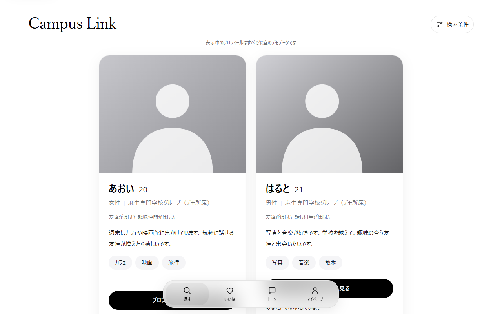
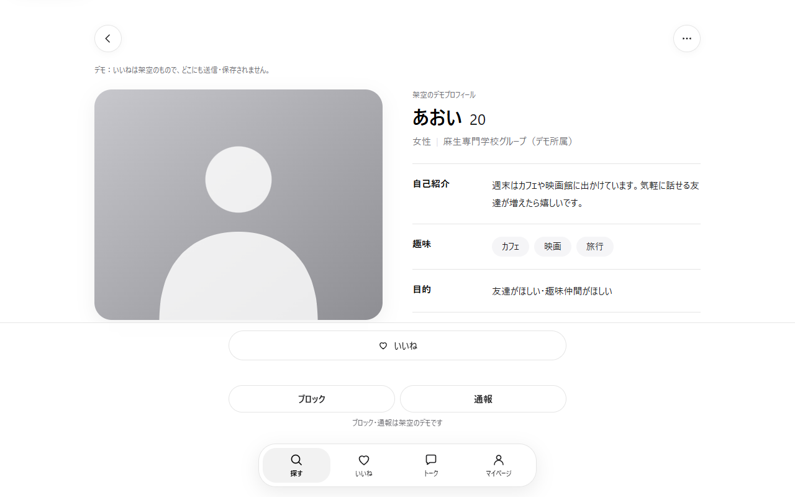
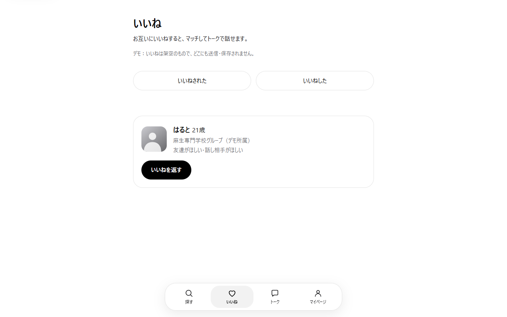
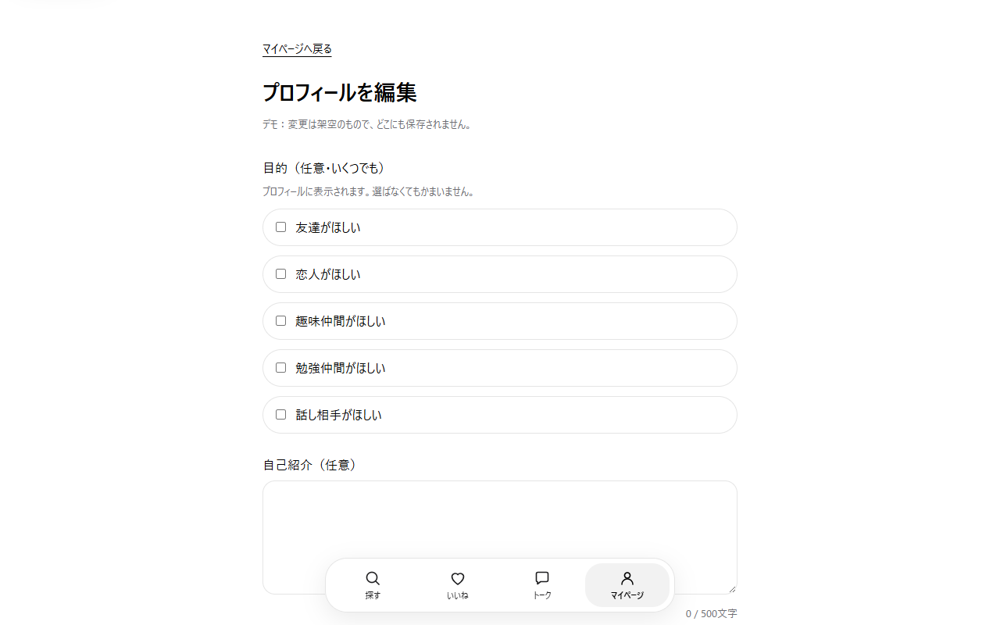
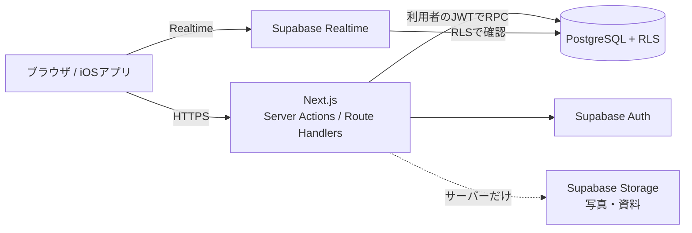

# Campus Link

18歳以上の学生だけが使える、学生どうしのマッチングWebアプリ（とiOSアプリ）です。お互いに「いいね」をしてマッチした相手とだけトークできます。

> **個人制作です。** 麻生専門学校グループ 福岡キャンパスの学生を対象に想定して作りましたが、学校とは関係がなく、学校の公認や依頼を受けたものではありません。一般には公開しておらず、画面やデータはすべて架空です。

- **デモ:** 準備中（架空のデータだけで動き、入力した内容はどこにも送られず保存もされません）
- **開発期間:** 2026年10月25日〜11月18日
- **規模:** アプリのコード 約2.1万行、試験のコード 約3万行、自動の試験 Vitest 3,425件・Playwright 246件

| 探す | プロフィール詳細 |
|---|---|
|  |  |
| **トーク** | **公開範囲設定** |
|  |  |
| **いいね** | **プロフィール編集** |
|  |  |
| **管理者ダッシュボード** | **探す（スマートフォン幅）** |
|  |  |

## 主な機能

- 新規登録・ログイン、学校・学科・クラスの登録、プロフィールの作成（写真、自己紹介、任意の目的）
- 学生証と年齢の確認の提出（開発中は架空のサンプル資料だけ）と、担当者による審査
- 探す（1つの一覧と検索条件）、プロフィール詳細、いいね、お互いのいいねでマッチ
- トーク一覧と個別のトーク（リアルタイムで届く）
- 公開範囲の設定（同じクラス・学科・学校の人から見えなくするなど）、ブロック、通報
- アカウントの休止・再開・退会、すべての端末からのログアウト
- 管理画面：確認の審査、通報の対応、学校・学科・クラスの管理、担当者の管理、停止中のアカウントの一覧
- iOSアプリ（Expo）：Web版と同じ機能とデータベースを使う（`mobile/`）

## 工夫した点

学生の個人情報を扱うマッチングアプリなので、「見せてはいけない相手に見せない」ことを一番大事にしました。

- **権限の判断はデータベースで行う。** すべての表でRLS（行ごとのアクセス制御）を有効にし、他人に関わる読み書きは共通の判定関数を通るRPCだけにしました。ブラウザが公開のキーでデータベースを直接呼んでも、規則を迂回できません。Next.js側の確認は使いやすさと多層防御のためで、唯一の防御ではありません。
- **非表示とブロックは両方向に効く。** 「同じクラスの人に見せない」などの設定とブロックは、どちらが設定しても2人の両方に効きます。判定は1つの関数（`pair_visible`）にまとめ、探す・詳細・いいね・トーク・写真の配信のすべてで同じものを使います。
- **使えるのは確認が済んだ人だけ。** 年齢と在学の両方が承認された18歳以上の人だけが使えます。審査する担当者は、2段階認証（TOTP）でログインしているときだけ審査でき、自分の提出は審査できません。
- **推測させない。** 拒否するときの文はすべて「表示できません」にそろえ、相手の設定やブロックを推測できないようにしました。登録済みのメールアドレスかどうかも、答えから分かりません。
- **同時の操作でも壊れない。** 2人が同時にいいねしてもマッチは1つだけで、データベースの1つのトランザクションで作ります。
- **やりすぎを止める。** ログイン、2段階認証のコード、写真のアップロード、いいねには回数の上限があり、データベースで数えます。
- **退会したら消える。** 退会するとすぐに見えなくなり、30日後に保守用のscriptがアカウントと写真・資料を削除します。
- **試験で確かめる。** RLSやRPC、非表示の組合せ、状態の移り変わりを、PGlite（ブラウザやNodeで動くPostgreSQL）で実際のSQLに対して試験しています。画面の操作、アクセシビリティ（axe-core）、セキュリティのヘッダーはPlaywrightで確かめています。

設計の詳細は [docs/03_ARCHITECTURE.md](docs/03_ARCHITECTURE.md)、データベースは [docs/04_DATABASE.md](docs/04_DATABASE.md)、アプリ全体のセキュリティの点検は [docs/39_SECURITY_REVIEW.md](docs/39_SECURITY_REVIEW.md) にあります。

## 使った技術

| 分野 | 技術 |
|---|---|
| Web | Next.js 16（App Router、Server Actions）、React 19、TypeScript、Tailwind CSS 4 |
| バックエンド | Supabase（PostgreSQL、Auth、Realtime、Storage） |
| iOS | Expo（React Native） |
| 試験 | Vitest、Testing Library、PGlite、Playwright、axe-core |
| 配置 | Vercel（開発中は保護つき） |



## 自分の役割とAIの使い方

このアプリは、複数のAIエージェントに役割を分けて開発しました。

**自分が担当したこと**

- **企画と要件:** 誰のための、どんなアプリにするかを決め、要件と画面の方針をまとめました（[docs/01_REQUIREMENTS.md](docs/01_REQUIREMENTS.md)、[docs/02_UI_DESIGN.md](docs/02_UI_DESIGN.md)）。
- **仕様の判断:** 開発の途中で、「申請と承認」の方式から「お互いのいいね」の方式に変えるなどの判断をしました。
- **開発の体制づくり:** 設計と取りまとめ、実装、レビューをそれぞれ別のAIに任せる体制を組み、役割、レビューの基準、お金をかけないためのルールを決めました。
- **環境の用意と動作の確認:** GitHub・Supabase・Vercelの無料の環境を用意し、PCとiPhoneで動作を確かめました。
- **公開に向けた確認:** 年齢の確認や利用規約など、公開の前に必要な法令と運営の条件を洗い出しました（確認はまだ終わっていません）。

**AIの役割**

| 役割 | 使ったもの |
|---|---|
| 設計と取りまとめ（作業の分割、仕様書、受け入れの判断） | Claude Code（Claude Opus） |
| 実装と試験 | Claude Sonnet（初めのころはOpenAI Codexも） |
| レビュー | Google AntigravityのGemini（認証・個人情報・データベースの変更は上位のモデル） |

作業ごとに「実装 → 試験 → 別のAIによるレビュー → 受け入れ」を通してから次に進めました。実行・待ち合わせ・利用枠の確認・記録を自動で回す仕組みもAIと一緒に作って使いました（このリポジトリには含めていません）。開発用の非公開リポジトリには、1,700件ほどのコミットがあります。

## 動かし方

デモモード（既定）では、外部のサービスに接続せず、`src/data/` の架空のデータだけを表示します。

```sh
npm install
npm run dev
```

`http://localhost:3000` を開きます。デモでの操作は保存されず、再読み込みで元に戻ります。

Supabaseにつなぐ場合は、環境変数 `CAMPUS_LINK_BACKEND=supabase` で切り替えます（`src/lib/backend.ts`）。Supabaseのプロジェクトに `supabase/migrations/` を順に適用し、`.env.local` に `NEXT_PUBLIC_SUPABASE_URL`、`NEXT_PUBLIC_SUPABASE_PUBLISHABLE_KEY`、`SUPABASE_SERVICE_ROLE_KEY`（サーバー専用）、`CAMPUS_LINK_SITE_URL` を置きます。鍵の値はリポジトリに含めていません。

## 試験

| コマンド | 内容 |
|---|---|
| `npm test` | Vitestによる単体・画面の試験と、PGliteによるデータベースの試験（RLS、RPC、非表示の組合せ、状態の移り変わり） |
| `npm run typecheck` | TypeScriptの型の確認 |
| `npm run test:e2e` | デモのビルドに対するPlaywrightの試験（画面の操作、アクセシビリティ、セキュリティのヘッダー、CSP）。インストール済みのChromeを使います |
| `npm run test:e2e:hosted` ほか | 開発用のSupabaseプロジェクトに対する試験（`tests/e2e-hosted/`）。そのプロジェクトの鍵が要るため、このリポジトリだけでは動きません |

## フォルダ構成

```
src/app/          画面とルート（App Router）
src/components/   画面の部品
src/server/       サーバーの処理（入力の検査、RPCの呼び出し、エラーの変換）
src/lib/          共通の処理
src/data/         デモの架空データ
supabase/         データベースのmigration（表、RLS、RPC）とメールのテンプレート
tests/            Vitest・PGlite・Playwrightの試験
mobile/           iOSアプリ（Expo）
scripts/          保守用のscript、READMEの画像の作成
docs/             要件、画面、設計、データベース、セキュリティの点検
```

コードのコメントにある `SEC-008` や `順24` などは、開発中の作業とmigrationの番号です。

## 公開について

一般には公開していません。公開するには、法令に合った年齢の確認の方式、利用規約とプライバシーポリシーの専門家による確認、運営の体制が必要で、どれもまだ確認できていません。

## ライセンス

ライセンスは設定していません。コードの無断での利用・転載はご遠慮ください。

---

## English summary

Campus Link is a personal project: a matching web app (plus an iOS app) for students aged 18 or over, built with the Fukuoka campus of the Aso vocational school group in mind but not affiliated with or endorsed by the school. It uses fictional data only and is not publicly launched. Authorization is enforced in PostgreSQL: RLS on every table, writes only through RPCs, two-way hide rules and blocks through one visibility function, age and enrollment reviews by staff with TOTP, and rate limits counted in the database. Stack: Next.js 16, React 19, TypeScript, Tailwind CSS 4, Supabase, Expo, Vitest, PGlite and Playwright. The app was built by directing several AI agents (Claude for coordination and implementation, Gemini for independent review); the author planned the product, made the product decisions, set up the workflow and tested on real devices. Run the demo with `npm install` and `npm run dev`. All rights reserved.
