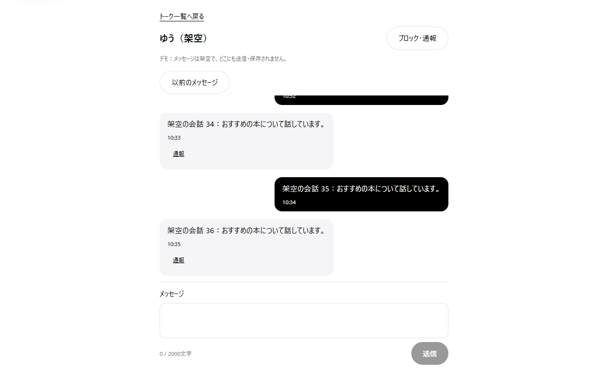
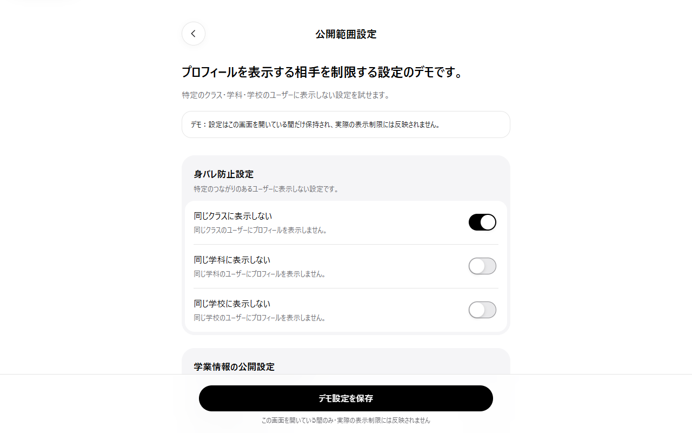
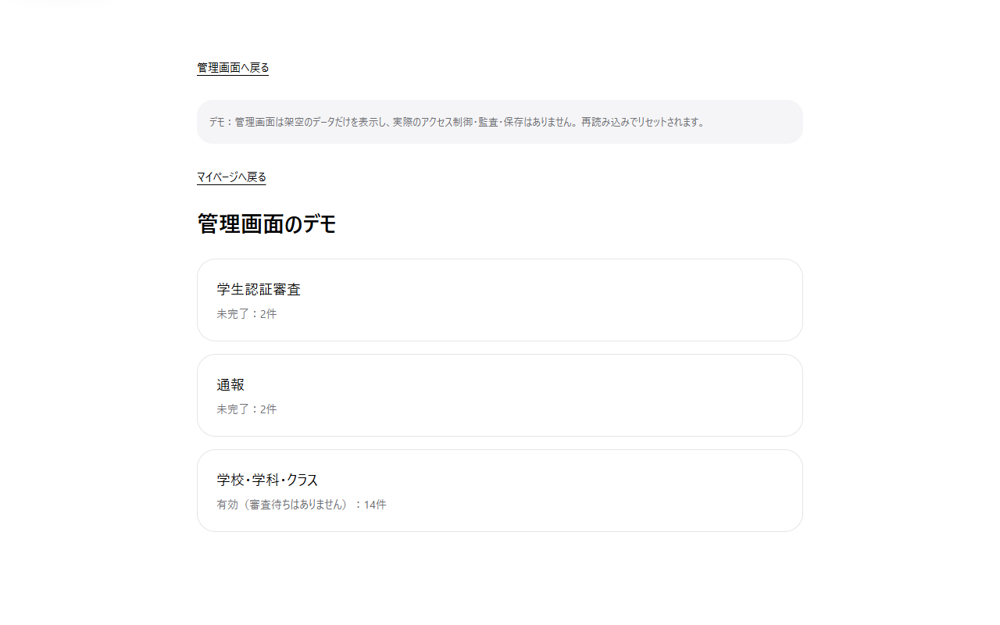
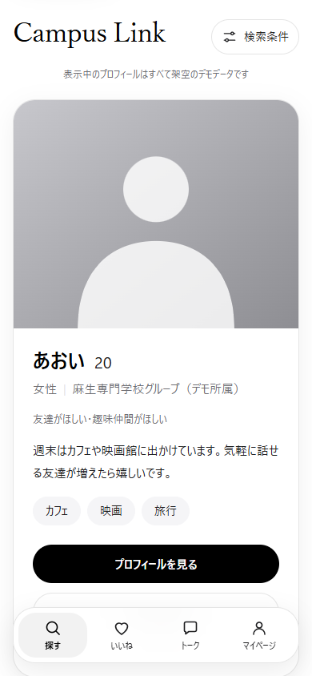

# Campus Link

18歳以上の学生だけが使える、学生どうしのマッチングWebアプリ（とiPhoneアプリ）です。お互いに「いいね」をしてマッチした相手とだけ、メッセージのやり取り（トーク）ができます。

> **個人制作です。** 麻生専門学校グループ 福岡キャンパスの学生を対象に想定して作りましたが、学校とは関係がなく、学校の公認や依頼を受けたものではありません。サービスとしては一般に公開しておらず、画面やデータはすべて架空です。

- **デモ:** https://campus-link-demo.vercel.app （架空のデータだけで動きます。入力した内容はどこにも送られず、保存もされません）
- **開発期間:** 2026年10月25日〜11月18日
- **規模:** アプリのプログラム 約2.1万行、試験のためのプログラム 約3万行、動作を自動で確かめる試験 3,676件

デモでは、架空の学生として使っているときの画面（探す、いいね、トークなど）と、運営用の管理画面を見られます。登場する人やメッセージはすべて架空です。入力したものは保存されず、ページを読み込み直すと元に戻ります。

| 探す | プロフィール詳細 |
|---|---|
|  |  |
| **トーク** | **公開範囲設定** |
|  |  |
| **いいね** | **プロフィール編集** |
|  |  |
| **管理者ダッシュボード** | **探す（スマートフォン幅）** |
|  |  |

## 主な機能

- アカウントを作ってログインし、学校・学科・クラスを登録して、プロフィール（写真、自己紹介、目的（任意））を作れます。
- 学生証と年齢の確認の資料を提出し、運営の担当者が審査します（開発中は架空の見本の資料だけを使います）。
- 一覧から相手を探し、条件で絞り込み、プロフィールを見て「いいね」できます。お互いに「いいね」するとマッチします。
- マッチした相手とトークができます。メッセージはすぐに相手の画面に届きます。
- 自分を見せない範囲の設定（同じクラス・学科・学校の人から見えなくするなど）、ブロック、通報ができます。
- アカウントの休止・再開・退会と、すべての端末からのログアウトができます。
- 運営用の管理画面：確認の資料の審査、通報への対応、学校・学科・クラスの管理、担当者の管理、利用を止めているアカウントの一覧。
- iPhoneアプリ：Web版と同じ機能と、同じデータを使います。

## 工夫した点

学生の個人情報を扱うマッチングアプリなので、「見せてはいけない相手には見せない」ことを一番大事にしました。

- **見られたくない人から、自分を隠せます。** たとえば同じクラスの人に見られたくない人は、そのクラスの人たちから自分が見えないようにできます。この設定は相手側にも効くので、自分からも相手が見えなくなり、どちらが設定したかも分かりません。ブロックも同じように、2人の両方に効きます。探す画面、プロフィール、いいね、トーク、写真のどこでも同じ決まりで判断するので、どこか1か所からだけ見えてしまう、ということがありません。
- **守りの決まりを、データを保管している所に置きました。** 「誰が、何を見られるか・変えられるか」の決まりを、画面の側ではなく、データを保管している所に置いています。画面を通さずに直接データを読もうとしても、この決まりは破れません。画面の側でも確かめていますが、それだけに頼ってはいません。
- **確認が済んだ人だけが使えます。** 年齢と在学の両方が認められた、18歳以上の人だけが使えます。審査をする担当者は、パスワードに加えてスマートフォンのアプリに出る確認コードを使ってログインしているとき（2段階認証）だけ審査でき、自分が提出したものは審査できません。
- **断るときに、理由を漏らしません。** 見られない相手のページを開いたときは、ブロックされたのか、非表示にされたのか、もともと存在しないのかに関係なく、同じ「表示できません」を出します。相手がどんな設定をしたかを推測されないためです。新規登録のときも、そのメールアドレスがすでに登録されているかどうかは、答えから分かりません。
- **同時に操作しても、食い違いません。** 2人がほぼ同時にお互いに「いいね」しても、マッチは必ず1つだけできます。
- **やりすぎを止めます。** ログイン、2段階認証のコードの入力、写真のアップロード、いいねには、短い時間にできる回数の上限があります。たとえば、パスワードを次々に試して他人のアカウントに入ろうとする行為を止められます。
- **退会したら、消えます。** 退会するとすぐにほかの人から見えなくなり、30日たつと、保守用の仕組みでアカウントと写真・資料を削除します。
- **自動の試験で確かめています。** 「この人からこの人は見えるか」といった組み合わせ、画面の操作、キーボードだけや画面の読み上げでも使えるかなどを、合わせて3,676件の自動の試験で確かめています。

## 使った技術

- Next.js（Webアプリを作るための仕組み）
- React（画面を部品に分けて作るための仕組み）
- TypeScript（プログラムを書く言葉。書き間違いを見つけやすい）
- Supabase（データの保管とログインの仕組みをまとめて使えるサービス）
- Vercel（デモのWebサイトを置いている場所）
- Expo（iPhoneアプリを作るための仕組み）

## 自分の役割とAIの使い方

このアプリは、複数のAIに役割を分けて開発しました。

**自分が担当したこと**

- **企画:** 誰のための、どんなアプリにするかを決め、必要なことと画面の方針をまとめました（[必要なことの資料](docs/01_REQUIREMENTS.md)、[画面の資料](docs/02_UI_DESIGN.md)）。
- **仕様の判断:** 開発の途中で、「申請して承認してもらう」方式から「お互いにいいねする」方式に変えるなどの判断をしました。
- **開発の体制づくり:** 設計と取りまとめ、プログラムを書く作業、チェックをそれぞれ別のAIに任せる体制を組み、役割、チェックの基準、お金をかけないためのルールを決めました。
- **環境の用意と動作の確認:** GitHub・Supabase・Vercelの無料の環境を用意し、PCとiPhoneで動作を確かめました。
- **公開に向けた確認:** 年齢の確認や利用規約など、公開の前に必要な法律と運営の条件を洗い出しました（確認はまだ終わっていません）。

**AIの役割**

| 役割 | 使ったAI |
|---|---|
| 設計と取りまとめ（作業の分け方、指示書づくり、できあがりを受け入れるかの判断） | Claude Code（Claude Opus） |
| プログラムを書く作業と試験 | Claude Sonnet（初めのころはOpenAI Codexも） |
| チェック | Google AntigravityのGemini（ログイン・個人情報・データの保管に関わる変更は、より上位のモデル） |

作業ごとに「プログラムを書く → 試験 → 別のAIによるチェック → 受け入れ」を通してから次に進めました。AIの実行、待ち合わせ、使える量の確認、記録を自動で回す仕組みもAIと一緒に作って使いました（このリポジトリには含めていません）。開発用の非公開リポジトリには、1,700件ほどの変更の記録があります。

## 公開について

サービスとしては一般に公開していません（上のデモは、架空のデータだけで動く見本です）。公開するには、法律に合った年齢の確認の方法、利用規約とプライバシーポリシーの専門家による確認、運営の体制が必要で、どれもまだ確認できていません。

## ライセンス

ライセンスは設定していません。コードを無断で使ったり、転載したりすることはご遠慮ください。

---

## English summary

Campus Link is a personal project: a matching web app for students, using fictional data only and not affiliated with any school. Demo: https://campus-link-demo.vercel.app
