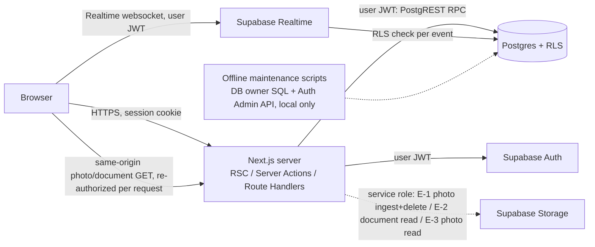
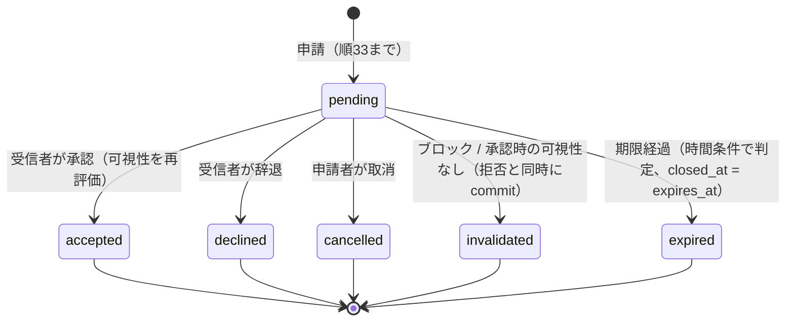
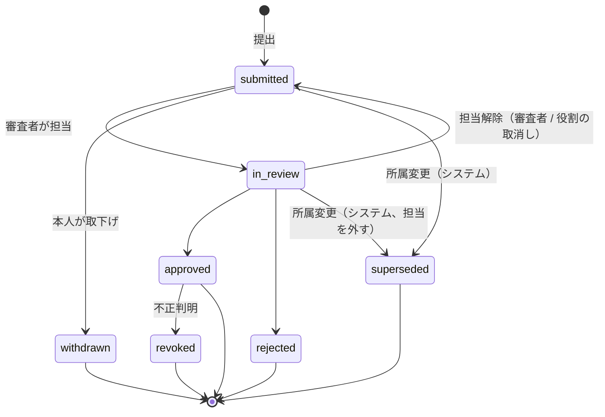

# Campus Link — Architecture

最初の設計（2026-10-25）を土台に、実装で加わった制御を §16 にまとめています。

## 0. 入力と前提

- 要件: [01_REQUIREMENTS](01_REQUIREMENTS.md) v1.2、UI: [02_UI_DESIGN](02_UI_DESIGN.md)。
- 受入済みの静的デモ: UI-001 Discover、UI-002 プロフィール詳細、UI-003 公開範囲設定デモ（localStorageのみ、実ACLではない）。データは `src/data/demo-*.ts` の架空データだけ。
- 現在のコード基盤: Next.js 16 / React 19 / TypeScript 7 / Tailwind 4 / Vitest 5 / Playwright。認証・DB・外部APIの依存はまだない。
- 規模の前提（未確認の仮定）: 福岡キャンパスの対象校群の学生のみで、利用者は数千人規模まで。これを超える性能設計は後回しにする。
- 用語: **viewer** = 閲覧する人、**target** = 閲覧される人、**eligible** = 利用資格（§5）を満たす状態、**pair_visible** = 2人の間で互いの存在を見せてよい状態（§6）。

## 1. 目標と非目標

目標:
1. 18歳以上かつ在学・所属確認済みの利用者だけが、探す・詳細・いいね・チャットを使える（順34から申請はいいねに替わった、§7）。
2. 非表示設定（同じクラス/学科/学校、指定した学校/学科/クラス）とブロックを**双方向**に、一覧・詳細・いいね・チャット・写真配信の**全経路で同じ判定**として適用する。
3. 所属や確認状態が未確定・不明・期限切れの場合は**安全側（見せない・操作させない）**に倒す。
4. 判定の最終強制点をDB（RLSとSECURITY DEFINER関数）に置き、ブラウザから直接DB APIを呼ばれても規則を迂回できないようにする。
5. 実在学生の身分資料を開発中に一切収集しない。

非目標（この設計の範囲外）:
- 本番公開、有料プラン、SMS認証、有料メール配信、決済。
- 推薦アルゴリズム、プッシュ通知、メール通知、画像の自動判定。
- 法令適合の判断そのもの（§12で未解決として保持）。

## 2. システム構成



| 部品 | 役割 | 信頼 |
|---|---|---|
| Browser | UI表示、入力、Realtime購読 | 信頼しない。anon keyとユーザーJWTは露出前提 |
| Next.js server | 画面描画、入力検証、RPC呼出し、画像の再エンコード | ユーザー操作はユーザーJWTで実行。権限の最終判断はしない（多層防御） |
| Postgres（Supabase） | データ、RLS、判定関数、状態遷移、監査 | **最終強制点** |
| Supabase Auth | 登録、ログイン、メール確認、MFA（管理者） | 認証のみ。権限・資格はDB側で判定 |
| Supabase Storage | プロフィール写真、確認資料（いずれも非公開bucket） | 利用者JWTの直接操作は資料の本人アップロード（開発中は不成立）だけ。ブラウザはStorageへ直接アクセスしない。写真・資料は、要求ごとに認可RPCを通したサーバーの配信経路でE-3/E-2が読み出して返す（署名URL・公開URLなし） |
| Supabase Realtime | チャットの新着配信 | postgres_changesのRLS評価に依存（実環境で要検証、§13） |
| 保守script | シード、保持期限による削除、初回管理者付与 | ローカルでDB所有者接続のSQLと、service roleのAuth Admin API（利用者作成・削除）。本番運用は未設計 |

ホスティング（Vercel / Supabase hosted）は未構成で、今回作らない（§13）。

## 3. 信頼境界と強制点

基本原則 **P1〜P6**:

- **P1 DBが最終強制点。** ブラウザはanon keyとユーザーJWTでPostgRESTを直接呼べる前提で設計する。Next.js側の確認はUXと多層防御であり、唯一の防御にしない。
- **P2 他人のデータは表へ直接触れさせない。** 他人のプロフィール・写真・所属に関する読取りは、共通の判定関数を通るRPC（`discover_profiles` / `get_profile` 等）だけで行う。表のRLSは「本人の行のみ」を基本にする（[04_DATABASE](04_DATABASE.md) §6）。
- **P3 判定は1か所。** 一覧・詳細・いいね・いいねの一覧・チャット・写真のすべてが同じ `private.pair_visible` を呼ぶ。経路ごとに別の条件式を書かない。
- **P4 既定拒否。** 全public表でRLSを有効化し、`anon` には表・関数の権限を与えない。関数のEXECUTEは既定のPUBLIC付与を取り消して明示付与する。
- **P5 区別できない拒否。** 非表示・ブロック・資格なし・存在しないIDは、同じ「表示できません / not_available」で返す。拒否理由で他人の設定やブロックを推測させない。応答だけでなく、その後に本人が観察できる永続状態（ブロック一覧など）でも区別させない（r3）。業務上の拒否は例外にせず、正常終了の戻り値で確定させる（[04_DATABASE](04_DATABASE.md) §5「エラーと拒否の2分類」）。
- **P6 秘密の局所化。** service role keyはサーバー専用の3モジュール（**E-1** 写真の取込み・削除、**E-2** 監査済み認可の後の確認資料の読出し、**E-3** 認可済みの写真の読出し（r3））とローカル保守scriptに限定し、それ以外のリクエスト経路では使わない。クライアントbundleへ入れない（`server-only`）。E-2とE-3は、要求ごとに、同じリクエスト内で利用者のJWTによる認可RPCが返した参照だけを読み出して返す（パス・bucketをリクエストから受け取らない）。E-1は登録先の利用者IDを、同じリクエスト内で利用者のJWTの `my_account()`（現在のセッションの判定を通る）が返した本人IDだけから取り、DB側の `service_register_photo` もその利用者のアカウント条件を確認する（r4、[04_DATABASE](04_DATABASE.md) §5.2）。非公開bucketの署名URL・公開URLはどのモジュールも発行しない（r3、[04_DATABASE](04_DATABASE.md) §9）。

信頼境界:

| 境界 | 越えるもの | 主な対策 |
|---|---|---|
| Browser → Next.js | フォーム、Server Action、画像 | 型/長さ検証、Origin確認、CSP、レート制限 |
| Browser → Supabase（直接） | ユーザーJWT付きPostgREST/Realtime | RLS、関数の権限、PUBLIC実行権の取消し、現在のセッションの共通判定（`session_uid`: sub・匿名でない・メール確認。公開RPC・`messages`・Realtimeで共通、r4） |
| Next.js → Supabase | ユーザーJWT（通常）、service role（E-1/E-2/E-3のみ） | `getUser()`/`getClaims()`での検証、service role利用箇所の限定と試験 |
| 管理者 → DB | 審査・停止・マスタ管理 | DBの役割表、MFA（aal2）、追記専用の監査ログ、役割の確認と取消しを同じlockで直列化（r4） |
| Storage → 閲覧者 | 同じoriginの配信経路（Route Handler）がE-2/E-3で読み出した写真・資料 | 要求ごとの認可RPC（資料は閲覧ごとの監査）、拒否は存在しない場合と同じ404、`private`（写真、定数以下のmax-age）/`no-store`（資料）、非公開bucket、写真bucketに利用者のstorageポリシーなし（利用者JWTでの直接の取得・署名は不可）、署名URL・公開URLなし |

## 4. 認証とセッション（Supabase Auth）

- 方式: メールアドレス＋パスワード、メール確認必須。SMS（費用発生）とOAuthはv1で使わない。**匿名サインインは無効**にする。匿名サインインのJWTもロールは `authenticated` になるため、設定だけに頼らず、DBの共通のセッション判定 `private.session_uid`（sub、JWTと `auth.users` の匿名の印、メール確認）で拒否する。全公開RPC（冒頭の `private.require_user`）、`messages` の直接読取りとRealtime（`rls_conversation_member`）、確認資料の本人アップロード（`rls_document_upload_allowed`）が同じ判定を使い、既に資格や会話を持つ利用者でも、メール確認が外れれば他人のメッセージを読めない（r4、[04_DATABASE](04_DATABASE.md) §4、NT-26・NT-21）。判定関数そのものは利用者に実行権を与えない。本人行の表の直接読取りは本人の行だけを返し、この判定を通さない（範囲と理由は [04_DATABASE](04_DATABASE.md) §4「判定の適用範囲」）。
- 登録・ログイン・パスワード再設定の応答と画面文言は、メールアドレスが登録済みかどうかを区別しない。Supabase Auth側の挙動はLSで確認する（§13）。
- セッション: `@supabase/ssr` のcookieセッション。Next.js 16のリクエスト前処理 `src/proxy.ts`（`middleware` から改名、同梱のNext.js 16.4.3のdocsで確認）でトークンを更新する。proxyはトークン更新と未ログイン時の誘導だけに使い、認可の判断はサーバー側の処理とDBで行う。
- サーバーでの認可には `supabase.auth.getUser()`（Auth照会）または `getClaims()`（署名検証）を使い、`getSession()` の内容を信用しない。
- 権限・資格はJWTのclaimに載せない。アカウント停止や管理者権限の取消しをトークン失効まで待たずにDBで即時反映するため、毎回DBの表で判定する。管理者権限の取消しは役割に依存する操作と同じlockで直列化し、取消しのcommit後に始まる・lockを待っていた操作を、最初の書込みより前に拒否する（r4、§8）。
- 管理者操作はMFA（TOTP、Supabase Authの無料機能）でaal2のセッションを必須にする（DB関数で `auth.jwt()->>'aal' = 'aal2'` を確認）。
- パスワード最小長・メール送信の上限・本番SMTPは運用前提として§12に残す。ローカルでは同梱のメール確認用サーバーを使う想定（未検証、§13）。
- ログアウトは現在端末のみが既定。全端末ログアウトは設定画面から提供する。

## 5. 利用資格: 年齢・在学・所属確認

### 5.1 資格の定義

`private.is_eligible(user)` が真のときだけ、その利用者は探す・詳細・いいね・チャットの当事者になれる。条件はすべて満たす必要がある（AND）。

1. アカウント状態が `active`（停止・休止・削除でない）。
2. 年齢確認が承認済みで取消されていない。
3. DB上の生年月日から計算して現在18歳以上（日本時間の日付で計算。2月29日生まれは平年は3月1日到達として保守側に扱う。法令解釈は§12 L1で要確認）。
4. 所属（学校・学科・クラス）が在学確認で **confirmed** かつ有効期限内。
5. プロフィールが完成（性別、表示名、学校、1枚以上の有効な写真）。順33までは「1つ以上のモード」も要った。順34でモードを1つに合わせ、この条件を外した。目的と自己紹介は任意。

いずれかが欠ける・不明・期限切れなら偽。行がない場合も偽（fail-closed）。

### 5.2 確認の流れ

1. 登録時に18歳以上であることの自己申告と生年月日を入力（生年月日は本人と審査者以外に出さない）。
2. 学校→学科→クラスを管理マスタから選択（自由入力なし）。状態は `unconfirmed`。
3. 年齢確認と在学確認を提出（`verification_submissions`）。提出時の所属をスナップショットとして保存する。
4. 審査者が資料を確認し、年齢と在学を別々に承認/却下する。在学承認で所属が `confirmed` になり、有効期限（`confirmed_until`）が設定される。審査者は自分の提出を担当できない。
5. 所属を変更すると `unconfirmed` に戻り、再確認まで資格を失う。未完了の在学確認の提出は、審査者が担当中（`in_review`）でも同時に `superseded`（所属変更による失効）になり、担当は外れる。古い所属への審査の決定は拒否され、新しい所属で提出し直せる（r3、[04_DATABASE](04_DATABASE.md) §5.2・§7・§8）。
6. 期限が近づいたら同じ所属で更新を提出できる。期限内の更新中は `confirmed` のまま資格を保ち、承認で期限を延長する。期限が切れてからの提出は `pending`（資格なし）になる。在学しなくなったことが判明した場合、審査者は確認を取り消す。

### 5.3 開発中の資料取扱い（架空資料のみ）

- 既定の取込みモードは `synthetic`。画面は「架空のサンプル資料」を選ぶだけで、任意ファイルのアップロード経路を出さない。サーバー設定とDB設定（`private.app_settings.verification_intake`）の両方が `synthetic` の間は、確認資料bucketへの書込みポリシーが成立しない二重の止め。
- 実資料のアップロード経路は、法令・規約・保持方針（§12 L1〜L3）の確定と独立レビューまで有効化しない。有効化は設定変更と独立レビューの対象とする。
- 法的な氏名は保存しない。審査者は資料画像で確認し、DBには判定結果・方式・期限・審査者だけを残す（データ最小化）。

## 6. 可視性: 双方向非表示・未確認所属・一覧/詳細の同等制御

### 6.1 判定関数

[04_DATABASE](04_DATABASE.md) §4に正式な定義を置く。概要:

- `private.hides(owner, other)`: ownerの設定がotherを除外するか。
  - `hide_same_class` かつ同じクラス / `hide_same_department` かつ同じ学科 / `hide_same_school` かつ同じ学校
  - ownerの個別指定（学校・学科・クラス）にotherの所属が含まれる
  - 設定行がない場合はUI-003と同じ既定値（同じクラスを非表示）を適用する
- `private.pair_visible(a, b)`: `a ≠ b` かつ両者eligible かつどちら向きのブロックもない かつ `not hides(a,b)` かつ `not hides(b,a)`。**定義上対称**（`pair_visible(a,b) = pair_visible(b,a)`）で、これを試験で不変条件として確認する。
- `private.can_access_conversation(user, conversation)`: 参加者 かつ つながりが有効 かつ `pair_visible`。
- `private.can_see_identity(viewer, target)`: 順34から `pair_visible` と同じ。写真の配信とブロック時の表示名スナップショットの条件に使う（r3）。
- 順33まではモード（恋愛/友達）があり、閲覧の判定 `can_view_profile(viewer, target, mode)` は「`pair_visible` かつ両者がそのモードに参加」、`can_see_identity` は「`pair_visible` かつ（共通モードあり、または有効なつながりあり）」だった。順34はモードを1つに合わせ、`can_view_profile` を削除した。外れたのは「同じモード」の条件だけで、資格・ブロック・公開範囲の設定（`hides`、もともとモードに頼っていない）は全経路に残る。

### 6.2 適用箇所（全経路で同じ判定）

| 経路 | 判定 |
|---|---|
| 探す一覧 `discover_profiles(filters)`（1つの一覧） | `pair_visible(viewer, t)` を満たす候補だけを返し、有効なつながりの相手と自分がいいねした相手を除く。フィルタは絞込みのみで広げない |
| 詳細 `get_profile(target)` | 同じ `pair_visible`。偽なら存在しない場合と同じ結果 |
| いいね `like_user`・マッチ | 2人のlockの下で `pair_visible` を確かめ、偽なら `not_available`。マッチを作るのはこの確認を通った呼出しだけ |
| いいねの一覧 `list_my_likes`・状態 `get_like_state` | 行ごとに `pair_visible`。見えない相手は出ない / 0行 |
| チャット読取り・送信・Realtime | `can_access_conversation`（内部で `pair_visible`）。RPCは `require_user`、`messages` の直接読取りとRealtimeは `rls_conversation_member` で、どちらも現在のセッションの判定（`session_uid`、§4）を先に通る（r4） |
| 写真の配信 | `authorize_photo_delivery`: 本人、または `can_see_identity`（順34から `pair_visible` と同じ）。登録済みで有効な写真だけ。同じoriginの配信経路が**要求ごとに**認可し、認可された写真だけをE-3が読み出して返す。署名URLは作らず、利用者JWTでのstorage直接の取得・署名もできない（r3） |
| ブロック一覧 | 自分のブロック行だけ。表示名はブロック時に `can_see_identity` が真だった場合のスナップショットだけで、現在の情報を解決しない（r3） |
| いいねの一覧・トーク一覧 | 現在 `pair_visible` でない相手の項目は表示しない |

**同等性の不変条件**: 任意のviewer・targetについて、`get_profile` が値を返す ⇔ `pair_visible` が真。`discover_profiles` の結果はすべて `pair_visible` を満たし、フィルタと既存関係（つながり・自分のいいね）の除外がなければ両者の集合は一致する。これを組合せ行列の試験で確認する（[04_DATABASE](04_DATABASE.md) §13）。

### 6.3 未確認所属の安全側制限

- 自分の所属が未確認の利用者は、他人を一切閲覧できず、他人からも見えない。理由: 未確認の所属で「同じクラスを非表示」等を評価すると、虚偽申告で他人の非表示設定をすり抜けられるため。
- 期限切れ・却下・再確認待ちも同じ扱い。時間条件（`confirmed_until > now()`）で判定するため、定期処理が止まっても安全側になる。

### 6.4 既存のつながりへの非表示の適用（既定は厳格、§12 P2で確認）

既定案: 非表示設定は**既存のつながりとチャットにも適用**する。条件に該当する間は双方とも詳細・チャットにアクセスできない（データは削除せず、条件が外れれば戻る）。設定保存時に、影響する自分のつながりの件数を本人にだけ示す。理由: 一覧・詳細・チャットを1つの判定に揃え、例外のない規則にするため。緩和（承認済みの相手は除外する等）は製品判断と独立レビューを経て行う。

### 6.5 残る推測リスク（要製品判断 §12 R1）

閲覧者が自分の非表示設定（例: 特定クラスを非表示）を切り替え、ある人が一覧から消えるかを観察すると、その人が非公開にした学科・クラスを推測できる。双方向非表示という要件に内在するため完全には防げない。緩和策: 非表示設定の変更回数制限（例: 1日あたりの上限）、短時間の連続変更の監査、学科・クラスでの検索フィルタを提供しない、一覧に件数を出さない。学校は公開必須のため学校単位の推測は新たな漏えいにならない。

## 7. いいね・マッチ・つながり・チャット

順34（DB-LIKES-001、2026-11-17）から、つながりの申請はなくなり、**いいね**になった。正式な定義は [04_DATABASE](04_DATABASE.md) §5.3。

- いいね（`public.likes`、向きを持つ1行）: 見える相手（`pair_visible`）にだけできる。自分・nullは `validation`、見えない・いない・ブロック・資格なしは区別のない `not_available`、つながり済みは `already_connected`。2回目も行は1つ。いいねと取消しの試行は合わせて1日100回まで（拒否も数える）。取り消すと、いいねした側の行だけが消える（相手のことは何も返さない）。
- マッチ: 相手もいいねしていれば、2つ目のいいねと同じトランザクションで、つながり（`connections`）と会話（`conversations`）を作り、2人のいいねを消す。2人の排他lockとread committedで、同時のいいねでもマッチはちょうど1つ（[04_DATABASE](04_DATABASE.md) §8）。相手からのいいねだけではマッチせず、本人がその相手にいいねしたとき（「いいねを返す」など）だけマッチする（明示の同意を保つ）。
- いいねの一覧: 「いいねされた」「いいねした」の2つ。どちらも見える相手で、つながりのない相手だけ。探す一覧は1つで、自分がいいねした相手とつながりの相手を除き、自分をいいねした相手は残す。
- 申請の履歴: 順34は未処理の申請を閉じ、`connection_requests` を凍結した（新しい行も変更もない）。古い申請の通報と運営の非表示の記録のために残す。順33までの申請の規則（モード付き、保留は1件、再申請の待機、承認時の再評価、申請者に見せる状態は2値）は履歴。
- つながりの終了: どちらからでも可能（解除）。ブロックでも終了する。ブロック解除でつながりは戻らない。
- チャット: 承認済みの1対1のみ。本文1〜2000文字、編集・削除はv1でなし、送信はRPC経由（レート制限と重複送信防止キー）。HTMLとして描画せずReactの通常描画のみ。
- Realtime: `messages` のpostgres_changesを会話IDで購読し、各イベントでRLS（`rls_conversation_member`: 現在のセッションの判定と `can_access_conversation`）が評価される前提。ブロック直後、および購読者のメール確認が外れた後（r4）に配信が止まることは実環境での試験が必要（§13、NT-21）。

## 8. ブロック・通報・管理

- ブロック: 即時・双方向に効く（`pair_visible` が偽になる）。2人のいいねを両向きとも消し（順34。順33までは保留中の申請を無効化した）、つながりを終了する。解除してもいいねもつながりも戻らない。ブロックされた側には通知せず、相手は「表示できません」になる。ブロック一覧は本人だけが見られ（`list_my_blocks` だけ。表の直接読取りなし）、誰にブロックされたかは誰にも見えない。
- ブロックとIDの存在（r3、ARCH-R2-02）: 存在しない・見えない（非表示、逆向きのブロック、資格なし）IDへのブロックも、見えている相手と同じ成功応答で、同じように一覧へ1行入る（対象への外部キーなし）。表示名は、ブロックした時点で相手の身元を正当に見られた場合（`can_see_identity`）だけその時点の値を保存し、それ以外は「表示できないユーザー」と表示する。ブロック後に相手の現在の名前・写真・存在を解決しない。これにより書込みの応答でも、その後の一覧でも、IDの存在や見えない相手の表示名を確認できない。ブロックには日次と総数の上限があり、超過は対象によらず同じ応答。
- 通報: 申請の履歴・いいね（どちら向きでも、順34）・つながり・会話の関係がある相手、または現在閲覧できる相手に限る（無関係なID宛ての乱用防止）。順34から申請の文脈の新しい通報は受け付けない（古い申請の通報は運営が読める）。メッセージの通報では本文を通報時点でスナップショット保存する。通報者は自分の通報の処理状態だけを見られ、対象者には見えない。「通報してブロック」は通報を先に確定してからブロックする。
- 管理: 役割は `reviewer`（確認審査）、`moderator`（通報対応）、`admin`（マスタ・役割・アカウント停止）。役割はDBの表で管理し、即時に取消せる。役割に依存する管理操作は、役割表のlockを共有で取った後の最新の役割で認可してそのlockをcommitまで保持し、役割の付与・取消しは同じlockを最初から排他で取る。取消しは先行する操作のcommitを待ってから確定し、取消し後に審査を担当・解除・決定することはできない（取り消された審査者が担当する審査中の提出は残らない。r4、[04_DATABASE](04_DATABASE.md) §8）。全管理操作をDBの追記専用監査ログへ記録する。自分の確認提出の審査と、自分が通報者・対象者の通報の処理はDBで拒否する。
- 管理者は既定でチャット本文を読めない。通報に添付されたスナップショットだけを読める（運用方針として§12 O1で要確認）。
- 確認資料は担当の審査者だけが閲覧できる。bucketには誰にも直接の読取り権限を与えず、同じoriginの資料配信経路が閲覧の要求ごとに監査を書く認可RPC（`admin_authorize_document_view`）を呼び、その後にサーバーのE-2モジュールが資料を読み出して `no-store` で返す（署名URLは作らない、r3）。これにより閲覧の記録を迂回できず、担当を外れた・役割を失った後の再取得もできない。
- 初回の管理者付与はローカル保守scriptからのみ行い、画面からは付与できない。

## 9. ストレージ

| bucket | 公開 | 書込み | 読取り | 削除 |
|---|---|---|---|---|
| `profile-photos` | 非公開 | サーバーの写真取込みモジュールのみ（service role、§3 P6の例外E-1） | 利用者向けのstorageポリシーなし（r3）。本人、または写真の判定（§6.2）を満たす人に、同じoriginの写真配信経路が要求ごとに `authorize_photo_delivery` で認可してから、E-3が読み出して返す。登録済みで有効な写真だけ（削除済みは不可） | 本人の削除操作でDBを `removed` にし、objectはE-1が消す |
| `verification-documents` | 非公開 | 本人が自分の提出フォルダへ。取込みモードが `upload` のときだけ成立（開発中は不成立） | 直接の読取り権限は誰にもない。担当 `reviewer`（aal2）の閲覧の要求ごとに監査付きRPCで認可し、E-2が読み出して `no-store` で返す。本人も再取得不可 | 保持期限による保守script |

- 写真はサーバーで再エンコードし、EXIF（位置情報を含む）を除去、寸法と形式を制限してから保存する。元ファイルは保存しない。
- 署名URLを使わない理由（r3、ARCH-R2-01）: Supabase Storageの署名発行は、呼出し者が期限（`expiresIn`）を選べ、発行済みURLの取得ではRLSが再評価されない。さらにSupabaseのSmart CDNは、tokenの期限切れ後もedgeのcacheから同じ署名URLへ応答し得る（[04_DATABASE](04_DATABASE.md) §9に出典）。署名URLの期限では閲覧不可になった後の取得を確実に止められないため、写真bucketに利用者のstorageポリシーを1つも置かず（利用者JWTでの直接の取得・単体/一括署名・一覧・変換を、操作名や期限の値にかかわらず拒否）、写真・資料のどちらにも署名URL・公開URLを発行しない。
- 配信経路: 画面は写真ID（`photo_ids`）から同じoriginのRoute Handlerを参照する。Route Handlerは要求ごとに利用者JWTで認可RPCを呼び、許可されたときだけE-3（写真）/E-2（資料）が読み出して返す。拒否・存在しない・削除済みは同じ404。写真の応答は `Cache-Control: private` でサーバー定数 `PHOTO_BROWSER_CACHE_SECONDS`（上限300秒）以下のmax-age、`Vary: Cookie`、資料は `no-store`。どちらも `Cross-Origin-Resource-Policy: same-origin`。E-2/E-3はパス・bucketをリクエストから受け取らない。
- 閲覧不可（ブロック・非表示・資格喪失・削除）になった後の新しい要求は即時に拒否され、新しい取得手段は残らない。残るのは閲覧者のブラウザが既に受け取った写真の私的cache（上記の定数まで）と画面撮影だけで、受信済みのbyteの扱いとして受容し、記録する（§12 R2・R3）。
- 公開bucketは使わない。公開URLは非表示とブロックを迂回するため。

## 10. 状態遷移

正式な遷移表と強制方法は [04_DATABASE](04_DATABASE.md) §7。

順34から: いいねは作るか消すだけで状態を持たない。2人のいいねがそろうとマッチ（つながりと会話）になり、いいねは消える。下の申請の図は順33までの履歴で、順34が未処理を `expired`/`invalidated` に閉じ、以後は新しい行も遷移もない。





- 確認提出: すべての遷移で版（`version`）を進める。所属変更と審査の担当・決定は本人単位のlockで直列化し、所属変更の後に古い版で届いた決定は拒否される（r3、[04_DATABASE](04_DATABASE.md) §7・§8）。本人の取下げは `submitted` からだけ（`in_review` からの取下げは所属変更による失効だけ）。担当者の `reviewer` 役割を取り消すと、その人の担当中の提出は同じトランザクションで `submitted` へ戻る。取消しは先行する担当のcommitを待ち、取消しのcommit後に始まった・待っていた担当・解除・決定は拒否される（r4、[04_DATABASE](04_DATABASE.md) §8）。
- アカウント: `active` ⇄ `deactivated`（本人）、`active`/`deactivated` → `suspended`（管理者）、`suspended` → `active`（管理者のみ）、任意 → `deleted`（本人の削除要求、終端）。
- 所属: `unconfirmed` → `pending`（提出）→ `confirmed` / `rejected`。所属変更で `unconfirmed` へ戻り、未完了の在学確認提出は `superseded`。期限切れは状態ではなく時間条件。期限内の更新は `confirmed` のまま期限を延長し、期限切れ後の提出は `pending` へ（§5.2）。取消は `confirmed` → `rejected`。
- つながり: 有効 → 終了（解除・ブロック・アカウント削除）。終了は戻らない。
- 通報: `open` → `triaged` → `actioned` / `dismissed`。

## 11. 脅威モデルとセキュリティ要件

### 11.1 保護対象と分類

| 分類 | データ |
|---|---|
| C3 最重要 | 確認資料画像、生年月日、通報内容とスナップショット、監査ログ |
| C2 個人 | 所属ID、メッセージ、ブロック一覧、非表示設定、いいね（順34）、申請履歴（凍結）、メールアドレス |
| C1 資格者に公開 | 表示名、年齢、性別、学校名、写真、自己紹介、趣味、目的、公開を選んだ学科/クラス名 |

### 11.2 主な脅威と対策

| ID | 脅威 | 対策 |
|---|---|---|
| T1 | PostgREST直接呼出しで非表示を迂回 | 他人行の表直接読取りなし、判定付きRPCのみ、本人行RLS |
| T2 | 所属の虚偽申告で非表示をすり抜け | 在学確認でconfirmed必須、未確認は閲覧不可 |
| T3 | エラー差・件数差でブロック/非表示を推測 | 区別できない拒否、件数非表示 |
| T4 | 写真URLの流出・直リンク | 非公開bucket、署名URL・公開URLなし、同じoriginの配信経路が要求ごとに認可（URLを知っても閲覧者のセッションと判定がなければ404）、CORP `same-origin` |
| T5 | 18歳未満の利用 | 年齢確認承認と生年月日の再計算を資格条件に |
| T6 | 確認資料の漏えい | 非公開、担当審査者のみ、要求ごとの認可と閲覧監査、`no-store`、署名URLなし、保持期限削除、開発中は架空のみ |
| T7 | 管理権限の濫用・奪取 | DB役割表、aal2必須、追記専用監査、チャット本文非閲覧 |
| T8 | 自分の状態列（承認・停止）を書換え | 状態は別表、表の更新権限は許可列のみ、遷移はSECURITY DEFINER関数 |
| T9 | XSS・HTML注入 | React通常描画のみ、CSP、長さ制限 |
| T10 | スパム・嫌がらせ | レート制限（順34からいいね・取消しは1日100回）、ブロック、通報。順33までは再申請待機も |
| T11 | ブロック後のRealtime配信 | イベント毎のRLS評価（実環境で要試験） |
| T12 | service role key流出 | サーバー専用3モジュール（E-1/E-2/E-3）、`.env`はGit対象外、bundle検査 |
| T13 | 競合（順34から同時のいいね・いいねとブロックの同時実行。順33までは二重承認、ブロックと承認の同時実行） | 2人単位のadvisory lock、行ロック、部分一意index |
| T14 | SECURITY DEFINER関数の悪用（search_path） | `set search_path = ''`、完全修飾名、PUBLIC実行権取消し、非公開schema |
| T15 | 停止後も古いJWTで操作 | 資格・役割を毎回DBで判定（役割は取消しと同じlockの下で確認、r4） |
| T16 | 写真の位置情報 | 再エンコードでメタデータ除去 |
| T17 | ログへの個人情報混入 | IDのみ記録、本文・資料・生年月日をログに出さない |
| T18 | 非表示設定の切替による所属推測（§6.5） | 変更回数制限、監査、学科/クラス検索なし。残余リスクとして製品判断 |
| T19 | 匿名サインイン・メール未確認のセッションで利用。既に資格・会話を持つ利用者のメール確認が外れた後に、直接読取りで相手のメッセージを読む（r3最終確認の指摘01） | 匿名サインイン無効、共通のセッション判定 `session_uid` で、全公開RPC（`require_user`）・`messages` の直接読取り・Realtime・資料アップロードをDBが拒否（r4）。判定関数は利用者に実行権なし |
| T20 | 再申請の待機や応答の差から辞退・ブロックを推測（順34から申請はない。いいねの取消しは行の有無によらず同じ `ok`、見えない相手へのいいねは区別のない `not_available`） | 終了理由を区別しない待機と応答、申請者の状態は2値 |
| T21 | 閲覧できる間に利用者JWTで写真の長期署名URLを直接作る、または署名URLのCDN cacheを使い、ブロック・非表示後も取得（r2指摘01） | 写真bucketに利用者のstorageポリシーなし、署名URL・公開URLを一切発行しない、要求ごとに認可する配信経路（E-3はパス・bucketを入力にしない） |
| T22 | ブロックの書込みや一覧から、存在しない・見えないIDの存在や表示名を知る（r2指摘02） | 対象によらず同じ1行、FKなし、表示名はブロック時に正当に見えた場合のスナップショットだけ、表の直接読取りなし |
| T23 | 業務上の拒否のロールバックで、無効化・期限切れの確定・試行の記録が消え、承認や待機の規則が崩れる（r2指摘04） | 業務上の拒否は正常終了の戻り値で確定、例外は書込み前の `forbidden`/`validation` だけ、`closed_at = expires_at` |
| T24 | 所属変更の後に、古い所属のスナップショットで審査が確定する。担当者が役割を失い、審査中の提出が残り続ける（r2指摘03）。役割の確認に成功した担当が待つ間に取消しが確定し、取消し後に担当が確定する（r3最終確認の指摘02） | `superseded` への同時失効、全遷移での版の更新、本人単位のlockで審査と直列化、役割取消しでの担当解除。r4: 役割の確認から更新・commitまで役割表の共有lock、付与・取消しは排他、待機後の最新の役割で書込み前に確認 |

### 11.3 セキュリティ要件と否定系試験の対応

試験の詳細（前提・操作・期待結果・実行環境）は [04_DATABASE](04_DATABASE.md) §13。実行環境の略号: **PG** = PGlite（ローカル、Docker不要、BE-001で導入予定）、**LS** = Supabaseローカルスタック（Docker必要、未整備）、**E2E** = ブラウザ試験（LS必要）、**build** = build成果物の検査、**PG/LS** = 判定関数の単体はPG、Supabase経由の確認はLS。

| SR | 要件 | 強制点 | 否定系試験 | 環境 |
|---|---|---|---|---|
| SR-01 | anonは全表・全RPCに触れない | 権限、RLS | NT-01 | PG |
| SR-02 | 全public表でRLS有効、権限は許可リストどおり | catalog | NT-02 | PG |
| SR-03 | SECURITY DEFINER関数は `search_path` 固定、PUBLIC実行なし | catalog | NT-03 | PG |
| SR-04 | 他人の表行を直接読めない | RLS | NT-04 | PG |
| SR-05 | 資格なし（各条件の欠落）は一覧・詳細の当事者にならない | `is_eligible` | NT-05 | PG |
| SR-06 | 非表示は双方向・対称 | `pair_visible` | NT-06 | PG |
| SR-07 | 一覧と詳細の同等性 | 共通判定 | NT-07 | PG |
| SR-08 | 拒否理由を区別できない | RPCの戻り値 | NT-08 | PG |
| SR-09 | 未確認・期限切れ所属は安全側。所属変更で未完了の在学確認（審査中を含む）が失効し、古い決定は拒否、再提出は可能 | `is_eligible`、遷移trigger、確認lock、version | NT-09 | PG |
| SR-10 | 18歳未満（境界・2月29日）を拒否 | `adult_from` | NT-10 | PG |
| SR-11 | 状態列・他人の行・役割を自分で変更できない | 権限、trigger | NT-11 | PG |
| SR-12 | 申請の不正遷移・自己申請・重複を拒否。再申請待機は終了理由を区別せず、終点は再試行で動かない（順34から申請はなく、凍結した履歴の変更を拒む。いいねは自分・null・見えない相手・つながり済みを拒み、同時でもマッチは1つ、[04_DATABASE](04_DATABASE.md) §13.2の読み替え） | RPC、一意index、check制約 | NT-12 | PG |
| SR-13 | 承認時の再評価（承認前にブロック/非表示）。無効化は拒否と同時に確定し、後で可視性が戻っても承認できない | RPC（確定する拒否） | NT-13 | PG |
| SR-14 | 非参加者・ブロック後・非表示中はチャット不可 | RLS、RPC | NT-14 | PG |
| SR-15 | ブロックは即時双方向、いいねの削除（順34。順33までは申請無効化）・つながり終了。IDの存在と見えない相手の身元を、応答でもその後の一覧・永続状態でも示さない | RPC、FKなしの行、権限なし | NT-15 | PG |
| SR-16 | 通報は関係者のみ、対象者に見えない | RPC、RLS | NT-16 | PG |
| SR-17 | 管理RPCは役割とaal2が必須、監査が残る。自分の提出・自分が当事者の通報は扱えない。役割の取消しで担当中の提出が解放され、取消し後の担当・解除・決定・閲覧は書込み前に拒否される（r4） | RPC、`require_staff`（`volatile`、役割表のlock） | NT-17 | PG |
| SR-18 | 監査ログは更新・削除・TRUNCATE不可 | trigger、権限 | NT-18 | PG |
| SR-19 | 同時実行で不変条件が壊れない（審査の決定と所属変更、役割の取消しと担当・決定（r4、両方の順序）、最後のadminの取消しを含む） | lock、index、version | NT-19 | LS |
| SR-20 | 写真・資料のstorage（削除済み写真を含む）。写真bucketは利用者JWTの直接の取得・署名・一括署名がすべて不可。写真・資料は要求ごとに認可する配信経路（E-3/E-2）だけで返し、拒否は同じ404、閲覧不可の後の再要求は通らない | 配信認可RPC、自己判定関数、storage policy（写真は利用者ポリシーなし）、配信経路、E-2/E-3 | NT-20 | PG/LS |
| SR-21 | ブロック後、および購読者のセッションが不適格（メール確認の消去・匿名・subなし、r4）のときRealtime配信が止まる | Realtime RLS（`rls_conversation_member`） | NT-21 | LS |
| SR-22 | 開発中は実資料の書込み経路が成立しない（storage側の確認はSR-20/NT-20） | 設定、RPC、storage policy | NT-22 | PG |
| SR-23 | service role keyがクライアントbundleに入らない。署名URL・公開URLを発行するコードがない（r3） | build検査、静的検査 | NT-23 | build |
| SR-24 | 直接URL・未ログイン・資格なしの画面アクセス制御 | Next.js guard + RPC | NT-24 | E2E |
| SR-25 | レート制限（申請（順34からいいね）・メッセージ・通報・ブロック・非表示設定変更） | RPC | NT-25 | PG |
| SR-26 | 匿名・メール未確認・`sub` なしのセッションは公開RPCを使えず、直接読取りでも他人の行を得ない。既に資格・有効な会話・相手のメッセージを持つ利用者でも同じ（r4） | `session_uid`（`require_user`、`rls_conversation_member`、`rls_document_upload_allowed`）、RLS | NT-26 | PG |
| SR-27 | 業務上の拒否は例外にせず確定させる。例外は書込み前の `forbidden`/`validation` だけ（r3） | `rpc_outcome`、RPCの順序 | NT-27 | PG |

## 12. 未解決の前提（承認済みと扱わない）

### 法務（L）

- **L1** 本サービスがインターネット異性紹介事業に該当するか（順34からモードは1つで、任意の目的の1つに「恋人がほしい」があり、お互いのいいねでトークが開く。事実は 。結論は出していない）、該当する場合の届出と、法令に適合する年齢確認の方式・記録の要否。法務確認なし。現設計は確認方式を差替え可能にし、開発中は架空資料だけを扱う。
- **L2** 個人情報保護法上の利用目的・同意・安全管理措置・保持期間・削除請求対応、確認資料の取扱い、ホスティング地域による越境移転の扱い。
- **L3** 利用規約・プライバシーポリシー、麻生専門学校グループの名称・校名の使用許諾、実際の学校/学科/クラスのマスタの提供元。実マスタは作らず、シードは架空名のみ。

### 運営（O）

- **O1** 審査・通報対応の体制、対応時間、緊急時（未成年の疑い、危険な通報）の連絡手順、管理者がチャット本文を読まない方針の可否。
- **O2** 本番メール送信（SMTP）の手段と費用。無料範囲で足りるかは未確認。
- **O3** ホスティングの無料枠の制限（休止、容量、転送量）と、本番に求める可用性。無料範囲の数値は利用時点で確認する。r3で写真・資料をサーバーの配信経路から返すため、画像の転送量がhosting側にも掛かる（[04_DATABASE](04_DATABASE.md) §15で実測予定）。
- **O4** 確認資料・退会者データ・通報・監査ログの保持期間（例示値は仮）。r3で追加: ブロック一覧の表示名スナップショットの保持（既定案: ブロックした本人が解除・退会するまで残し、相手の退会でも変えない。変えると相手の退会を推測させるため。L2のデータ最小化との調整が必要）。

### 製品（P）

- **P1** モードの意味（両方参加の可否、恋愛モードでの性別・対象の指定）。順34でモードを1つに合わせ、任意の目的（5つの決まった選択肢）に替えた。
- **P2** 既存のつながりへの非表示の適用（既定は厳格、§6.4）。
- **P3** 在学確認の有効期限（学生証の有効期限 / 年度末 / 卒業予定）。
- **P4** 申請の上限、辞退後の再申請待機期間、保留の期限、メッセージ等のレート制限の数値。順34からは申請がなく、いいねは1日100回（取消しも数える）、取り消した後の付け直しの待ち時間はない（公開後に見直す、docs/handoffs/LIKES-DECISIONS.md Q2）。
- **P5** 写真の事前審査の有無（既定案: 承認時に確認、承認後の変更は即時反映し通報で対応）。
- **P6** 性別の選択肢（要件は登録と公開を必須とする）。
- **P7** 年齢の表示（実年齢 / 年代）。
- **P8** 学科・クラスの変更時の再確認の範囲。
- **P9** ブロックした側が過去の会話を証拠として読めるか（既定案: 読めない。通報時のスナップショットで代替）。

### 残余リスク（R）

- **R1** 非表示設定の切替による所属推測（§6.5）。
- **R2** 閲覧者のブラウザが既に受け取った写真の私的cache（§9）。r3で署名URLを廃止し、閲覧不可になった後の新しい要求は即時に拒否されるため、新しい取得手段は残らない。残るのは受信済みの写真が `PHOTO_BROWSER_CACHE_SECONDS`（上限300秒）まで画面に出得ることだけ（資料は `no-store`）。
- **R3** 一度見た情報の画面撮影は技術的に防げない。

## 13. 環境と実行可能性（2026-10-25 読取りのみの確認、2026-10-26 再確認）

| 項目 | 観測 | 影響 |
|---|---|---|
| Node / npm | v24.19.0 / 11.17.0（両日同じ） | 利用可 |
| Docker / Podman | PATHになく、既定の導入先もなし（両日同じ） | Supabaseローカルスタック（`supabase start`）不可 |
| WSL | 2026-10-25は `wsl --status` でディストリビューション未導入。2026-10-26の `wsl --list` は「WSLがインストールされていない」（`wsl.exe` の入口のみ） | Docker Desktopの前提も未整備 |
| PostgreSQL / psql | なし | ネイティブDB試験不可 |
| Supabase CLI | なし（PATH、node_modules、既定導入先） | マイグレーション実行・型生成・pgTAP不可 |
| PGlite | 未導入（`node_modules/@electric-sql` なし） | BE-001で無償devDependencyとして追加する計画 |
| Vercel CLI / 認証 | CLIなし、ローカル認証ファイルなし | preview不可（既知のブラウザログイン未整備と一致） |
| GitHub CLI | 導入済み（2026-10-25にログイン済みを確認） | 変更なし |

結論と提案:

1. **今すぐ無償・OS変更なしで可能**: PGlite（WASMのPostgres、npmの無償devDependency）でマイグレーション・RLS・判定関数・状態遷移をNode上で試験する。Supabase互換の最小shim（`anon`/`authenticated`ロール、`auth.uid()`/`auth.jwt()`）を試験専用に用意する。PGliteでのロール・RLS・SECURITY DEFINERの動作は**未検証**で、 の最初の受入条件として実証する。不可なら停止して報告する。
2. **PGliteで試験できないもの**: 同時実行（単一接続）、Supabase Auth、Storage、Realtime、PostgRESTの公開設定。これらはSR-19〜21・24の環境（LS/E2E）が必要。
3. **本人の判断が必要**: (a) Docker Desktop＋WSL2の導入（OS変更・本人操作）、または (b) Supabaseの無料hostedプロジェクト（アカウント作成、地域、休止、データの置き場所。L2/O3と関係）。どちらも今回は行わない。
4. Vercel previewはBE-001に不要。必要になった時点で本人のログインと無料範囲・公開範囲を確認する。

## 14. アプリケーション構成（実装時の目安）

```
src/
  app/
    (public)/            ウェルカム、登録、ログイン
    (onboarding)/        所属登録、プロフィール作成、確認提出
    (app)/               探す、詳細、いいね（/likes）、トーク、マイページ（プロフィールの編集を含む）、公開範囲設定
    admin/               審査、通報、マスタ、アカウント（役割＋aal2）
      documents/[submissionId]/[n]/route.ts  資料配信経路（要求ごとに監査付き認可→E-2、no-store）
    media/photos/[photoId]/route.ts         写真配信経路（要求ごとに authorize_photo_delivery→E-3、private）
  lib/supabase/
    server.ts            ユーザーJWTのサーバークライアント（cookie）
    browser.ts           Realtime購読と認証画面のみ
  server/                'server-only'。RPC呼出しの薄い層、入力検証、エラー変換
    storage/photo-ingest.ts  service role利用（E-1、取込みと削除）
    storage/document-read.ts service role利用（E-2、監査済み認可の後の資料の読出し）
    storage/photo-read.ts    service role利用（E-3、認可済み写真の読出し）。この3つ以外では使わない。署名URL・公開URLは作らない
  data/demo-*.ts         既存の静的デモ（DB接続後に段階的に置換）
supabase/
  migrations/            順序付きSQL（[04_DATABASE](04_DATABASE.md) §12）
  seed.sql               架空データのみ
```

- 画面とRPCの対応:

| 画面 | 主なRPC | ガード |
|---|---|---|
| 探す / 検索条件（1つの一覧、カードにも「いいね」） | `discover_profiles`、`like_user`/`unlike_user`、写真は配信経路（`authorize_photo_delivery`＋E-3） | ログイン＋eligible |
| プロフィール詳細 | `get_profile`、`get_like_state`、`like_user`/`unlike_user`、写真は配信経路（`authorize_photo_delivery`＋E-3） | ログイン＋eligible、拒否は404と同じ |
| いいね / いいねの一覧（`/likes`、順34から。`/requests` は `/likes` へ転送） | `like_user` / `unlike_user` / `list_my_likes` / `get_like_state` | eligible |
| トーク一覧 / 個別チャット | `list_my_conversations` / `list_messages` / `send_message` / Realtime | eligible＋会話アクセス |
| マイページ / 公開範囲設定 | `my_account`、`privacy_settings`本人行、`hidden_affiliations`本人行、保存は `update_privacy_settings` | ログイン |
| 学校・学科・クラス登録 / プロフィール作成 / 確認 | `start_onboarding` / `set_affiliation` / `update_profile`（自己紹介1つと任意の目的） / `complete_profile` / `submit_verification`（写真はE-1経由） | ログイン |
| プロフィールの編集（`/mypage/profile`、順34から） | 本人行の `profiles` の読取り、保存は `update_profile` | ログイン |
| ブロック・通報 / ブロック一覧 | `block_user` / `unblock_user` / `submit_report` / `list_my_blocks` | ログイン |
| 管理: 審査 / 通報 / マスタ / アカウント | `admin_*` | 役割＋aal2 |

- 入力検証はクライアントとサーバーで同じschema（無償のschemaライブラリ。採用はBE-002で決める）を使い、DB制約を最終の真実とする。
- エラーはRPCの定義済みコード（`not_available` / `invalid_state` / `already_pending` / `already_connected` / `rate_limited` / `forbidden` / `validation`、[04_DATABASE](04_DATABASE.md) §5）を画面文言へ変換し、DBの内部メッセージを表示しない。r3: 前の5つは状態を変えるRPCの戻り値 `rpc_outcome`（`ok = false`）、`forbidden`/`validation` は例外で届く。サーバー層は両方を同じ変換表で扱い、経路の違いを画面に出さない。
- セキュリティヘッダ: CSP（scriptは自身のみ、画像は自身のみ。写真は同じoriginの配信経路から届き、Storageのドメインは許可しない）、`frame-ancestors 'none'`、`Referrer-Policy: strict-origin-when-cross-origin`、`Permissions-Policy` で不要機能を無効化。
- 静的デモから実データへの移行は画面単位で行い、デモである旨の表示はその画面が実データに切り替わるまで残す。

## 15. 段階計画

| 段階 | 内容 | 必要な環境 |
|---|---|---|
| ARCH-001 | 本設計 | なし |
| BE-001 | マイグレーション、判定関数、RLS、状態遷移RPC、PGlite試験基盤 | PGlite（無償devDependency） |
| BE-002 | Supabase Auth接続、Next.jsのセッション、登録/所属/プロフィール画面、Storage、写真取込みと写真配信経路 | 無料のhosted環境 |
| BE-003 | 確認審査と管理画面（資料配信経路を含む）、監査 | 同上 |
| BE-004 | 探す/詳細の実データ化と同等性E2E | 同上 |
| BE-005 | 申請・承認・チャット・Realtime（申請は順34でいいねに替わった） | 同上 |
| BE-006 | ブロック・通報・管理の仕上げ、全体の否定系E2E | 同上 |

認証・プライバシー・DBに関わる段階は、別のモデルによる独立したレビューを通してから次へ進めた。

## 16. 実装との差分（2026-11-12、2026-11-17更新）

DOCS-007で追加し、DOCS-009でSEC-007・SEC-008・SEC-010を、DOCS-010でSEC-011・SEC-012を、DOCS-011でRETENTION-003を、DOCS-012でRETENTION-004を、DOCS-013でRETENTION-005・SEC-013・FIX-002を、DOCS-015でSEC-015・SEC-016を、DOCS-016で順31・32とUI-014を、DOCS-017でFIX-004を、DOCS-020でiOS版のAPI（MOBILE-API-001・REFACTOR-001）とアプリ（MOBILE-001〜004）を加え、DEPLOY-002の事実に合わせた。§0〜§15と冒頭のレビューの記録は書き換えていない。ただしDOCS-LIKES（2026-11-18）は、順34（いいね・1つのモード）が置き換えた申請とモードの記述を §1・§3・§5〜§8・§10〜§12・§14・§15 で直し、順33までの形は各所に履歴として残した。この節は、受入済みの実装がこの設計の後に加えた制御を、設計のどの節を広げたかとともに記録する。この設計そのものの受入（§15のARCH-001の行）は変わらず、この節は設計を受入済み・完成とするものではない。各文の出典は受入の記録、DBの記述（[04_DATABASE](04_DATABASE.md)）、migrationのファイル、[39_SECURITY_REVIEW](39_SECURITY_REVIEW.md) とhostedの記録（`docs/safety/HOSTED-*-execution-*.json`）。

### 16.1 加わった制御

| 制御 | 何をするか | 強制する所 | 広げた節 | 出典 |
|---|---|---|---|---|
| 退会済みの拒否（順17・18） | 退会済みのアカウントは保持期限の削除までAuthの利用者が残るため、退会前のtokenでも届く。順17で `private.session_uid()` が明示的な `deleted` のprofileを拒否し（元の本体は誰にも実行権のない `session_uid_any_status()`）、`require_user`・`require_staff`・`messages` とRealtimeのRLS・資料のupload policyがすべて退会済みを拒否する。本人行の9つのポリシーは `rls_own_uid()` に替わり、退会済みには0行を返す。順18で `my_account` は退会済みに本人のID・`has_profile`・`deleted` だけを返し、生年月日と所属の状態はnull | DB：`supabase/migrations/20261110120017_deleted_account.sql`（順17）、`20261111120018_my_account_deleted.sql`（順18）。アプリ：サインインは退会済みなら `signOut({scope: global})` してパスワード違いと同じ `failed`、ページと管理の門も退会済みを止める（ACCOUNT-002） | §4（セッション判定 `session_uid`）、§11 T15・T19 | ACCOUNT-002 `d1a086e`、ACCOUNT-003 `2594541`、ACCOUNT-004 `f4a3565`。[04_DATABASE](04_DATABASE.md) §4「退会済みの拒否」・§5.2 `my_account`。hosted：HOSTED-005・HOSTED-006の記録 |
| 自分の役割の読取り `my_staff_roles`（順19） | 呼んだ人自身の取り消されていない役割だけを返す（`require_user`、aal2は不要、他人の行を読まず何も許可しない）。`/admin` はaal2で役割が1つ以上あるときだけダッシュボードを出し、担当者でない人には404。管理RPCの認可は引き続き各RPCの `require_staff` | DB：`supabase/migrations/20261111120019_my_staff_roles.sql`（順19）。アプリ：`/admin` の画面の振り分け | §8（管理）、§11 T7 | ADMIN-005 `7f8e325`。[04_DATABASE](04_DATABASE.md) §5.2・§5.6。hosted：HOSTED-007の記録 |
| 役割の付与の前に確認済みのTOTP（順20） | `admin_grant_role` は、相手に確認済みのTOTP（`auth.mfa_factors` の `factor_type = 'totp' and status = 'verified'`）がなければ、最初の書込みの前に `mfa_required` で拒否し、役割の行も監査の行も書かない。メールでの付与も `admin_grant_role` を通るので同じ拒否 | DB：`supabase/migrations/20261111120020_grant_requires_totp.sql`（順20、`outcome_code` に `mfa_required` を追加） | §4（管理者のaal2）、§8（役割の付与）、§11 T7 | SEC-003 `dd48bcd`。[04_DATABASE](04_DATABASE.md) §5.6。[39_SECURITY_REVIEW](39_SECURITY_REVIEW.md) M-3。hosted：HOSTED-008の記録 |
| 写真の取込みの回数制限（順21） | `rate_policy` に `photo`（利用者ごとに10件/10分）。`reserve_photo_upload()` が本人とアカウントを確かめ、上限内なら1行を記録して `ok`、超えていれば記録せず `rate_limited`。`uploadPhoto` は本人の確認の後、ファイルを読む・復号する前に予約し、`ok` 以外では復号しない | DB：`supabase/migrations/20261111120021_photo_rate_limit.sql`（順21）。アプリ：`src/server/photo-actions.ts`（E-1） | §9（写真の取込み）、§11 T10 | SEC-004-r2 `e5bc492`（内容は `13b0b53` と同じ）。[04_DATABASE](04_DATABASE.md) §5.2・§8。[39_SECURITY_REVIEW](39_SECURITY_REVIEW.md) M-2。hosted：HOSTED-009の記録 |
| ログインとTOTPの回数制限（順22） | `rate_policy` に `signin`（入力したアドレスの鍵ごとに10件/15分）と `mfa`（利用者ごとに10件/10分）。どちらも成功を含むすべての試行を数える。アドレスの鍵はDBだけが読めるpepper（`private.app_settings` の `auth_rate_pepper`）と正規化したアドレスのsha256から作り、存在しないアドレスと実在のアカウントは同じ答え。ログインは `service_reserve_signin`（service_roleだけ）、TOTPの確認は `reserve_mfa_attempt`（authenticatedだけ）で、Authを呼ぶ前に予約し、`ok` 以外ではAuthを呼ばない | DB：`supabase/migrations/20261111120022_auth_rate_limit.sql`（順22）。アプリ：`src/server/auth-rate.ts`、`src/server/auth-actions.ts`、`src/server/mfa-actions.ts` | §4（認証）、§11 T10 | SEC-006 `b136e03`。[04_DATABASE](04_DATABASE.md) §3.9・§5.2・§8。[39_SECURITY_REVIEW](39_SECURITY_REVIEW.md) M-1（一部修正）。hosted：HOSTED-010の記録 |
| 停止中のアカウントの一覧（順23） | `admin_list_suspended_accounts()` は `require_staff('admin')`（aal2）の後、呼ぶたびに監査1行を書き、停止中の人だけを返す（呼んだ本人は出さない）。列は利用者ID・表示名・停止の日時・理由で、日時と理由は最新の停止の監査の行から。生年月日・所属・写真・メール・通報の本文は返さない。`/admin/accounts` の「停止を解除」は既存の `admin_set_account_status` を使う | DB：`supabase/migrations/20261112120023_suspended_accounts.sql`（順23）。アプリ：`/admin/accounts`（担当者でない人には404） | §8（管理：アカウント停止）、§11 T7・T17 | ADMIN-006 `4bfb815`。[04_DATABASE](04_DATABASE.md) §5.6。hosted：HOSTED-011の記録 |
| 確認の後の画面 `/auth/confirmed` | `/auth/confirm` は成功すると（`token_hash` と `code` のどちらも）アプリへ直接入らず `/auth/confirmed` へ送り、`next` は `safeNextPath` を通したものだけを渡す。この画面は使えるセッションのときだけログイン中のアドレスと「続ける」「自分のアカウントではありません」（この端末のセッションを終えて `/login`）を出し、セッションがない・退会済み・読めないときは何も出さず `/login` へ | アプリ：`src/app/auth/confirm/route.ts`、`src/app/auth/confirmed/page.tsx` | §4（メール確認とセッション） | SEC-005 `2e6bf75`。[39_SECURITY_REVIEW](39_SECURITY_REVIEW.md) L-2。hostedでの確認はTEST-006 `41440ee` |
| すべての端末からログアウト | `signOutEverywhereAction`（`scope: "global"`）と、マイページのログアウトの下の「すべての端末からログアウト」。通常のログアウトはこの端末だけ（`local`）のまま。§4は「設定画面から提供する」としていたが、実装の置き場所はマイページ | アプリ：`src/server/auth-actions.ts`、`src/components/logout-button.tsx`、`src/components/mypage-live.tsx` | §4（ログアウト） | SEC-005 `2e6bf75`。[39_SECURITY_REVIEW](39_SECURITY_REVIEW.md) L-5 |
| 認証の転送を相対の `Location` に（FIX-001） | `/auth/confirm` は `status: 307` の相対の `Location`（`/auth/confirmed[?next=…]` か `/login?error=confirm`、`no-store`）を返し、ブラウザが開いたホストのままにする。逸脱として受入：proxyの `/login` への転送は絶対URLのまま（Next 16.4.3のproxyのadapterは相対の `Location` で失敗し、同じホストの絶対URLをpathとqueryに書き換えるため、ブラウザが受け取るのは相対） | アプリ：`src/app/auth/confirm/route.ts`、`src/proxy.ts` | §4（セッションとproxy）、§14（構成） | FIX-001 `69d1203` |
| 写真のアップロードのroute `POST /api/photos`（SEC-007） | 写真の登録をServer Actionから専用のroute handlerに移し、`next.config.ts` の `serverActions.bodySizeLimit: "9mb"` を削除して、Server Actionの本文の上限を既定に戻した。NextのServer ActionのOriginの確認はroute handlerに効かないため、routeが自分で同じoriginを確かめる：Originのhostと `Host` が同じでなければ403（`X-Forwarded-Host` は読まない、Originがない・`null`・`Sec-Fetch-Site` が別のサイトも403）。multipartだけ（415）、`Content-Length` が必須（411）、本文は8 MiB＋64 KiBまでを数えながら読み、超えたら413、すべて `no-store`。proxyの後ろのままで、セッションがなければ本文を読む前に `/login` へ。予約・復号・Storage・登録・補償の処理は変えずに `src/server/photo-upload.ts` へ移した。残り：Nextのproxyは既定の10 MBまで本文を読む（SEC-015でこのrouteはproxyの外に出た、下の行） | アプリ：`src/app/api/photos/route.ts`、`src/server/photo-upload.ts`、`next.config.ts` | §9（写真の取込み）、§14（構成） | SEC-007 `bb74609`。[39_SECURITY_REVIEW](39_SECURITY_REVIEW.md) L-3 |
| ログインの接続元のIPごとの回数制限（順24） | `rate_policy` に `signin_ip`（IPの鍵ごとに30件/15分、成功も数える）。鍵は順22のpepperで `'ip:' \|\| 正規化したIP` をハッシュしたもの（IPv4はそのまま、IPv4を写したIPv6はIPv4、ほかのIPv6は/64）で、IPをそのまま保存しない。`service_reserve_signin(p_email, p_ip default null)` の1つにまとめ（順22の1引数の形は削除）、アドレス→IPの順にlockし、両方とも通るときだけ両方を記録する（service_roleだけ）。アプリは `VERCEL=1` のときだけ `x-real-ip` を信用し（`x-forwarded-for` は読まない）、IPとして読めないときやVercelの外ではIPを渡さず、アドレスごとの制限だけになる。IPはログに出さない。hostedの通し試験はローカルのサーバーで動くのでIPを渡していない。Vercelの上では、アプリのログインがIPをRPCに渡した（DEPLOY-002、`signin_ip` 0→1）。拒否そのものは試していない | DB：`supabase/migrations/20261115120024_signin_ip_limit.sql`（順24）。アプリ：`src/server/auth-rate.ts` | §4（認証）、§11 T10 | SEC-008 `2fb7e6d`。[04_DATABASE](04_DATABASE.md) §3.9・§5.2・§8。[39_SECURITY_REVIEW](39_SECURITY_REVIEW.md) M-1。hosted：HOSTED-012の記録。出典：vercel.com/docs/headers/request-headers |
| HttpOnlyのセッションcookieとRealtimeのトークンのroute（SEC-010） | cookieを書く2つのclient（`createServerSupabase` とproxy）が `sessionCookieOptions()`（`httpOnly: true`、`secure` はVercelのときだけ、ほかはライブラリの既定）を使い、JavaScriptからアクセストークンもrefresh tokenも読めない。古いcookieは次の更新でHttpOnlyに書き直される。ブラウザのRealtimeは `GET /api/realtime-token` からトークンを得る：デモは404、`Sec-Fetch-Site` が同じoriginでなければ403、`getClaims()` の後に同じ利用者のセッションだけを読み、答えはアクセストークンと期限だけ（refresh tokenと利用者の情報は返さない、ログなし）、ほかは401、すべて `no-store`、proxyの後ろ。ブラウザのclientはcookieを読まない `createClient(url, key, { accessToken })` で、トークンを期限の60秒前まで使い回す | アプリ：`src/lib/supabase/cookie-options.ts`、`src/lib/supabase/server.ts`、`src/proxy.ts`、`src/app/api/realtime-token/route.ts`、`src/lib/supabase/browser.ts` | §4（セッション）、§3（信頼境界：ブラウザ）、§14（構成） | SEC-010 `5e679ad`。[39_SECURITY_REVIEW](39_SECURITY_REVIEW.md) L-4。hosted：run `07bedb2ea811`（ログインの後に `document.cookie` に `sb-` がない） |
| 写真の同時の復号の上限（SEC-011） | プロセスごとに同時の復号は2件まで、ほかに4件まで到着順に待ち、待ちは10秒まで。待ちきれない・満員は `rate_limited`（既存の429と再試行の文）。`uploadPhoto` はアカウントの確認の後、`reserve_photo_upload` の前に枠を取るので、忙しいときは予約を使わない。枠は復号が終わった直後に `finally` で返し（成功・失敗・予約の拒否のどれでも、Storageへの書込みの前）、1回だけ返して次の待ちにそのまま渡す。時間切れの待ちは列から外れる。メモリの中・プロセスごとで、インスタンスをまたいでは制限しない | アプリ：`src/server/decode-slots.ts`、`src/server/photo-upload.ts` | §9（写真の取込み）、§16.2 T27 | SEC-011 `0068104`。[39_SECURITY_REVIEW](39_SECURITY_REVIEW.md) M-2。試験：`tests/decode-slots.test.tsx` |
| 登録の回数制限（順25） | `rate_policy` に `signup`（入力したアドレスの鍵ごとに5件/1時間）と `signup_ip`（IPの鍵ごとに10件/1時間）、どちらもすべての試行を数える。鍵はログインのもの（順22・24）をそのまま使い、数は別。`service_reserve_signup(p_email, p_ip default null)` はアドレス→IPの順にlockし、両方を記録するか何もしない（service_roleだけ）。`signUpAction` は入力の検証の後、Authの前に予約し、`rate_limited` 以外の失敗はすべて `unavailable`（Authを呼ばない）。IPはログインと同じくVercelのときだけ。既存のアドレスへの `sent` は変わらない。確認リンクはアプリでは制限していない | DB：`supabase/migrations/20261115120025_signup_rate_limit.sql`（順25）。アプリ：`src/server/auth-actions.ts`、`src/server/auth-rate.ts` | §4（認証）、§16.2 T25 | SEC-012 `9321da1`。[04_DATABASE](04_DATABASE.md) §5.2・§8。[39_SECURITY_REVIEW](39_SECURITY_REVIEW.md) M-1。hosted：HOSTED-013の記録 |
| 登録されなかった写真のobjectの保持期限の削除（順26） | `uploadPhoto` はobjectを書いてから `service_register_photo` で登録し、登録に失敗すると消すが、その削除も失敗するとどの行にも指されないobjectが残る。順26は `service_retention_candidates` を作り直し、新しい種類 `orphan_photo` を加える：`profile-photos` のobjectで、作られてから24時間以上たち、名前が利用者のuuidのフォルダで始まり、その名前の `profile_photos` の行がない（取り消した写真の行も行として数える）もの。アップロードの途中は対象にならない。ほかの種類・順・引数・service_roleだけの実行権は同じ。`retention.mjs` は `--apply` のときだけ、Storageの段で（アカウントの前に）100件ずつ消し、dry runは件数だけを出す（パス・名前・IDは出さない） | DB：`supabase/migrations/20261115120026_orphan_photo_retention.sql`（順26）。保守script：`scripts/maintenance/retention.mjs` | §9（写真の取込み）、[04_DATABASE](04_DATABASE.md) §11 | RETENTION-003 `d526b43`。[04_DATABASE](04_DATABASE.md) §11・§12。hosted：HOSTED-014の記録（dry runで対象0、`--apply` は未実行） |
| 登録されなかった資料のobjectの保持期限の削除と提出の確認（順27） | アップロードの方式では、利用者が先に `verification-documents` へobjectを置き、後で（または一度も）`submit_verification` を呼ぶため、どの提出にも名前を持たれないobjectが残りうる。順27は `service_retention_candidates` に新しい種類 `orphan_document` を加える：`verification-documents` のobjectで、作られてから24時間以上たち、名前が利用者のuuidのフォルダで始まり、どの提出（状態・方式を問わない）の `document_refs` にも名前がないもの。あわせて `submit_verification` は `upload` の方式で、objectがない・12時間以上前に作られた・作成日時がない参照を入力の検証で、ほかの提出がすでに名前を持つ参照を `lock_verification_subject` の後で、どれも書込みの前に `validation` で断る。一覧に出たobjectが後から提出に使われることはない。`synthetic` の方式は変わらない。`retention.mjs` は `--apply` のときだけStorageの段で消し、dry runは件数だけ | DB：`supabase/migrations/20261115120027_orphan_document_retention.sql`（順27）。保守script：`scripts/maintenance/retention.mjs` | §9（確認資料の取込み）、[04_DATABASE](04_DATABASE.md) §5.2・§11 | RETENTION-004 `c98cf95`。[04_DATABASE](04_DATABASE.md) §5.2・§11・§12。hosted：HOSTED-015の記録（dry runで対象0、`--apply` は未実行） |
| 削除した写真のobjectの保持期限の削除と資料の名前の規則（順28） | `removePhoto` は行を `removed` にしてからobjectの削除を1回だけ試し、失敗するとobjectが残るが、順26・27の `orphan_photo` は行が名前を持つobjectを出さなかった（[39_SECURITY_REVIEW](39_SECURITY_REVIEW.md) N-5）。順28は `orphan_photo` を、`active` の行が名前を持たないobjectに広げる（保持期限の来た退会アカウントの行が名前を持つものは `account` だけが出し、1つのパスは1つの種類にだけ出る）。`removed` は行にとって終端なので、一覧に出た写真が再び表示されることはない。あわせて資料の書込みのpolicyが呼ぶ `rls_document_upload_allowed` は、提出・一覧と同じパスの規則に合う名前と、本人のフォルダに16個未満のobjectを求める（N-6。今は取込みが `synthetic` で書込みは断られる）。ほかの種類・順・署名・実行権は同じ。`retention.mjs` は変えていない | DB：`supabase/migrations/20261116120028_removed_photo_retention.sql`（順28） | §9（写真と確認資料の取込み）、[04_DATABASE](04_DATABASE.md) §5.2・§11 | RETENTION-005 `256dd10`。[04_DATABASE](04_DATABASE.md) §11・§12。hosted：HOSTED-016の記録（dry runで対象0、`--apply` は未実行） |
| 役割は付与のときのTOTPでだけ働く（順29） | 順20は付与のときだけ確認済みのTOTPを確かめ、`require_staff` はaal2と役割の行しか見なかったため、TOTPを消した後にパスワードを知る人が登録し直せば、aal2で役割が働いた（[39_SECURITY_REVIEW](39_SECURITY_REVIEW.md) N-3）。順29の `private.staff_role_effective`（どのロールも実行不可）は、取り消されていない行があり、行の `granted_at` 以前に作られた確認済みのTOTPがあり、`granted_at` より後に作られた確認済みの要素がないときだけ真。`require_staff`（全管理RPC）と `my_staff_roles`（`/admin` の画面の振り分け）がこれを使う。付与のときの確認、`admin_revoke_role` と最後のadminの規則、`admin_list_staff` は変えていない。要素を置き換えたら取り消して付与し直す。唯一のadminの役割が働かなくなったときのアプリの迂回路は加えず、運用者の手順にした（§2） | DB：`supabase/migrations/20261116120029_staff_totp_binding.sql`（順29）。試験の環境：`scripts/e2e-hosted/bootstrap.sql` の付け直しの段（HOSTED-016） | §4（管理者のaal2）、§8（管理）、§11 T7、§16.2 T28 | SEC-013 `242834c`。[04_DATABASE](04_DATABASE.md) §4・§5.2・§12。hosted：HOSTED-016の記録（適用後に `e2e-admin` の3つの役割が働き、`test:e2e:hosted` の既定の11件PASS） |
| 最後のadminは働いているadminで数える（順30） | 順10の `admin_revoke_role` は取り消されていないadminの行の数で最後のadminを数えたため、順29の後は、働かないadminの行がほかに残っていると、働くadminが自分のadminを外せて、働くadminが0人になりえた（[39_SECURITY_REVIEW](39_SECURITY_REVIEW.md) N-3の注記）。順30は、対象者以外の利用者に取り消されていない働いているadminの行（`private.staff_role_effective`）がなければ、`admin` の取消しを同じ `invalid_state` で拒む。同じ排他の役割表のlockの下で、最初の書込みより前に確かめる。働かないadminの行は外せる。ほかの確認・担当解除・監査・署名・権限は同じ。運用者の付け直しの手順（§2）は残す | DB：`supabase/migrations/20261116120030_last_admin_acting.sql`（順30） | §8（管理） | SEC-014 `184a5a9`。[04_DATABASE](04_DATABASE.md) §5.6・§12。hosted：HOSTED-017の記録（`4aa5f71`、censusは変わらず、`admin_revoke_role` の本体が順30と同じ） |
| 資料の上限は名前のないものと開いている提出のものを数える（順31） | 順28の `rls_document_upload_allowed` は本人のフォルダのobjectをすべて16個まで数え、決定済みの提出の資料（決定から30日残る）も数えたため、何度か拒否された利用者が最大30日、提出し直せなくなりえた（[39_SECURITY_REVIEW](39_SECURITY_REVIEW.md) SECREVIEW-003 P-4）。順31は、本人の `upload` の方式の承認・拒否・取消しの提出が名前を持ち、開いている提出（`submitted`・`in_review`）が名前を持たないobjectを数えない。パスの規則・フォルダの確認・`upload` の方式・上限16・署名・definer・`search_path`・volatility・実行権は同じ（今は取込みが `synthetic` で書込みは断られる） | DB：`supabase/migrations/20261116120031_document_cap_open_only.sql`（順31） | §9（確認資料の取込み）、[04_DATABASE](04_DATABASE.md) §11 | RETENTION-006 `4953ebd`。[04_DATABASE](04_DATABASE.md) §11・§12。hosted：HOSTED-018の記録（censusは変わらず、`rls_document_upload_allowed` の本体がPGliteの順31・32と同じ、実行権はauthenticatedだけ） |
| 取下げ・置換えの提出の資料も保持期限で消す（順32） | 取下げと所属の変更による置換えは、審査者の決定と同じく `decided_at` を書くが、順28の `document` の種類は承認・拒否・取消しの提出しか出さず、`withdrawn`・`superseded` の提出の資料は退会から30日後まで残った（`upload` のときだけ）。順32は `service_retention_candidates` の `document` の種類と、資料の上限の「決定済み」に、この2つの状態を加える。どちらも終端（順4の遷移trigger）で、順27から1つの参照を名前に持つ提出は1つだけなので、一覧に出た資料の提出が再び開くことはない。上限で数えないobjectは、ちょうど `document` の種類が決定から30日後に消すもの。ほかの種類・退会アカウントの除外・パスの規則・存在の確認・順・署名・実行権は同じ。`retention.mjs` は変えていない | DB：`supabase/migrations/20261116120032_withdrawn_superseded_documents.sql`（順32） | §9（確認資料の取込み）、[04_DATABASE](04_DATABASE.md) §11 | RETENTION-007 `e2135ec`。[04_DATABASE](04_DATABASE.md) §11・§12。hosted：HOSTED-018の記録（`service_retention_candidates` の本体がPGliteの順32と同じ、実行権はservice_roleだけ、dry runで対象0、`--apply` は未実行） |
| 写真の本文を読む前の確認と枠（FIX-002） | `POST /api/photos` は、本文を1バイトも読む前に、アカウントの確認（`uploadAccount`、401・503）、利用者ごとのアップロードのlock（同じ利用者の2件目は429 `rate_limited`）、プロセスごとに4つの本文の枠（待ちなし、満員は429）を、この順に取る。どの拒否もすぐに答え、予約を使わない。本文は30秒以内に読み終わらなければ取り消して400 `invalid`。枠はFormDataができた時点か失敗のときに、lockは要求の終わりに、どちらも1回だけ返す。その後の流れ（復号の枠・予約・復号・Storage・登録・補償）は同じ。lockと枠はメモリの中・プロセスごとで、インスタンスをまたいでは制限せず、proxyはrouteの前に本文を読みうる（L-3の残り。SEC-015で修正、下の行） | アプリ：`src/app/api/photos/route.ts`、`src/server/photo-upload.ts` | §9（写真の取込み）、§16.2 T27 | FIX-002 `0b55684`。[39_SECURITY_REVIEW](39_SECURITY_REVIEW.md) N-2。試験：`tests/photo-upload-route.test.tsx` |
| 写真のrouteはproxyの外（SEC-015） | proxyのmatcherから `/api/photos` だけを外した（`api/photos$`）。Next 16.4.3はproxyが動く道でだけ本文をメモリに写すため、このrouteの本文はFIX-002の確認より前にためられない。ほかの道は前と同じくproxyを通る（`/api/photos/`・`/api/photosx` なども）。proxyが与えていた守りはroute自身が持つ：別のoriginは本文を読む前に403。セッションがない・Supabaseが更新できない古いセッションは、`my_account` が401になり、routeも本文を読む前に401（proxyの `/login` への転送ではない）。更新できるセッションは `createServerSupabase` が更新し、cookieを応答に書く。どの答えも `no-store` と、何も許さないCSP（`default-src 'none'; frame-ancestors 'none'`）。`next.config.ts` の `headers()` の見出しは変わらず付く | アプリ：`src/proxy.ts`、`src/app/api/photos/route.ts` | §4（セッションとproxy）、§9（写真の取込み） | SEC-015 `ccd3619`、Argon Medium PASS。hosted run `24cfc4ef06c2` 11件PASS。[39_SECURITY_REVIEW](39_SECURITY_REVIEW.md) L-3・N-2。試験：`tests/proxy-matcher.test.tsx`、`tests/photo-route-proxy.test.tsx`、`tests/photo-upload-route.test.tsx` |
| proxyの本文の写しの上限とmatcherの点（SEC-016） | `next.config.ts` の `experimental.proxyClientMaxBodySize` を既定の10 MiBから1 MiB＋256 KiB（`1_310_720`）にした。proxyを通る要求の本文は、Nextがこの大きさまでだけ写し、超えると警告して、proxyの写しも元の本文も同じ所で切る（`next/dist/server/body-streams.js:52-118`）。切られたServer Actionの本文は必ず1 MiBを超えるため、Nextのactionの処理が解く前に断る（手動の確認ではNextは500 `Body exceeded 1 MB limit` で答え、actionは動かない）。`/api/csp-report` は16 KiBまでしか読まず、`/api/realtime-token` のPOSTは405。正当なPOSTはどれも数十KBまで。matcherの点をすべて `[.]` と書いた（`favicon[.]ico`、`[^/]+[.](?:…)$`）。前は `favicon.ico` の点がどの文字にも合い、`/faviconxico` がproxyを通らなかった。`/api/photos` は外のまま、proxyの処理は変えていない | アプリ：`next.config.ts`、`src/proxy.ts` | §4（セッションとproxy）、§14（構成） | SEC-016 `4c01dae`、Argon Medium PASS。hosted run `5f1db2e704bb` 11件PASS。[39_SECURITY_REVIEW](39_SECURITY_REVIEW.md) L-3・N-2。試験：`tests/proxy-matcher.test.tsx`、`tests/next-config.test.tsx` |
| すべての端末からのログアウトの失敗を知らせる（FIX-002） | `signOutAndLeave` は `signOut({ scope })` の `error` を見る。`global` で `error` が返るか例外のときは、`/welcome` ではなく `/login?error=signout` へ送り、`/login` は決まった文（ほかの端末のログアウトを確かめられなかったので、ログインしてもう一度押す）を `role="alert"` で出す。Authの失敗の内容は出さず、ログにも書かない。auth-jsは取消しが失敗しても、この端末のセッションは消す。`local` の動きは同じ | アプリ：`src/server/auth-actions.ts`、`src/app/login/page.tsx`、`src/components/auth-form.tsx`、`src/lib/auth-validation.ts` | §4（ログアウト） | FIX-002 `0b55684`。[39_SECURITY_REVIEW](39_SECURITY_REVIEW.md) N-4。試験：`tests/auth-actions.test.tsx`、`tests/login-page.test.tsx` |
| 写真はブラウザで縮めてから送る（UI-014） | 写真の管理の画面は、選んだ画像を `createImageBitmap`（向きは画像のとおり）で読み、1600×1600に収まるよう縮めて（広げない）WebP 0.85で書き出す。WebPが返らなければ白地のJPEG 0.85。元より小さいときだけ使う。読めない（HEICなど）・書けない・小さくならないなど、どの失敗でも元のまま送る。送る部分の名前は `photo.webp`・`photo.jpg`・`photo.png` の決まった名前で、利用者のファイル名は送らない。8 MiBを超える画像も、縮めて8 MiB以下になれば送れる。縮める間は既存の送信中の状態のまま。サーバーは変えていない | アプリ：`src/lib/photo-downscale.ts`、`src/components/photo-manager.tsx` | §9（写真の取込み） | UI-014 `a5df3e8`、Flash High PASS。hosted run `13110416fe5a` 11件PASS（3000×2000のPNGが3738バイトのWebPで受け付けられ、1600×1067で配信された）。試験：`tests/photo-downscale.test.tsx`、`tests/photo-manager.test.tsx` |
| 写真の上限はVercelの本文の上限の内（FIX-004） | 写真の部分の上限を、クライアントとサーバーが共有する1つの定数4 MiB（4,194,304バイト、`src/lib/photo-downscale.ts` の `MAX_PHOTO_BYTES`。サーバーはそれを使う）にした（前は8 MiB）。routeの本文の上限は写真＋64 KiBの4,259,840バイトで、Vercelの本文の上限（約4.5 MB）より小さい。縮めた後も4 MiBを超えるものは送らずに `too_large`。HTTP 413の応答は本文を問わず `too_large`（Vercelの文字だけの `413 FUNCTION_PAYLOAD_TOO_LARGE` も）で、ほかのJSONでない応答は `unavailable` のまま。表示は「4MB以下」。routeの順番・予約・復号・再符号化は変えていない | アプリ：`src/lib/photo-downscale.ts`、`src/server/photo-upload.ts`、`src/app/api/photos/route.ts`、`src/components/photo-manager.tsx` | §9（写真の取込み） | FIX-004 `9a7b213`、Flash High PASS（指摘0）。[39_SECURITY_REVIEW](39_SECURITY_REVIEW.md) SECREVIEW-003 Q-2。hosted run `737eb0da7324` 11件PASS。試験：`tests/photo-upload-route.test.tsx`、`tests/photo-actions.test.tsx`、`tests/photo-manager.test.tsx` |
| 通報された内容の非表示（順33） | 通報からの措置はアカウント全体の停止（`admin_set_account_status`）しかなかった（§1.3(c)）。aal2のmoderator（`require_staff('moderator')`。reviewer・adminだけでは拒否）で、通報者・対象者でない人が、その通報が指す対象者の内容を非表示にできる：メッセージ、申請の本文、自己紹介（恋愛・友達のどちらか）、写真1枚。メッセージと申請の本文は両方の参加者に固定の文言「この発言は運営により非表示になりました。」を出し（誰が隠したかは出さない）、元の本文はブラウザに届かない。自己紹介は本人が新しいものを書くまでどこにも出ない。写真は `removed` になり（最後の1枚でも。そのときは本人が新しい写真を上げるまで一覧などから外れる）、取り消せない。メッセージと申請の本文だけ「表示を戻す」で戻せる。通報詳細に「通報された内容」の節（状態、確認のダイアログつきの「内容を非表示にする」、「表示を戻す」）を加え、`profile` の通報では対象者の写真を `/admin/reports/[id]/photos/[photoId]`（`admin_authorize_report_photo` を要求ごとに呼ぶ、`no-store`）で出す。チャットと申請は文言を出し、非表示のメッセージには通報の操作を出さない。非表示・戻す・内容の閲覧はすべて監査1行、通報時点の証拠は変えない | DB：`supabase/migrations/20261117120033_hide_reported_content.sql`（順33）。アプリ：`src/server/admin-reports.ts`、`src/server/admin-report-actions.ts`、`src/components/admin-report-content-live.tsx`、`src/app/admin/reports/[id]/photos/[photoId]/route.ts`、`src/components/hidden-content.tsx`、`src/server/chat-data.ts`、`src/server/request-data.ts` | §8（ブロック・通報・管理）、§7（チャット）、[04_DATABASE](04_DATABASE.md) §3.8・§5.3・§5.4・§5.6 | MOD-001 `92bb32c`、Argon Medium PASS（指摘0）。[04_DATABASE](04_DATABASE.md) §12。hosted：HOSTED-019の記録（census `722e7ed8…` → `941ffe26…`、`npm run test:e2e:hosted:hide-content` 12件PASS。hostedで試したのはメッセージの非表示と戻すだけ） |
| iOS版のAPI `/api/mobile/*`（MOBILE-API-001・REFACTOR-001） | ネイティブのアプリから呼べなかった3つの流れ（登録・ログイン・写真）だけを、cookieを使わないJSONのrouteにした。`POST /api/mobile/auth/signin`・`signup` はWebのServer Actionと同じ `src/server/auth-core.ts`（検証、`signin`/`signin_ip`・`signup`/`signup_ip` の予約、失敗の1500 msの下限、退会済みはglobalのログアウトの後に `failed`）を呼び、セッションは本文だけで返す（JSON 4096バイトまで、読取り10秒）。`POST /api/mobile/photos`・`GET`/`DELETE /api/mobile/photos/[photoId]` は `Authorization: Bearer` だけを読み（cookieは読まない、なしか無効は401）、本文を読む前にtokenの利用者と `my_account` を確かめ、Webと同じ利用者ごとのlockと本文の枠、4 MiB＋64 KiBの上限、`uploadPhoto`・`authorize_photo_delivery`・`remove_photo` を通る。配信の拒否はすべて同じ404、画像の200は `private, max-age=120` と `Vary: Authorization`、ほかの答えは `no-store`。どの答えも `default-src 'none'` のCSP、`Set-Cookie` なし、CORSなし、何も記録しない。demoのときは404（DELETEは503）。REFACTOR-001で、Webの写真のrouteと `removePhoto` も同じ部品（`src/server/request-body.ts`、`src/server/photo-route-core.ts`）を呼ぶようにした。Webの同じoriginの確認（403）とアプリのBearerの確認（401）、セッションの得方、`Vary` は家ごとに分けたまま | アプリ：`src/app/api/mobile/auth/signin/route.ts`・`signup/route.ts`、`src/app/api/mobile/photos/route.ts`・`[photoId]/route.ts`、`src/server/auth-core.ts`、`src/server/mobile-auth.ts`、`src/server/mobile-photos.ts`、`src/server/photo-route-core.ts`、`src/server/request-body.ts`。proxyのmatcherは `api/mobile/` を外に出し（ほかの道はSEC-016と同じ）、DBの変更なし | §4（セッション）、§9（ストレージ）、§16.1 の順22・24・25・SEC-015・FIX-002 | MOBILE-API-001 `14a7e74`、REFACTOR-001 `20604a2`、どちらもArgon Medium PASS（指摘0）（`docs/safety/conductor/MOBILE-API-001-*.json`・`REFACTOR-001-*.json`）。hosted：`npm run test:e2e:hosted:mobile` 2件PASS（run `e88826a36721`、REFACTOR-001の後はrun `c95613418030`、どちらも後片付けを確認） |
| iOSのアプリ `mobile/`（MOBILE-001〜004、 M0〜M4） | Expo SDK 58（expo-router、React Native 0.88.1、`@supabase/supabase-js` はWebと同じ版、依存は `mobile/package.json` だけ）。アプリに入る鍵は公開のURLと公開キーだけ。セッションはsupabase-jsの保存先をKeychain（`expo-secure-store`、`AFTER_FIRST_UNLOCK_THIS_DEVICE_ONLY`、分けて保存し最後に数を書く）にし、URLからのセッションの取込みはしない。ログイン・登録・写真は `/api/mobile/*`、ほかは利用者のJWTでRPCと本人の行を直接読む。`mobile/src/rpc.ts` は許可した名前のRPCだけを呼び、`admin_*`・`service_*` は呼べない。Realtimeはアプリのclientが自分のセッションのtokenを渡し（`/api/realtime-token` は使わない）、届いた中身は使わずRPCで読み直す。画像は `expo-image` のメモリだけの保存（`cachePolicy: 'memory'`）で、ログアウトとブロックの後に消す。写真は選んだものを1600に収めてWebP 0.85にし、4 MiBを超えれば送らない。退会の確認の文と、ログアウト・すべての端末からのログアウトの扱いはWebと同じ | アプリ：`mobile/app/**`、`mobile/src/secure-storage.ts`、`mobile/src/supabase.ts`、`mobile/src/rpc.ts`、`mobile/src/realtime.ts`、`mobile/src/photos.ts`。検証の規則は `src/lib` から共有（`src/lib/onboarding-rules.ts` に分けた）。最後の強制点はDBのまま（P1） | §2・§4・§7・§8、〜§3 | MOBILE-001 `cbf903c`、MOBILE-002 `6a9c88a`、MOBILE-003 `2c6dc0e`、MOBILE-004 `460b002`、どれもFlash High PASS（指摘0）（`docs/safety/conductor/MOBILE-00*-*.json`）。試験は型の確認、jest（13 suites 266件）と `expo export --platform ios` だけ。**実機（iPhone）では未確認** |
| いいね・1つのモード・任意の目的（順34、DB-LIKES-001・WEB-LIKES-001・MOBILE-LIKES-001） | 申請をやめ、お互いのいいねでマッチしてトークが開く。恋愛・友達のモードを1つにし、自己紹介は1つ、目的は5つの決まった選択肢から任意。いいねは見える相手だけで、2人の排他lockとread committedの下でマッチを1つだけ作る。いいね・取消しは1日100回。ブロックと退会はいいねを消す。申請の表は凍結した履歴 | DB（`like_user`・`unlike_user`・`list_my_likes`・`get_like_state`、`likes` の表は権限なし、`connection_requests_frozen`）。Web `/likes`・`/mypage/profile`、iOS `app/likes.tsx`・`app/settings/profile.tsx` | §1、§5.1、§6、§7、§8、§10、§14 | `supabase/migrations/20261117120034_likes_single_mode.sql`、、[04_DATABASE](04_DATABASE.md) §5.3、`docs/safety/HOSTED-021-execution-20261117.json` |

### 16.2 追加の脅威（§11.2の形式）

§11.2の表は書き換えず、ここに続ける。

| ID | 脅威 | 対策 |
|---|---|---|
| T25 | 共有のサーバーのIPの後ろでのパスワードの総当たり。SupabaseのAuthの回数制限は要求元のIPで数えるため、Next.jsのサーバーから呼ぶ登録・ログイン・TOTPの確認は利用者ごとの制限にならない（[39_SECURITY_REVIEW](39_SECURITY_REVIEW.md) M-1） | 順22（SEC-006）：アドレスの鍵ごとの `signin`（10件/15分）と利用者ごとの `mfa`（10件/10分）を、Authを呼ぶ前にDBで予約。順24（SEC-008）：接続元のIPの鍵ごとの `signin_ip`（30件/15分）を同じ予約で数える。順25（SEC-012）：登録はアドレスの鍵ごとの `signup`（5件/1時間）とIPの鍵ごとの `signup_ip`（10件/1時間）を、`auth.signUp` の前に予約。IPはVercelのときだけ信用し、それ以外はアドレスごとの制限だけ（§16.1、§16.3） |
| T26 | 確認リンクによるログインCSRF。攻撃者が自分の確認リンクを人に開かせ、その人を攻撃者のアカウントでログインさせる（[39_SECURITY_REVIEW](39_SECURITY_REVIEW.md) L-2） | SEC-005：確認の後は必ず `/auth/confirmed` でログイン中のアドレスを出し、「自分のアカウントではありません」でこの端末のセッションを終えられる |
| T27 | 写真のアップロードによる復号のDoS。1人が繰り返しアップロードし、サーバーのsharpの復号とStorageの書込み・削除を使い続ける（[39_SECURITY_REVIEW](39_SECURITY_REVIEW.md) M-2） | 順21（SEC-004-r2）：利用者ごとの `photo`（10件/10分）を、ファイルを読む・復号する前に予約。SEC-011：プロセスごとに同時の復号は2件・待ち4件・10秒まで、予約の前に枠を取る。インスタンスをまたいでは制限しない |
| T28 | 担当者の役割の最初のTOTP登録による乗っ取り。TOTP未登録の担当者のパスワードを盗んだ人が、先に自分の認証アプリを登録してaal2になる（[39_SECURITY_REVIEW](39_SECURITY_REVIEW.md) M-3） | 順20（SEC-003）：確認済みのTOTPがない相手への役割の付与を `mfa_required` で書込み前に拒否 |
| T29 | 認証の転送がブラウザの開いたホストを離れる。要求のURLから作った絶対の転送先が、ブラウザの開いたホストと違い、cookieのないホストへ移る | FIX-001：`/auth/confirm` は相対の `Location`。proxyの `/login` への転送は同じホストの絶対URLで、adapterがpathとqueryに書き換える（§16.1） |

### 16.3 未対応のもの（[39_SECURITY_REVIEW](39_SECURITY_REVIEW.md) から）

| 項目 | 内容 | 追跡している所 |
|---|---|---|
| M-1の残り | 接続元のIPごとの制限（SEC-008）はアプリがVercelで動くときだけ効き、ほかではアドレスごとの制限だけ。Vercelの上では、アプリのログインがIPをRPCに渡した（DEPLOY-002、`signin_ip` 0→1）。拒否そのものと、Vercelでの登録は試していない。受け入れたリスク：誰でも1つのアドレスを15分ずつロックできる。登録はアプリで制限した（SEC-012）が、確認リンクはアプリでは制限していない（アプリに再送の流れはなく、メールの送信はSupabaseの制限だけ） | 、[04_DATABASE](04_DATABASE.md) §8、[39_SECURITY_REVIEW](39_SECURITY_REVIEW.md) M-1「残るもの」 |
| L-4の残り | cookieはHttpOnly（SEC-010）。XSSがあれば、ブラウザは `/api/realtime-token` からアクセストークンを得られる（トークンの期限1回分）。refresh tokenは渡らない | [39_SECURITY_REVIEW](39_SECURITY_REVIEW.md) §1 L-4 |
| L-6 | HSTSとCSPの違反の報告先がない。公開前にホスティングで設定する | [39_SECURITY_REVIEW](39_SECURITY_REVIEW.md) §5、、「before public release」 |
