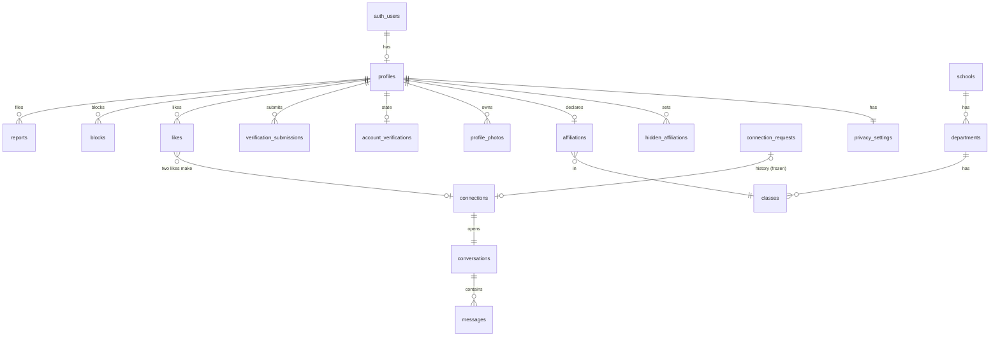

# Campus Link — Database


## 0. 原則

1. **書込みはすべてRPC。** `authenticated` には、どのpublic表にもINSERT/UPDATE/DELETE/TRUNCATE権限を与えない。状態遷移・入力検証・レート制限・監査をRPCの中で一貫して行う。
2. **読取りは本人行RLSか判定付きRPC。** 他人に関わる読取り（一覧、詳細、いいねの一覧、トーク一覧）はRPCだけ。例外は `messages`（Realtimeのため、会話参加の判定付きSELECTポリシー）。
3. **判定関数は `private` schemaに1組だけ。** 一覧・詳細・いいね・チャット・写真が同じ関数を呼ぶ（[03_ARCHITECTURE](03_ARCHITECTURE.md) §6）。
4. **SECURITY DEFINER関数は** `set search_path = ''`、完全修飾名、`revoke all ... from public, anon`、必要なものだけ `grant execute ... to authenticated`。
5. **欠損は拒否。** 行がない・NULL・期限切れは常に偽（見せない・操作させない）。
6. **時間条件で判定する。** 期限切れを定期処理に頼らず、`now()` との比較で判定する。
7. **C3データ（生年月日、確認資料、通報証拠、監査）は `private` schemaか非公開bucketに置く。**
8. **RPCは自分で判定する。** SECURITY DEFINERのRPCは表の所有者権限で動き、RLSを通らない（`force row level security` は使わない）。したがってRLSは「表を直接読む経路」の防御であり、RPCの中では毎回、呼出し者の確認（§4 `require_user`。内部は現在のセッションの判定 `session_uid`）と判定関数の呼出しを明示的に行う。判定を省いたRPCは、RLSがあっても他人のデータを返し得る。
9. **業務上の拒否は例外にしない（r3、ARCH-R2-04）。** 例外（RAISE）はトランザクション全体を取り消すため、拒否の前に行った正規化や記録が残らない。例外は `forbidden`/`validation` だけにして最初の書込みより前に限り、業務上の拒否は正常終了の戻り値で返して確定させる（§5「エラーと拒否の2分類」）。
10. **利用者JWTに写真の保存先を直接操作させず、非公開bucketの署名URL・公開URLを発行しない（r3、ARCH-R2-01）。** `profile-photos` には利用者向けのstorageポリシーを置かない。写真と確認資料は、要求ごとに利用者JWTの認可RPCを通したサーバーの配信経路（E-3/E-2）だけが読み出して返す（§9）。
11. **現在のセッションの判定は1か所（r4、ARCH-R3-FINAL-01）。** sub・匿名でないこと・メール確認を判定する非公開の `private.session_uid()` を、公開RPC（`require_user`）、`messages` の直接読取りとRealtime（`rls_conversation_member`）、確認資料の本人アップロード（`rls_document_upload_allowed`）が共通に使う。不適格なら公開RPCは `forbidden`、直接読取りは他人の行0件。`session_uid` 自体は `authenticated` に実行権を与えない（§4「判定の適用範囲」）。順17（ACCOUNT-003）から、`session_uid` は明示的に `deleted` のprofileを持つ呼出し者も拒否する（§4「退会済みの拒否」）。
12. **役割の確認は取消しと同じlockの下で行う（r4、ARCH-R3-FINAL-02）。** 役割に依存する管理RPCは役割表のlockを共有で取ってから最新の役割行を確認し、そのlockをcommitまで保持する。役割の付与・取消しは同じlockを排他で取る（§4 `require_staff`、§8）。

## 1. schemaとロール

| schema | 公開（PostgREST） | 内容 |
|---|---|---|
| `auth` | なし（Supabase管理） | `auth.users`、`auth.uid()`、`auth.jwt()` |
| `public` | あり | 本人行を読む表、RPC、enum、戻り値の型 |
| `private` | **なし**（APIの公開schemaに含めない） | 判定関数、生年月日、役割、監査、レート制限、設定、通報証拠 |
| `storage` | Supabase管理 | bucketとobjectのポリシー（BE-002） |

| ロール | 権限 |
|---|---|
| `anon` | public表・関数の権限なし。`private` のusageなし |
| `authenticated` | 許可リストの表へのSELECT（§6、一部は列単位）、公開RPCのEXECUTE、`private` のusageとRLS・storage用の自己判定関数2つ（`rls_conversation_member`、`rls_document_upload_allowed`）のEXECUTEだけ。r4: 2つとも内部で現在のセッションの判定 `session_uid` を通る。順17（ACCOUNT-003）で本人行ポリシー用の `rls_own_uid` が加わり3つ（§4「退会済みの拒否」）。`session_uid`・`session_uid_any_status`・`auth_account_ok` 自体の実行権はない |
| `service_role` | 写真の取込み・削除（E-1）、確認資料の読出し（E-2）、写真の読出し（E-3）のサーバーモジュールと、保守scriptのAuth Admin API呼出しのみ。public表の権限は与えず、service_role専用RPC（`service_register_photo`）のEXECUTEだけ。Storage APIではservice keyがRLSを通らないため、E-2/E-3は「同じリクエスト内で利用者JWTの認可RPCが返した参照だけを読み出す」規則で縛り、どのモジュールも署名URL・公開URLを発行しない（§9） |
| 所有者（`postgres`） | マイグレーションと保守scriptのSQL（初回admin付与、保持期限による削除）。アプリのリクエスト経路では使わない |

Supabaseはpublicの新規表・関数に `anon`/`authenticated`/`service_role` への権限を既定で付与するため、各マイグレーションで対象ごとに `revoke` してから必要分を `grant` する。最後にcatalog試験（NT-02、NT-03）で許可リストとの完全一致を確認する。

## 2. ER概要



`private` 側: `user_private`（生年月日）、`staff_roles`、`audit_log`、`rate_limit_events`、`app_settings`、`report_evidence`、`report_actions`、`hidden_messages`・`hidden_request_messages`・`hidden_bios`（順33、§3.8）。

順34（DB-LIKES-001、2026-11-17、`647facd`）から、つながりは申請ではなく2人の相互の**いいね**（`public.likes`）から作る。`profile_modes` はなくなり、`connection_requests` は履歴として凍結した（§3.3、§3.6）。

`blocks` の関係はブロックした側（`blocker_id`）だけで、ブロックされた側の `blocked_id` には外部キーを付けない（対象の存在の有無で書込み結果と一覧を変えないため、§3.8、§5.5）。

## 3. 表（DDLスケッチ）

共通: 主キーは `uuid default gen_random_uuid()`（メッセージのみ `bigint identity`）。全public表に `alter table ... enable row level security`。`updated_at` は共通triggerで更新。

### 3.1 enum

```sql
create type public.discover_mode       as enum ('romance', 'friends');
create type public.account_status      as enum ('active', 'deactivated', 'suspended', 'deleted');
create type public.affiliation_status  as enum ('unconfirmed', 'pending', 'confirmed', 'rejected');
create type public.verification_kind   as enum ('age', 'enrollment');
create type public.verification_status as enum ('submitted', 'in_review', 'approved', 'rejected', 'withdrawn', 'revoked', 'superseded');  -- superseded: 所属変更による失効（r3）
create type public.request_status      as enum ('pending', 'accepted', 'declined', 'cancelled', 'invalidated', 'expired');
create type public.connection_end      as enum ('unmatched', 'blocked', 'account_deleted');
create type public.report_context      as enum ('profile', 'request', 'message');
create type public.report_reason       as enum ('harassment', 'inappropriate_content', 'spam', 'impersonation', 'underage_suspected', 'other');
create type public.report_status       as enum ('open', 'triaged', 'actioned', 'dismissed');
create type public.staff_role          as enum ('reviewer', 'moderator', 'admin');
-- 状態を変える公開RPCの戻り値（r3、§5「エラーと拒否の2分類」）
create type public.outcome_code        as enum ('ok', 'not_available', 'invalid_state', 'already_pending', 'already_connected', 'rate_limited');
alter type public.outcome_code add value 'mfa_required';   -- 順20（SEC-003）: 確認済みのTOTPがない相手への役割の付与の拒否（§5.6 `admin_grant_role`）
create type public.rpc_outcome         as (ok boolean, code public.outcome_code, ref text);   -- ref: 作成・対象の行ID（文字列）、拒否時はNULL
```

性別は選択肢が未確定（[03_ARCHITECTURE](03_ARCHITECTURE.md) §12 P6）のため、enumではなく `text` + check制約にして変更を容易にする。

### 3.2 所属マスタ（管理者のみ変更、物理削除なし）

```sql
create table public.schools (
  id         uuid primary key default gen_random_uuid(),
  name       text not null unique check (char_length(name) between 1 and 80),
  is_active  boolean not null default true,
  sort_order int not null default 0,
  created_at timestamptz not null default now()
);
create table public.departments (
  id         uuid primary key default gen_random_uuid(),
  school_id  uuid not null references public.schools(id),
  name       text not null check (char_length(name) between 1 and 80),
  is_active  boolean not null default true,
  sort_order int not null default 0,
  unique (school_id, name),
  unique (school_id, id)              -- 複合FKの参照先
);
create table public.classes (
  id            uuid primary key default gen_random_uuid(),
  department_id uuid not null references public.departments(id),
  name          text not null check (char_length(name) between 1 and 40),
  academic_year smallint,             -- 年度での管理有無は未確定
  is_active     boolean not null default true,
  unique nulls not distinct (department_id, name, academic_year),
  unique (department_id, id)
);
```

無効化したマスタは新規選択に出さないだけで、既存の所属は変えない（変更方針は §12 P8 と合わせて未確定）。

### 3.3 アカウントとプロフィール

```sql
create table public.profiles (
  user_id              uuid primary key references auth.users(id) on delete cascade,
  display_name         text not null check (char_length(display_name) between 1 and 20),
  gender               text not null check (gender in ('female', 'male', 'other')),   -- P6
  bio                  text check (char_length(bio) <= 500),                                    -- 順34
  purposes             text[] not null default '{}' check (private.purposes_ok(purposes)),     -- 順34
  hobbies              text[] not null default '{}' check (private.hobbies_ok(hobbies)), -- 10件以内・各20文字以内
  account_status       public.account_status not null default 'active',
  profile_completed_at timestamptz,
  created_at           timestamptz not null default now(),
  updated_at           timestamptz not null default now()
);

create table private.user_private (
  user_id              uuid primary key references public.profiles(user_id) on delete cascade,
  birth_date           date not null check (birth_date > date '1900-01-01'),
  birth_date_locked_at timestamptz         -- 年齢確認承認で固定、以後変更不可
);

create table public.profile_photos (
  id           uuid primary key default gen_random_uuid(),
  user_id      uuid not null references public.profiles(user_id) on delete cascade,
  storage_path text not null unique,  -- '{user_id}/{id}.webp'
  position     smallint not null check (position between 0 and 5),
  status       text not null default 'active' check (status in ('active', 'removed')),
  created_at   timestamptz not null default now(),
  check (storage_path like user_id::text || '/%')
);
create unique index profile_photos_active_position
  on public.profile_photos (user_id, position) where status = 'active';   -- 最大6枚

create table public.account_verifications (
  user_id           uuid primary key references public.profiles(user_id) on delete cascade,
  age_verified_at   timestamptz,
  age_submission_id uuid,             -- FKは 3.5 の作成後に追加
  age_revoked_at    timestamptz,
  updated_at        timestamptz not null default now()
);
```

法的な氏名・住所・学籍番号は保存しない。

**順34（DB-LIKES-001）でのプロフィールの変更**:
- 自己紹介は `bio`（500字以内）の1つ。順33までの `bio_romance`・`bio_friends`・`purpose_romance`（自由記述）・`purpose_friends` の4列は削除した。移行は `bio := coalesce(nullif(bio_friends, ''), nullif(bio_romance, ''))`（友達向けが先、空の文字列は空）。非表示の自己紹介はすでに列がnullなので戻らない。両方の文があった人の恋愛向けの文は捨てた。
- 目的は `purposes text[]`（任意、空でよい）。決まった5つの符号 `friends`（友達がほしい）・`partner`（恋人がほしい）・`hobby`（趣味仲間がほしい）・`study`（勉強仲間がほしい）・`talk`（話し相手がほしい）から、重複なく5つまで。検査は `private.purposes_ok(text[])`、保存は `update_profile` が `private.purposes_sorted(text[])` でこの順に並べる。どちらもどのロールも実行できない。
- 表 `public.profile_modes`（ポリシー `profile_modes_own` と authenticated のSELECT）は削除した。enum `discover_mode` は凍結して残す（履歴の列 `connection_requests.mode`・`connections.mode`・`private.hidden_bios.mode` のため。新しい関数の引数にも戻り値にも使わない）。
- 移行の前に、空でない `purpose_romance`・`purpose_friends` と「完了していてモードのない人」がないことを確かめ、あれば何も変えずに止まる。

### 3.4 所属と非表示設定

```sql
create table public.affiliations (
  user_id                 uuid primary key references public.profiles(user_id) on delete cascade,
  school_id               uuid not null references public.schools(id),
  department_id           uuid not null,
  class_id                uuid not null,
  status                  public.affiliation_status not null default 'unconfirmed',
  confirmed_until         timestamptz,
  confirmed_by_submission uuid,       -- FKは 3.5 の作成後に追加
  updated_at              timestamptz not null default now(),
  foreign key (school_id, department_id) references public.departments(school_id, id),
  foreign key (department_id, class_id)  references public.classes(department_id, id),
  check ((status = 'confirmed') = (confirmed_until is not null and confirmed_by_submission is not null))
);
create index on public.affiliations (school_id);
create index on public.affiliations (department_id);
create index on public.affiliations (class_id);

create table public.privacy_settings (           -- 既定値はUI-003デモと同じ
  user_id              uuid primary key references public.profiles(user_id) on delete cascade,
  hide_same_class      boolean not null default true,
  hide_same_department boolean not null default false,
  hide_same_school     boolean not null default false,
  show_department      boolean not null default false,
  show_class           boolean not null default false,
  updated_at           timestamptz not null default now()
);

create table public.hidden_affiliations (
  id            uuid primary key default gen_random_uuid(),
  user_id       uuid not null references public.profiles(user_id) on delete cascade,
  school_id     uuid references public.schools(id),
  department_id uuid references public.departments(id),
  class_id      uuid references public.classes(id),
  created_at    timestamptz not null default now(),
  check (num_nonnulls(school_id, department_id, class_id) = 1)
);
create unique index hidden_affiliations_unique
  on public.hidden_affiliations (user_id, coalesce(school_id, department_id, class_id));
```

複合FKにより「クラスは学科に、学科は学校に属する」不整合をDBで拒否する。

### 3.5 在学・年齢確認

```sql
create table public.verification_submissions (
  id                   uuid primary key default gen_random_uuid(),
  user_id              uuid not null references public.profiles(user_id) on delete cascade,
  kind                 public.verification_kind not null,
  status               public.verification_status not null default 'submitted',
  intake_mode          text not null check (intake_mode in ('synthetic', 'upload')),
  document_refs        text[] not null check (cardinality(document_refs) between 1 and 4),
  affiliation_snapshot jsonb,         -- enrollmentのみ {school_id, department_id, class_id}
  reviewer_id          uuid references auth.users(id),   -- 担当中、または直近に決定（承認・却下・取消）した審査者
  claimed_at           timestamptz,
  decided_at           timestamptz,   -- 直近の決定・終了の時刻（承認・却下・取下げ・所属変更による失効・取消）
  decision_reason      text check (char_length(decision_reason) <= 64),  -- 定義済み理由コード
  valid_until          timestamptz,   -- enrollment承認時の有効期限
  version              int not null default 0,   -- すべての遷移で+1（§7）
  created_at           timestamptz not null default now(),
  check ((kind = 'enrollment') = (affiliation_snapshot is not null)),
  check (case status                  -- 状態ごとの担当・終了情報（r3、ARCH-R2-03）
    when 'submitted'  then reviewer_id is null and claimed_at is null and decided_at is null
    when 'in_review'  then reviewer_id is not null and claimed_at is not null and decided_at is null
    when 'approved'   then reviewer_id is not null and decided_at is not null
    when 'rejected'   then reviewer_id is not null and decided_at is not null
    when 'revoked'    then reviewer_id is not null and decided_at is not null
    when 'withdrawn'  then reviewer_id is null and claimed_at is null and decided_at is not null
    when 'superseded' then reviewer_id is null and claimed_at is null and decided_at is not null
                           and kind = 'enrollment' and decision_reason = 'affiliation_changed'
    else false end)
);
create unique index one_open_submission_per_kind
  on public.verification_submissions (user_id, kind) where status in ('submitted', 'in_review');
```

開発中の `document_refs` は `synthetic:sample-1` 〜 `synthetic:sample-3` だけを受け付ける（§5、NT-22）。

`superseded` は所属変更（`set_affiliation`）だけが作る終了状態で、`submitted` と `in_review` の両方から遷移する。担当情報（`reviewer_id`・`claimed_at`）を消し、`version` を進め、直前の担当者は監査ログに残す。未完了の一意indexの対象外になるため、新しい提出ができる（§5.2、§7）。

`revoked` への取消では、`reviewer_id` を取り消した審査者、`decided_at` を取消の時刻、`decision_reason` を取消の理由コードに置き換える（承認時の値は監査ログに残る）。表へのUPDATEは§7の遷移だけで、状態が変わらないUPDATEも遷移triggerが拒否する。

本人に見せる列は `id, user_id, kind, status, created_at, decided_at, decision_reason, valid_until` の8列だけ（`user_id` はRLSポリシーの条件列として含める）。表単位のSELECTは付与せず、この列だけを列単位で付与する（表単位で付与すると列単位の取消しは効かないため）。`reviewer_id`・`claimed_at`・`version`・`document_refs`・`affiliation_snapshot` は本人にも返さない。

### 3.6 いいね・つながり・申請の履歴

```sql
-- 順34（DB-LIKES-001）
create table public.likes (
  liker_id   uuid not null references public.profiles(user_id) on delete cascade,
  liked_id   uuid not null references public.profiles(user_id) on delete cascade,
  created_at timestamptz not null default now(),
  primary key (liker_id, liked_id),
  check (liker_id <> liked_id)
);
create index on public.likes (liked_id, created_at desc);
create index on public.likes (liker_id, created_at desc);
alter table public.likes enable row level security;
revoke all on table public.likes from public, anon, authenticated, service_role;

-- 順6からの申請の表。順34で凍結（下記）
create table public.connection_requests (
  id           uuid primary key default gen_random_uuid(),
  requester_id uuid not null references public.profiles(user_id) on delete cascade,
  recipient_id uuid not null references public.profiles(user_id) on delete cascade,
  mode         public.discover_mode not null,
  message      text check (char_length(message) <= 200),
  status       public.request_status not null default 'pending',
  created_at   timestamptz not null default now(),
  expires_at   timestamptz not null default now() + interval '30 days',   -- 値はP4で確定
  closed_at    timestamptz,           -- 終了の時刻。期限切れは確定した時刻ではなく expires_at（r3）
  check (requester_id <> recipient_id),
  check ((status = 'pending') = (closed_at is null)),
  check (status <> 'expired' or closed_at = expires_at),
  check (closed_at is null or closed_at <= expires_at)
);
create unique index one_pending_per_pair on public.connection_requests
  (least(requester_id, recipient_id), greatest(requester_id, recipient_id)) where status = 'pending';
create index on public.connection_requests (recipient_id, status);
create index on public.connection_requests (requester_id, status);

create table public.connections (
  id                uuid primary key default gen_random_uuid(),
  user_low          uuid not null references public.profiles(user_id) on delete cascade,
  user_high         uuid not null references public.profiles(user_id) on delete cascade,
  origin_request_id uuid unique references public.connection_requests(id) on delete cascade,   -- 順34でnull可
  mode              public.discover_mode,                                                       -- 順34でnull可
  created_at        timestamptz not null default now(),
  ended_at          timestamptz,
  ended_reason      public.connection_end,
  check (user_low < user_high),
  check ((ended_at is null) = (ended_reason is null))
);
create unique index one_active_connection_per_pair
  on public.connections (user_low, user_high) where ended_at is null;
-- 順34
alter table public.connection_requests add constraint connection_requests_frozen check (status <> 'pending');
alter table public.connections add constraint connections_origin_check
  check ((origin_request_id is null) = (mode is null));
```

順34から:
- **いいね** `public.likes` は向きを持つ1行（`liker_id` → `liked_id`）。どのロールにも表の権限がなく、読むのは `list_my_likes`・`get_like_state` だけ（§5.3）。行は作るか消すだけで、更新しない。両方のFKは `profiles` へ `on delete cascade`。
- **マッチ**は2つ目のいいねと同じトランザクションで `connections`（`origin_request_id` と `mode` は両方null）と `conversations` に1行ずつ作り、2人のいいねを消す（§5.3 `like_user`）。既存のつながりは `origin_request_id` と `mode` を持ったまま `connections_origin_check` を満たし、トークは続く。
- **申請の履歴**: 順34は未処理の申請を閉じた（`expires_at` が過ぎたものは `expired`・`closed_at = expires_at`、残りは `invalidated`・`closed_at = now()`）。その後 `connection_requests_frozen` が新しい行を拒み（`status` の既定は `pending`）、`request_transition` が閉じた行の変更を拒むので、表は変わらない。申請を作る・答える・取り消す・一覧するRPCは削除した。表・索引・`reports.request_id`・`private.hidden_request_messages` は監査と古い通報のために残す。

順33までの申請の扱い（履歴）: 期限切れは時間条件（`status = 'pending' and expires_at <= now()`）で無効として扱い、次に同じ2人を扱うRPCが `expired` へ確定させる。確定時の `closed_at` は常に `expires_at` にする（いつ確定しても終了時刻と再申請待機の終点が変わらない。ARCH-R2-04）。それ以外の終了（承認・辞退・取消・無効化）は、期限内に行われるのでその時刻の `now()`（`expires_at` より前）。

### 3.7 チャット

```sql
create table public.conversations (
  id            uuid primary key default gen_random_uuid(),
  connection_id uuid not null unique references public.connections(id) on delete cascade,
  created_at    timestamptz not null default now()
);
create table public.messages (
  id              bigint generated always as identity primary key,
  conversation_id uuid not null references public.conversations(id) on delete cascade,
  sender_id       uuid not null references public.profiles(user_id) on delete cascade,
  client_msg_id   uuid not null,      -- 重複送信防止
  body            text not null check (char_length(body) between 1 and 2000 and body !~ '^\s*$'),
  created_at      timestamptz not null default now(),
  unique (sender_id, client_msg_id)
);
create index on public.messages (conversation_id, id desc);
create table public.conversation_reads (
  conversation_id      uuid not null references public.conversations(id) on delete cascade,
  user_id              uuid not null references public.profiles(user_id) on delete cascade,
  last_read_message_id bigint,
  primary key (conversation_id, user_id)
);
```

### 3.8 ブロックと通報

```sql
create table public.blocks (
  blocker_id            uuid not null references public.profiles(user_id) on delete cascade,
  blocked_id            uuid not null,   -- FKなし（r3、ARCH-R2-02）。存在しない・見えないIDでも同じように1行
  blocked_name_snapshot text,            -- ブロック時に相手の身元が見えていた（can_see_identity）場合だけ、その時点の表示名
  created_at            timestamptz not null default now(),
  primary key (blocker_id, blocked_id),
  check (blocker_id <> blocked_id),
  check (char_length(blocked_name_snapshot) between 1 and 20)
);
create index on public.blocks (blocked_id);

create table public.reports (
  id             uuid primary key default gen_random_uuid(),
  reporter_id    uuid references public.profiles(user_id) on delete set null,   -- 退会後も通報を保持（O4）
  target_user_id uuid references public.profiles(user_id) on delete set null,
  context        public.report_context not null,
  request_id     uuid references public.connection_requests(id) on delete set null,
  message_id     bigint references public.messages(id) on delete set null,
  reason         public.report_reason not null,
  detail         text check (char_length(detail) <= 1000),
  status         public.report_status not null default 'open',
  created_at     timestamptz not null default now(),
  check (reporter_id <> target_user_id)
);

create table private.report_evidence (           -- 通報時点のスナップショット
  report_id          uuid primary key references public.reports(id) on delete cascade,
  conversation_id    uuid,
  message_body       text,
  message_created_at timestamptz,
  captured_at        timestamptz not null default now()
);
create table private.report_actions (
  id         bigint generated always as identity primary key,
  report_id  uuid not null references public.reports(id) on delete cascade,
  actor_id   uuid not null,
  action     text not null,
  note       text check (char_length(note) <= 1000),
  created_at timestamptz not null default now()
);
```

ブロック行の意味（r3、ARCH-R2-02）: `block_user` は対象IDの存在・可視性・逆向きのブロック・資格にかかわらず、同じように1行を作る。行の有無と一覧の項目数は対象の状態に依存しない。表示名は、ブロック時に呼出し者が相手の身元を正当に見られた場合（§4 `can_see_identity`。その時点で一覧・詳細・トークに出ていた相手）だけスナップショットし、それ以外はNULL（画面では「表示できないユーザー」）。ブロック後に相手の現在の名前・写真・状態を解決することはない。相手の退会・物理削除でも行とスナップショットは変えない（変えると退会を推測させるため。保持の扱いは [03_ARCHITECTURE](03_ARCHITECTURE.md) §12 O4）。ブロックした本人の退会では `blocker_id` のcascadeで消える。`authenticated` には表の権限を与えず、読取りは `list_my_blocks` だけ（§6）。

順33（MOD-001、2026-11-17、`92bb32c`）から、通報された内容を非表示にした記録として `private` に3つの表が加わる。どれもRLSを有効にし、public・anon・authenticated・service_roleの権限をすべて取り消す（`hidden_bios` の連番も同じ）。読み書きは §5.6 のRPCだけ。

```sql
create table private.hidden_messages (           -- 1メッセージ1行。元の本文はここに残る
  message_id    bigint primary key references public.messages(id) on delete cascade,
  original_body text not null,
  report_id     uuid not null references public.reports(id),
  hidden_by     uuid not null,
  hidden_at     timestamptz not null default now()
);
create table private.hidden_request_messages (   -- 申請の本文は変えず、非表示の申請を名指す
  request_id uuid primary key references public.connection_requests(id) on delete cascade,
  report_id  uuid not null references public.reports(id),
  hidden_by  uuid not null,
  hidden_at  timestamptz not null default now()
);
create table private.hidden_bios (               -- 非表示1回につき1行（本人の新しい自己紹介が再び非表示になりうる）
  id            bigint generated always as identity primary key,
  user_id       uuid not null references public.profiles(user_id) on delete cascade,
  mode          public.discover_mode,          -- 順34でnull可。新しい非表示はnull（1つの自己紹介）
  original_text text not null,
  report_id     uuid not null references public.reports(id),
  hidden_by     uuid not null,
  hidden_at     timestamptz not null default now()
);
```

非表示の行は、隠したメッセージ・申請・プロフィールのcascadeで消えるため、既存の退会・保持の削除で内容と一緒に消える。`private.report_evidence`（通報時点のスナップショット）は変えない。参加者に見える経路は、誰がいつ隠したかを返さない。

### 3.9 管理・監査・システム（すべて `private`）

```sql
create table private.staff_roles (
  user_id    uuid not null references auth.users(id) on delete cascade,
  role       public.staff_role not null,
  granted_by uuid,
  granted_at timestamptz not null default now(),
  revoked_at timestamptz,
  primary key (user_id, role, granted_at)
);
create unique index staff_roles_active on private.staff_roles (user_id, role) where revoked_at is null;

create table private.audit_log (                 -- 追記専用（行のBEFORE UPDATE/DELETEと文のBEFORE TRUNCATEのtriggerで常に拒否）
  id          bigint generated always as identity primary key,
  actor_id    uuid,                   -- FKなし（退会後も保持）
  action      text not null,
  target_type text not null,
  target_id   text,
  detail      jsonb not null default '{}',   -- C3の値（生年月日、資料内容）は入れない
  created_at  timestamptz not null default now()
);

create table private.rate_limit_events (
  user_id    uuid not null,
  action     text not null,
  created_at timestamptz not null default now()
);
create index on private.rate_limit_events (user_id, action, created_at);

create table private.app_settings (key text primary key, value text not null);
insert into private.app_settings values ('verification_intake', 'synthetic');
```

順22（SEC-006）から `app_settings` に `auth_rate_pepper` の1行が加わる。32バイトの乱数を64文字の16進にした値（`gen_random_uuid()` 2つから作り、拡張は使わない）で、一度だけ書き（`on conflict (key) do nothing`）、置き換えない。`private.app_settings` はどのAPIロール（anon・authenticated・service_role）からも読めない（順5）。ログインの回数制限の鍵 `private.signin_rate_key(p_email)` は `sha256(pepper || 正規化したアドレス)` の先頭16バイトをuuidにしたもの（§8）。pepperがない・64文字未満・アドレスがNULLなら `forbidden` を投げ、鍵のない試行は数えない。この関数はどのAPIロールも実行できない。

順24（SEC-008）から、接続元のIPの鍵 `private.signin_ip_rate_key(p_ip)` が加わる。同じpepperで `private.signin_rate_key('ip:' || 正規化したIP)` を作り、IPをそのまま保存しない。正規化：IPv4はそのまま、IPv4を写したIPv6はIPv4、ほかのIPv6は/64。1つのIPv4・IPv6のhostのアドレスでない値（64文字超、maskつきを含む）は `validation` を投げ、何も数えない。この関数もどのAPIロールも実行できない。

職員アカウントは学生プロフィールを持たない別アカウントにする案（利益相反の回避、O1で確認）。

## 4. 判定関数（`private`、すべて `security definer set search_path = ''`。判定は `stable`、役割の確認 `require_staff` だけ `volatile`（r4、§8））

```sql
-- 日本時間の今日
create function private.today_jst() returns date
language sql stable set search_path = '' as $$
  select (now() at time zone 'Asia/Tokyo')::date
$$;

-- n回目の誕生日。2/29生まれは平年なら3/1（保守側。法令解釈はL1で確認）
create function private.anniversary(p_birth date, p_years int) returns date
language sql immutable set search_path = '' as $$
  select case
    when extract(month from p_birth) = 2 and extract(day from p_birth) = 29
     and not (   (extract(year from p_birth)::int + p_years) % 400 = 0
              or ((extract(year from p_birth)::int + p_years) % 4 = 0
                  and (extract(year from p_birth)::int + p_years) % 100 <> 0))
    then make_date(extract(year from p_birth)::int + p_years, 3, 1)
    else (p_birth + make_interval(years => p_years))::date
  end
$$;

create function private.adult_from(p_birth date) returns date
language sql immutable set search_path = '' as $$ select private.anniversary(p_birth, 18) $$;

-- 表示用の年齢。anniversaryと同じ規則（age_years >= 18 ⇔ adult_from <= today を試験）
create function private.age_years(p_birth date, p_today date) returns int
language sql immutable set search_path = '' as $$
  select (extract(year from p_today)::int - extract(year from p_birth)::int)
       - case when private.anniversary(p_birth, extract(year from p_today)::int - extract(year from p_birth)::int) > p_today
              then 1 else 0 end
$$;

create function private.is_eligible(p_user uuid) returns boolean
language sql stable security definer set search_path = '' as $$
  select coalesce((
    select true
    from public.profiles p
    join private.user_private u         on u.user_id = p.user_id
    join public.account_verifications v on v.user_id = p.user_id
    join public.affiliations a          on a.user_id = p.user_id
    where p.user_id = p_user
      and p.account_status = 'active'
      and p.profile_completed_at is not null
      and v.age_verified_at is not null
      and v.age_revoked_at is null
      and private.adult_from(u.birth_date) <= private.today_jst()
      and a.status = 'confirmed'
      and a.confirmed_until > now()
      and exists (select 1 from public.profile_photos ph where ph.user_id = p.user_id and ph.status = 'active')
      -- 順33までは「モードが1つ以上ある」（profile_modes）も求めた。順34で外した
  ), false)
$$;

-- ownerの設定がotherを除外するか。評価できない（所属行がない等）場合は除外（true）
create function private.hides(p_owner uuid, p_other uuid) returns boolean
language sql stable security definer set search_path = '' as $$
  select coalesce((
    select (coalesce(s.hide_same_class, true)       and ao.class_id      = ax.class_id)
        or (coalesce(s.hide_same_department, false) and ao.department_id = ax.department_id)
        or (coalesce(s.hide_same_school, false)     and ao.school_id     = ax.school_id)
        or exists (select 1 from public.hidden_affiliations h
                   where h.user_id = p_owner
                     and (h.school_id = ax.school_id or h.department_id = ax.department_id or h.class_id = ax.class_id))
    from public.affiliations ao
    join public.affiliations ax on ax.user_id = p_other
    left join public.privacy_settings s on s.user_id = p_owner
    where ao.user_id = p_owner
  ), true)
$$;

-- 2人の間で互いを見せてよいか。定義上対称
create function private.pair_visible(p_a uuid, p_b uuid) returns boolean
language sql stable security definer set search_path = '' as $$
  select coalesce(
       p_a <> p_b
   and private.is_eligible(p_a)
   and private.is_eligible(p_b)
   and not exists (select 1 from public.blocks b
                   where (b.blocker_id = p_a and b.blocked_id = p_b)
                      or (b.blocker_id = p_b and b.blocked_id = p_a))
   and not private.hides(p_a, p_b)
   and not private.hides(p_b, p_a), false)
$$;

-- 順33までの private.can_view_profile(uuid, uuid, discover_mode)（pair_visible かつ両方が同じモードを持つ）は
-- 順34で削除した。閲覧・いいね・いいねの一覧は pair_visible を直接使う

create function private.has_active_connection(p_a uuid, p_b uuid) returns boolean
language sql stable security definer set search_path = '' as $$
  select exists (select 1 from public.connections k
                 where k.ended_at is null and k.user_low = least(p_a, p_b) and k.user_high = greatest(p_a, p_b))
$$;

create function private.can_access_conversation(p_user uuid, p_conversation uuid) returns boolean
language sql stable security definer set search_path = '' as $$
  select exists (
    select 1 from public.conversations c
    join public.connections k on k.id = c.connection_id
    where c.id = p_conversation and k.ended_at is null
      and p_user in (k.user_low, k.user_high)
      and private.pair_visible(k.user_low, k.user_high))
$$;

-- 相手の身元（表示名・写真）を見せてよいか。順34から pair_visible と同じ（プロフィールが見える相手にだけ身元を見せる）。
-- 順33までは pair_visible かつ（共通モードあり、または有効なつながりあり）だった
create or replace function private.can_see_identity(p_viewer uuid, p_target uuid) returns boolean
language sql stable security definer set search_path = '' as $$
  select coalesce(private.pair_visible(p_viewer, p_target), false)
$$;

create function private.can_view_photo(p_viewer uuid, p_owner uuid) returns boolean
language sql stable security definer set search_path = '' as $$
  select coalesce(p_viewer = p_owner, false) or private.can_see_identity(p_viewer, p_owner)
$$;
```

順34でモードの条件を外しても、どの確認も弱くならない。外れたのは「同じモードを持つ」だけで、資格・両向きのブロック・両向きの `hides`（公開範囲の設定。もともとモードに頼っていない）はすべての経路に残る。広がるのは、順33まで別々のモードにいた2人が互いに見えることだけで、これはモードを合わせる決定そのもの。完了したプロフィールは必ずモードを持っていた（順34の移行の前の確認）ので、新しく資格を得る人はいない。

```sql
-- 写真1枚の配信可否（r3、ARCH-R2-01）。authorize_photo_delivery（§5.1）だけが呼ぶ。
-- 本人には自分の有効な写真、他人には status = 'active' かつ can_view_photo の写真だけ。authenticatedへ実行権なし
create function private.photo_delivery_allowed(p_viewer uuid, p_photo uuid) returns boolean
language sql stable security definer set search_path = '' as $$
  select exists (
    select 1 from public.profile_photos ph
    where ph.id = p_photo and ph.status = 'active'
      and private.can_view_photo(p_viewer, ph.user_id))
$$;
```

**現在のセッションの判定（r4、ARCH-R3-FINAL-01）**: 公開RPC・直接読取り・Realtime・資料アップロードが同じ1つの判定を使う。r3では匿名・メール未確認を拒否するのが `require_user` だけで、`messages` のRLS（`rls_conversation_member`）は `auth.uid()` をそのまま判定へ渡していた。そのため、資格と有効な会話を持つ利用者のメール確認が外れても、公開RPCは `forbidden` なのに、直接SELECTでは相手のメッセージを読めた（設計上の契約の不整合。実環境での到達性や攻撃の実証ではない）。

```sql
-- アカウント条件: auth.usersの行があり、メール確認済みで、匿名ユーザーでない。行がない・NULLなら偽
create function private.auth_account_ok(p_user uuid) returns boolean
language sql stable security definer set search_path = '' as $$
  select coalesce((select u.email_confirmed_at is not null and u.is_anonymous = false
                   from auth.users u where u.id = p_user), false)
$$;

-- 現在のセッションの呼出し者。subがない、JWTのis_anonymousが真、アカウント条件を欠く、のどれかならNULL（fail-closed）。
-- JWTにis_anonymousがない場合も、正本の auth.users.is_anonymous で匿名を拒否する
create function private.session_uid() returns uuid
language sql stable security definer set search_path = '' as $$
  select s.uid
  from (select auth.uid() as uid) s
  where s.uid is not null
    and coalesce((auth.jwt() ->> 'is_anonymous')::boolean, false) = false
    and private.auth_account_ok(s.uid)
$$;
```

**RLS・storageポリシーから呼ぶ関数は呼出し者に固定した版だけを公開する**（他人同士の判定を問い合わせる道具にさせないため）。r3で写真のstorageポリシーをなくしたため（§9）、公開するのは2つ（順17で本人行ポリシー用の `rls_own_uid` が加わり3つ、下の「退会済みの拒否」）。r4で、どちらも呼出し者を `auth.uid()` ではなく `session_uid()` から取る:

```sql
create function private.rls_conversation_member(p_conversation uuid) returns boolean
language sql stable security definer set search_path = '' as $$
  select coalesce(s.uid is not null and private.can_access_conversation(s.uid, p_conversation), false)
  from (select private.session_uid() as uid) s
$$;
-- 確認資料の本人アップロード（storageポリシーの適用はBE-002、関数単体の試験はBE-001）。
-- 現在のセッションが有効で、objectの先頭フォルダが本人のIDで、取込みモードが 'upload' のときだけ真。設定行がなければ偽
create function private.rls_document_upload_allowed(p_object_name text) returns boolean
language sql stable security definer set search_path = '' as $$
  select coalesce(s.uid is not null
     and split_part(p_object_name, '/', 1) = s.uid::text
     and (select c.value = 'upload' from private.app_settings c
          where c.key = 'verification_intake'), false)
  from (select private.session_uid() as uid) s
$$;
grant usage on schema private to authenticated;
grant execute on function private.rls_conversation_member(uuid),
                          private.rls_document_upload_allowed(text) to authenticated;
-- 他のprivate関数（session_uid・auth_account_ok・photo_delivery_allowed を含む）はauthenticatedへEXECUTEを付与しない
```

2つの自己判定は呼出し者自身についての真偽だけを返し（他人の会話・他人のフォルダの名前を渡しても常に偽）、他人同士の関係や他人のアカウントの状態を問い合わせる道具にならない。`session_uid`（呼出し者の確認状態）と `auth_account_ok`（任意の利用者のアカウント条件）は実行権を与えず、SECURITY DEFINERの関数の中からだけ呼ぶ（汎用の問い合わせ関数を公開しない）。`private` はAPIの公開schemaに含めないため、2つの自己判定もRLS・storageポリシーの式の中からだけ評価される。

**退会済みの拒否（順17、ACCOUNT-003）**: 退会済みのアカウントは保持期限の削除までAuthの利用者が残るため、退会前のtokenでもPostgREST・Realtimeに届く。順17で `session_uid` が明示的な `deleted` のprofileを拒否し、本人行ポリシーも退会済みに0行を返す。profileのないstaff、`active`・`deactivated`・`suspended` の結果は変わらない。

```sql
-- 元のsession_uidの本体（deletedの確認より前の呼出し者）。my_accountだけが使う
create function private.session_uid_any_status() returns uuid
language sql stable security definer set search_path = '' as $$
  select s.uid
  from (select auth.uid() as uid) s
  where s.uid is not null
    and coalesce((auth.jwt() ->> 'is_anonymous')::boolean, false) = false
    and private.auth_account_ok(s.uid)
$$;

create or replace function private.session_uid() returns uuid
language sql stable security definer set search_path = '' as $$
  select s.uid
  from (select private.session_uid_any_status() as uid) s
  where s.uid is not null
    and not exists (select 1 from public.profiles p where p.user_id = s.uid and p.account_status = 'deleted')
$$;

-- §6の本人行ポリシー用: auth.uid()、ただし退会済みならNULL
create function private.rls_own_uid() returns uuid
language sql stable security definer set search_path = '' as $$
  select s.uid
  from (select auth.uid() as uid) s
  where not exists (select 1 from public.profiles p where p.user_id = s.uid and p.account_status = 'deleted')
$$;

revoke all on function private.session_uid_any_status(), private.rls_own_uid()
from public, anon, authenticated, service_role;
grant execute on function private.rls_own_uid() to authenticated;
```

- `session_uid_any_status` は誰にも実行権を与えない（public・anon・authenticated・service_roleから取消し）。使うのは `my_account` だけ（§5.2）。
- `session_uid` は `create or replace` のため権限は変わらない（`authenticated` に実行権なし）。これを通る `require_user`・`require_staff`・`messages` の直接SELECTとRealtime（`rls_conversation_member`）・確認資料の本人アップロード（`rls_document_upload_allowed`）が、退会済みを拒否する。
- `rls_own_uid` は `authenticated` だけに実行権を与える。`auth.uid()` を返し、退会済みならNULL。匿名・メール未確認の判定はしない（`session_uid` を通さない、下の理由）。
- 保守scriptのservice role経路（`scripts/maintenance/retention.mjs`）はこれらの判定を使わない。

**判定の適用範囲（r4）**:

| 経路 | 判定 | 不適格なセッション（subなし・匿名・メール未確認・Authの行なし。順17から退会済みも）の結果 |
|---|---|---|
| 公開RPC（§5、`authenticated`） | 冒頭の `require_user` → `session_uid` | `forbidden`（最初の書込みより前。行は変わらない） |
| 管理RPC（§5.6） | `require_staff` → `require_user` → `session_uid`、続けて役割（§8） | `forbidden` |
| `messages` の直接SELECTとRealtime（§6、§10） | `rls_conversation_member` → `session_uid` | 0行 / イベントなし。既に資格・有効な会話・相手のメッセージを持つ利用者でも同じ |
| 確認資料の本人アップロード（storageのINSERT、BE-002） | `rls_document_upload_allowed` → `session_uid` | 不成立（取込みモードが `upload` でも）。自己判定は「本人フォルダへの書込み」だけを判定し、提出の存在や資格は見ない（参照の検査は `submit_verification`、§5.2）。開発中は取込みモードが `synthetic` のため、正常なセッションでも不成立 |
| 本人行の表の直接SELECT（§6） | `user_id = (select private.rls_own_uid())`（順17。`session_uid` を通さない） | 本人の行だけ。他人の行は構造上0件。subなしは0件。退会済みは0件（順17）。匿名・メール未確認は本人の行を読める（下の理由） |
| `my_account`（§5.2） | `session_uid_any_status`（順17。退会済みの確認より前の呼出し者） | subなし・匿名・メール未確認・Authの行なしは `forbidden`。退会済みは `deleted` の1行（順18） |
| マスタ表（§6） | `is_active` | 架空（将来は公開前提）の学校・学科・クラス名だけ |
| `service_register_photo`（service_role、§5.2） | 利用者のセッションがないため、`p_user` に `auth_account_ok` | `forbidden`（書込み前） |

本人行の表を `session_uid` で止めない理由: RLSのポリシー式から呼ぶ関数には呼出し者のEXECUTE権が必要で、止めるには `session_uid` か同等の自己判定を `authenticated` に新たに公開することになる。本人行は本人の情報だけで他人の情報を含まず、不適格なセッションでは本人向けのRPC（`my_account` など）も `forbidden` になる。将来、本人行の読取りも止める場合は、新しい自己判定関数の公開として設計変更・独立レビューの対象にする。順17（ACCOUNT-003、独立レビュー済み・受入）でその公開を退会済みに限って行った: `rls_own_uid` は退会済みだけを止め、匿名・メール未確認の扱いは上のとおり変えない。

呼出し者と役割の確認:

```sql
-- 全公開RPCの冒頭で呼ぶ。現在のセッションが不適格（session_uid がNULL）なら書込み前に中断
create function private.require_user() returns uuid
language plpgsql stable security definer set search_path = '' as $$
declare v_uid uuid := private.session_uid();
begin
  if v_uid is null then
    raise exception using errcode = 'P0001', message = 'forbidden';
  end if;
  return v_uid;
end $$;

-- 役割の確認（r4、ARCH-R3-FINAL-02）。役割に依存する管理RPCの冒頭で1回だけ呼ぶ。
-- volatile: lockの取得後の文が新しいsnapshotで最新の役割行を読む（待機中にcommitされた取消しが見える、§8）
create function private.require_staff(p_role public.staff_role, p_exclusive boolean default false) returns uuid
language plpgsql volatile security definer set search_path = '' as $$
declare v_uid uuid := private.require_user();          -- セッションの判定（lockより前、書込みなし）
begin
  perform private.lock_staff_roles(p_exclusive);       -- 共有: 役割に依存する操作 / 排他: 付与・取消し。commitまで保持
  if coalesce(auth.jwt() ->> 'aal', '') <> 'aal2'
     or not exists (select 1 from private.staff_roles r
                    where r.user_id = v_uid and r.role = p_role and r.revoked_at is null) then
    raise exception using errcode = 'P0001', message = 'forbidden';
  end if;
  return v_uid;
end $$;
```

順29（SEC-013、2026-11-16、`242834c`、[39_SECURITY_REVIEW](39_SECURITY_REVIEW.md) N-3）: 上の `require_staff` の役割の行の確認は `private.staff_role_effective(v_uid, p_role)` に替わった（lock・aal2の規則・`forbidden`・戻り値は同じ）。`staff_role_effective(p_user, p_role)` は `language sql stable security definer`、どのロールにも実行権がない。真になるのは、取り消されていない役割の行があり、その利用者に `created_at` が行の `granted_at` 以前の確認済みのTOTP（`factor_type = 'totp' and status = 'verified'`）があり、`granted_at` より後に作られた確認済みの要素（種類を問わない）がないときだけ。このため、付与のときのTOTPを消した・置き換えた、または付与の後に確認済みの要素を加えた役割は働かない（行は残る）。`my_staff_roles`（§5.2）も同じ判定を使う。付与のときの確認（順20 `admin_grant_role`、`admin_grant_role_by_email`、重複の確認）、`admin_revoke_role` と最後のadminの規則、`admin_list_staff`（働かない役割も含め、取り消されていない行をすべて出す）は変えていない。要素を置き換えた後は、adminが役割を取り消して付与し直す（新しい行の `granted_at` が新しい要素より後になる）。取消しは相手の役割が働いているかを問わない。唯一のadminの役割が働かなくなったときのアプリの迂回路は加えていない（運用者の手順は  §2）。最後のadminの規則は、その後、順30（SEC-014）で働いている役割を数えるようになった（§5.6）。時計: `auth.mfa_factors.created_at` はAuth、`granted_at` はPostgresが書く。登録・確認・付与は別々の人の操作で数秒以上離れるため、ふつうの時計のずれは許容する。

役割は明示的に分け、`admin` は他の役割を暗黙に含まない（最小権限。必要なら自分に明示付与し、監査に残る）。r4: `require_staff` は管理RPCの最初の書込みより前に1回だけ呼び、同じトランザクションでlockのmodeを変えない（付与・取消しは最初から `p_exclusive = true`、それ以外は共有。§8）。`stable` にすると、関数内の文は呼出し元の文のsnapshotを使い、lockの待機中にcommitされた取消しが見えないため、`volatile` にする（NT-17のcatalog検査）。

## 5. 公開RPC

すべて `security definer`、`set search_path = ''`、`authenticated` のみEXECUTE（例外は §5.2 のservice_role専用RPC、順25から2つ）。冒頭で `private.require_user()`（現在のセッションの判定 `session_uid` が不適格、すなわちsubなし・匿名・メール未確認・Authの行なし、順17から退会済みも `forbidden`、§4。例外は `my_account`、§5.2）。順22から、service_role専用の `service_reserve_signin`（§5.2、順24から2引数）が加わり2つになる。順25（SEC-012）から、同じくservice_role専用の `service_reserve_signup`（§5.2）が加わり3つになる。どちらもセッションを持たないので `require_user` を通らない。定義済みコードは7つ: `not_available`（存在しない/見えない/資格なしを区別しない）、`invalid_state`、`already_pending`、`already_connected`、`rate_limited`、`forbidden`、`validation`。順20から `mfa_required`（役割の付与だけ、§5.6）が加わり8つ。

**エラーと拒否の2分類（r3、ARCH-R2-04）**:

| 分類 | コード | 返し方 | トランザクション |
|---|---|---|---|
| 中断 | `forbidden`（現在のセッション・役割・aal2・アカウント状態・役割の確認の前提である分離レベル（§8））、`validation`（引数の形式・範囲、自分自身の指定、存在しないマスタID） | `raise exception using errcode = 'P0001', message = '<code>'` | 全体を取り消す。**そのRPCの最初の書込みより前にだけ**発生させる |
| 確定する拒否 | `not_available`、`invalid_state`、`already_pending`、`already_connected`、`rate_limited`、`mfa_required`（順20） | 状態を変えるRPCは `public.rpc_outcome`（§3.1）の `ok = false` で正常終了。読取りRPC（監査を書く管理の読取りを含む）は0行 | commitされる。拒否より前の正規化（期限切れの確定、承認時の無効化）と試行の記録が残る |

- 状態を変える公開RPC（§5.2〜§5.6のうち書込みを行うものすべて。`service_register_photo` を含み、`my_account`・一覧・`admin_get_*` などの読取りは含まない）は戻り値を `public.rpc_outcome` に統一し、成功は `ok = true, code = 'ok'`（`ref` に作成・対象の行ID）。業務上の拒否で例外を出さない。
- 同じRPCの同じコードは常に同じ経路で返す（例外とenvelopeを混ぜない）。理由によってHTTP状態や応答の形が変わり、拒否理由を推測させることを防ぐ（[03_ARCHITECTURE](03_ARCHITECTURE.md) P5）。
- 予期しない例外（一意制約違反など）は全体が取り消されるので部分的な状態は残らない。業務上の判定はindexの違反に頼らず、lock（§8）の下で先に確認する。
- アプリ（Next.js）は両経路のコードを同じ画面文言へ変換する（[03_ARCHITECTURE](03_ARCHITECTURE.md) §14）。
- 試験は拒否の後に**別のトランザクション**で永続状態を確認する。トランザクション内で例外を捕捉して、先行する更新が残ったと仮定しない（§13.1）。

アカウント状態による制限: `suspended` と `deleted` の本人が使えるのは `my_account` と本人行の読取りだけ（`deleted` は再開不可、`suspended` の解除はadminのみ）。順17から `deleted` の本人は `my_account` だけで、本人行の読取りは0行、他の公開RPCは `forbidden`（§4「退会済みの拒否」）。`deactivated` の本人は `reactivate_account` と本人情報の編集だけ。他人に関わるRPCはいずれも、資格判定（`is_eligible`）を通じてこれらの状態を拒否する。

### 5.1 閲覧

| RPC | 判定・処理 |
|---|---|
| `discover_profiles(p_min_age int, p_max_age int, p_genders text[], p_school_ids uuid[], p_after uuid, p_limit int) returns setof profile_view` | 順34からモードの引数はない（1つの一覧）。候補tごとに `pair_visible(me, t)`。さらに絞込み（年齢・性別・学校）、自分・有効なつながりの相手・**自分がいいねした相手**を除外する。自分をいいねした相手は除かない（いいねを返せばマッチになる）。`user_id > p_after` の順でkeyset、`p_limit` は1〜50に丸める。件数は返さない |
| `get_profile(p_target uuid) returns setof profile_view` | 順34から1引数。`p_target` がnullなら `validation`。`pair_visible(me, p_target)` が真なら1行、偽なら0行。アプリは0行を404と同じ表示にする |
| `authorize_photo_delivery(p_photo_ids uuid[]) returns table(photo_id uuid, storage_path text)` | r3（ARCH-R2-01）。1〜60件（範囲外は `validation`）。各IDについて `photo_delivery_allowed(me, id)` が真のものだけを返し、偽・存在しないIDは区別せず省く。書込みなし。サーバーの写真配信経路はこのRPCを**要求ごとに**呼び、E-3は**同じリクエスト内で**返された `storage_path` だけを読み出して応答として返す（署名URLは作らない、§9） |

`profile_view`（戻り値の型、順34で作り直し）: `user_id, display_name, age, gender, school_name, department_name, class_name, bio, purposes text[], hobbies, photo_ids`。組み立てるのは `private.profile_view_of(p_target uuid)`（権限を確かめない。呼ぶ側が先に `pair_visible` を確かめる）。`department_name`/`class_name` は本人の `show_department`/`show_class` が真のときだけ値を入れる。`bio` は1つの自己紹介、`purposes` は §3.3 の符号の配列（空でよい）。`photo_ids` は有効な写真のIDを位置順に並べたもの（保存先のパスでもURLでもない。画面は写真IDから同じoriginの配信経路を参照し、配信は要求ごとの `authorize_photo_delivery` とE-3、§9）。生年月日・所属ID・設定・アカウント状態は含めない。

学科・クラスによる検索絞込みは提供しない（[03_ARCHITECTURE](03_ARCHITECTURE.md) §6.5）。

### 5.2 オンボーディングと本人情報

| RPC | 処理 |
|---|---|
| `start_onboarding(p_display_name, p_gender, p_birth_date, p_adult_declared bool)` | 自己申告が真かつ `adult_from(p_birth_date) <= today_jst()` でなければ `validation`（18歳未満の生年月日は保存しない）。`profiles`、`private.user_private`、`privacy_settings`（既定値）、`account_verifications`（空）を作成 |
| `update_birth_date(p_birth_date)` | `birth_date_locked_at` がNULLの間だけ。18歳未満は拒否 |
| `update_profile(p_display_name text, p_gender text, p_bio text, p_purposes text[], p_hobbies text[])` | 順34から5引数（7引数の形は削除）。許可した項目だけで、状態列は引数に存在しない。書込み前に `validation`: 名前1〜20字で空白だけでない、性別、`p_bio` 500字以内（nullは空）、`p_purposes` がnullでなく `purposes_ok`、趣味が `hobbies_ok`。`require_account(me, true)`。`bio` は空の文字列をnullとして保存し、`purposes` は `purposes_sorted` の順で保存する。オンボーディングと、マイページの「プロフィールを編集」（自己紹介と目的だけを変え、名前・性別・趣味は本人行の今の値を送る）がこれを使う |
| `set_affiliation(p_school, p_department, p_class)` | 有効なマスタの組合せでなければ `validation`（書込み前）。現在と同じ組合せなら何も変えずに `ok`。r3（ARCH-R2-03）: 本人の確認lock（§8 `lock_verification_subject`）を取り、所属を新しい値・`unconfirmed` にして確認情報（`confirmed_until`・`confirmed_by_submission`）を消去し、未完了のenrollment提出（`submitted` と `in_review` の両方）を `superseded` にする（`decided_at = now()`、`decision_reason = 'affiliation_changed'`、`reviewer_id`/`claimed_at` を消去、`version + 1`、直前の担当者を監査ログへ1行）。age提出は変えない。`withdraw_verification` の範囲は広げない |
| `complete_profile()` | 表示名・性別・所属申告・有効な写真1枚以上・生年月日を確認し `profile_completed_at` を設定。順34からモードを要しない（目的も自己紹介も要らない）。モードを設定する `set_modes` は順34で削除した |
| `remove_photo(p_photo)` / `reorder_photos(p_ids uuid[])` | 本人の写真のみ。完成済みプロフィールの最後の1枚は削除不可。削除は `status = 'removed'` にし、storageのobjectはサーバーの `removePhoto`（E-1）が行の更新の直後に1回だけ消す（失敗は無視、[39_SECURITY_REVIEW](39_SECURITY_REVIEW.md) N-5）。消えずに残ったobjectは、順28（RETENTION-005）から保持期限の `orphan_photo` が24時間後に一覧に出す（§11）。objectが残っていても配信の認可 `photo_delivery_allowed` が偽になり、利用者JWTでの直接取得もできない（§4・§9） |
| `service_register_photo(p_user, p_path)` | **service_roleだけがEXECUTE**（E-1の写真取込みモジュール。`authenticated`/`anon`/PUBLICから取消し）。PostgRESTから呼べるようpublicに置く。パスが `{p_user}/` で始まり、空いている位置があること（なければ `invalid_state`）。`ref` に写真ID。r4: 利用者のセッションを持たないため、`private.auth_account_ok(p_user)` が偽なら書込み前に `forbidden`（§4「判定の適用範囲」）。E-1は `p_user` をリクエストから受け取らず、同じリクエスト内で利用者JWTの `my_account()`（`require_user` を通る）が返した本人IDだけを使う |
| `submit_verification(p_kind, p_document_refs text[])` | 参照の形式は書込み前に検査（`validation`）: `app_settings.verification_intake` が `synthetic` なら `^synthetic:sample-[1-3]$` のみ、`upload` なら `{me}/` 配下のみ。本人の確認lock（§8）の下で、同じ種類の未完了があれば `invalid_state`（一意indexの違反に頼らない）。enrollmentは現在の所属をスナップショットする。所属が `unconfirmed`/`rejected`、または `confirmed` でも期限切れなら `pending` へ。期限内の `confirmed` からの更新提出は、決定まで `confirmed` のまま（更新中に資格を失わせない）。順27（RETENTION-004）: `upload` では、どれも書込みの前に `validation` で断る。入力の検証で、`verification-documents` にobjectがない（`profile-photos` にしかないものを含む）・作られてから12時間以上たった・作成日時がない参照を、`lock_verification_subject` の後で、ほかの提出（状態・方式を問わず、自分の開いている提出を含む）がすでに名前を持つ参照を。このため `upload` では、開いている自分の提出と同じ資料を出し直すと `invalid_state` ではなく `validation`。`synthetic` の検査は順7と同じ |
| `withdraw_verification(p_id)` | 本人の確認lockの下で、本人の `submitted` のみ（`in_review` は不可、他人・不明IDは `not_available`、それ以外は `invalid_state`）→ `withdrawn`（`decided_at = now()`、`version + 1`）。enrollmentで所属が `pending` なら `unconfirmed` へ戻す |
| `update_privacy_settings(p_hide_same_class, p_hide_same_department, p_hide_same_school, p_show_department, p_show_class, p_hidden_school_ids uuid[], p_hidden_department_ids uuid[], p_hidden_class_ids uuid[])` | 個別指定は種類ごとの配列で受け、各IDがその種類のマスタに存在すること・合計50件以内。レート制限（R1緩和）。差し替えは1トランザクション |
| `my_account()` | 本人のID・状態、資格の各条件の充足（オンボーディング表示用）、生年月日。順34で削除して作り直し、列 `has_mode` を外した（ほかの列と退会済みの1行は順18と同じ）。順17から呼出し者を `session_uid_any_status` で取る（`require_user` を通らない。subなし・匿名・メール未確認・Authの行なしは `forbidden`）。順18（ACCOUNT-004）: 退会済みの呼出しには1行だけ返す。本人のID、`has_profile` true、`account_status = 'deleted'`、`affiliation_status`・`birth_date` はNULL、他の真偽値はすべてfalse。それ以外の呼出し者の行は順17と同じ。順18では署名・列・権限は変えなかった |
| `reserve_photo_upload()` | 順21（SEC-004-r2）: 写真1枚の取込み（サーバーでの復号）の予約。`require_user` を通り（subなし・匿名・メール未確認・退会済みは `forbidden`）、`require_account(me, true)`（プロフィールなし・停止中・退会済みは `forbidden`。休止中は可、`service_register_photo` の取込みと同じ）。`lock_rate(me, 'photo')` の下で上限（`photo`、10件/10分、§8）を超えていれば `rate_limited`（記録しない）、超えていなければ `rate_limit_events` に1行を記録して `ok`（`ref` なし）。記録するのは成功した予約だけ。`authenticated` だけがEXECUTE。E-1の `uploadPhoto` は本人の確認の後、ファイルを読む・復号する前にこれを呼び、`ok` 以外では復号しない |
| `service_reserve_signin(p_email text, p_ip text default null)` | 順22（SEC-006）: ログイン1回の試行の予約。**service_roleだけがEXECUTE**（`src/server/auth-rate.ts`。PUBLIC・anon・authenticatedから取消し）。セッションがないため `require_user` を通らない。`lower(btrim(p_email))` が空・NULL・320文字超なら `validation` を投げ、何も記録しない。正規化したアドレスから `private.signin_rate_key` で鍵を作り（§3.9）、`lock_rate(鍵, 'signin')` の下で上限（`signin`、アドレスの鍵ごとに10件/15分、§8）を超えていれば `rate_limited`（記録しない）、超えていなければ `rate_limit_events` に1行を記録して `ok`（`ref` なし）。鍵は入力したアドレスだけで決まるので、存在しないアドレスと実在のアカウントは同じ答えになる。サーバーの `signInAction` は入力の検証の後、`signInWithPassword` の前にこれを呼び、`ok` 以外ではAuthを呼ばない（`rate_limited` 以外は失敗として閉じる）。成功したログインも数える。順24（SEC-008）で1引数の形を削除し、この2引数の形に置き換えた（上書きの多重定義にすると `p_email` だけの呼出しがあいまいになるため）。`p_ip` があれば `private.signin_ip_rate_key` で鍵を作り（不正なら `validation`、何も記録しない）、アドレスの鍵→IPの鍵の順に `lock_rate` を取り、`signin` と `signin_ip`（IPの鍵ごとに30件/15分、§8）の両方が上限内のときだけ両方に1行ずつ記録して `ok`、どちらかが超えていれば何も記録せず `rate_limited`。`p_ip` がNULLならアドレスの制限だけ（順22と同じ）。サーバーは `VERCEL=1` のときだけ `x-real-ip` をIPとして渡し、それ以外・IPとして読めないときはNULL（`src/server/auth-rate.ts`） |
| `service_reserve_signup(p_email text, p_ip text default null)` | 順25（SEC-012）: 登録1回の試行の予約。**service_roleだけがEXECUTE**（`src/server/auth-rate.ts` の `reserveSignUp`。PUBLIC・anon・authenticatedから取消し）。セッションがないため `require_user` を通らない。`lower(btrim(p_email))` が空・NULL・320文字超なら `validation` を投げ、何も記録しない。鍵はログインと同じ `private.signin_rate_key`（アドレス）と `private.signin_ip_rate_key`（`p_ip` があるとき、不正なら `validation`）をそのまま使うが、数はログインと別（`signup` と `signup_ip`、§8）。アドレスの鍵→IPの鍵の順に `lock_rate` を取り、`signup`（アドレスの鍵ごとに5件/1時間）と `signup_ip`（IPの鍵ごとに10件/1時間）の両方が上限内のときだけ両方に1行ずつ記録して `ok`（`ref` なし）、どちらかが超えていれば何も記録せず `rate_limited`。`p_ip` がNULLならアドレスの制限だけ。鍵は入力したアドレスだけで決まるので、存在しないアドレスと実在のアカウントは同じ答えになる。サーバーの `signUpAction` は入力の検証の後、`auth.signUp` の前にこれを呼び、`rate_limited` はそのまま `rate_limited`、ほかの失敗はすべて `unavailable`（Authを呼ばない）。IPはログインと同じく `VERCEL=1` のときだけ `x-real-ip`（`src/server/auth-rate.ts`） |
| `reserve_mfa_attempt()` | 順22（SEC-006）: TOTPの確認1回の試行の予約。`require_user` だけを通る（subなし・匿名・メール未確認・退会済みは `forbidden`）。aal1で呼べ（登録と昇格の確認はどちらもaal1で行う）、`require_account` を通らないので、プロフィールのない職員もaal2に届く。`lock_rate(me, 'mfa')` の下で上限（`mfa`、利用者ごとに10件/10分、§8）を超えていれば `rate_limited`（記録しない）、超えていなければ1行を記録して `ok`（`ref` なし）。`authenticated` だけがEXECUTE。サーバーの `verifyTotp` は要素を選んだ後、`challengeAndVerify` の前にこれを呼び、`ok` 以外ではAuthを呼ばない。成功した確認も数える |
| `my_staff_roles() returns table(role staff_role)` | 順19（ADMIN-005）: 呼出し者自身の取り消されていない役割（`revoked_at is null`）を役割の順に返す。順29（SEC-013）から、`private.staff_role_effective` が真の役割だけを返す（§4。`/admin` は管理RPCがすべて拒む画面を出さない）。`require_user` を通り（退会済みは `forbidden`）、aal2は要らない。他人の行を読まず、何も許可しない（管理RPCは各自 `require_staff` でaal2と役割を確認する、§5.6）。`authenticated` だけがEXECUTE |
| `deactivate_account()` / `reactivate_account()` | `active` ⇄ `deactivated`。`suspended` からは不可 |
| `request_account_deletion()` | `deleted`（終端）。即時に資格を失い、保守scriptが保持期限後に削除。順34から、有効なつながりの相手とどちら向きかのいいねの相手について、相手のIDの順に2人の排他lockを取り、本人のいいねを両向きとも消し、有効なつながりを `account_deleted` で終える（申請を閉じる文に替えた） |

### 5.3 いいね・マッチ・つながり

順34（DB-LIKES-001）から、申請のRPC `send_connection_request`・`respond_connection_request`・`cancel_connection_request`・`list_my_requests` と `set_modes` は**削除**した（呼ぶとPostgRESTの404 `PGRST202` で、書込みは起きない）。つながりを作る経路は `like_user` だけ。

| RPC | 判定・処理 |
|---|---|
| `like_user(p_target uuid) returns rpc_outcome` | nullと自分は `validation`。`require_account(me, false)`（休止・停止・退会・プロフィールなしは `forbidden`）。分離レベルが `read committed` でなければ `forbidden`（どれも書込み前）。(1) `lock_rate(me, 'like')` の下で試行を記録し、上限（§8）を超えたら `rate_limited`（対象によらず、拒否も数える）。(2) 2人の排他lock（§8）。(3) `pair_visible(me, p_target)` が偽なら `not_available`（いない・ブロック・資格なし・隠し合いを区別しない）。(4) 有効なつながりがあれば `already_connected`。(5) いいねを入れる（`on conflict do nothing`。2回目も行と `created_at` は変わらない）。(6) 相手のいいねがなければ `ok`（`ref` はnull）。(7) あれば**マッチ**: 2人のいいねを両向きとも消し、`connections`（`origin_request_id`・`mode` はnull）と `conversations` を同じトランザクションで作り、`ok` の `ref` に新しい会話のID |
| `unlike_user(p_target uuid) returns rpc_outcome` | nullと自分は `validation`、`require_account(me, false)`。`lock_rate(me, 'like')` の下で試行を記録し（取消しも `like` の1回）、超えたら `rate_limited`。2人の排他lockの下で自分のいいねの行を消す。行がなくても `ok`（相手の有無や可視性は答えに出ない）。相手が見えなくなっていても自分のいいねは取り消せる。マッチの後は行がないので何も変わらない（マッチをやめるのは `end_connection`） |
| `list_my_likes(p_direction text, p_before_at timestamptz, p_before_id uuid, p_limit int) returns table(counterpart_id uuid, liked_at timestamptz, counterpart profile_view)` | `p_direction` は `sent`（いいねした）か `received`（いいねされた）、ほかは `validation`。`p_before_at` と `p_before_id` はそろってnullか、そろって値（keyset、そうでなければ `validation`）。`p_limit` は1〜100に丸める（既定50）。行は `pair_visible(me, 相手)` が真で、有効なつながりのない相手だけ。並びは `created_at desc, 相手 desc`。カードは `profile_view_of(相手)`。自分が休止中なら `pair_visible` が偽で両方とも空 |
| `get_like_state(p_target uuid) returns table(i_liked boolean, liked_me boolean, conversation_id uuid)` | nullと自分は `validation`。`pair_visible(me, p_target)` が偽なら0行。真なら1行: 自分のいいね、相手のいいね、有効なつながりの会話のID（`can_access_conversation` が真のときだけ） |
| `end_connection(p_connection)` | 2人のlock。参加者でない・不明IDは `not_available`、終了済みは `invalid_state`。→ `ended_reason = 'unmatched'` |

**同時のいいねでもマッチは1つ**（§8）: A→B と B→A は同じ `pair:least:greatest` の排他lockを取り、後の呼出しは先の確定を待つ。read committedでは文ごとに新しいsnapshotになるので、後の呼出しはlockの後の文で先のいいねを読み、マッチを作る。先の呼出しはいいねだけで確定する。最後の歯止めは部分一意索引 `one_active_connection_per_pair`。同じ人の同じ相手への2回は主キーで1行。

### 5.4 チャット

| RPC | 判定・処理 |
|---|---|
| `list_my_conversations()` | `can_access_conversation(me, c)` の会話だけ。相手の表示名・先頭写真のID（`photo_ids` と同じ扱い）・最新メッセージ・未読有無 |
| `list_messages(p_conversation, p_before bigint, p_limit int)` | `can_access_conversation` が偽なら0行（読取りRPCの `not_available`、§5の2分類）。順33（MOD-001）で削除して作り直し、最後の列 `hidden`（`private.hidden_messages` に行があるか）を加える。非表示のメッセージは保存された `body` そのものが固定の文言「この発言は運営により非表示になりました。」に置き換わっているため、`list_messages`・`list_my_conversations` の最新メッセージ・`messages_member` の表の読取り・Realtime（順12、replica identity default のためUPDATEは新しい行だけを運ぶ）のどれも元の本文を返さない |
| `send_message(p_conversation, p_client_msg_id uuid, p_body)` | 本文検証は書込み前（`validation`）。2人の共有lock（§8）。`can_access_conversation` が偽なら `not_available`、レート制限は `rate_limited`。`(sender_id, client_msg_id)` が既存ならその行のIDを `ref` で返す（重複なし） |
| `mark_read(p_conversation, p_message_id)` | 参加者でアクセスできる会話のみ（それ以外は `not_available`） |

### 5.5 ブロック・通報

| RPC | 判定・処理 |
|---|---|
| `block_user(p_target)` | 自分は `validation`（書込み前）。r3（ARCH-R2-02）: 日次上限と総数上限（P4）を超えたら対象によらず `rate_limited`。2人のlock。対象の存在・可視性・逆向きブロック・資格にかかわらず、ブロック行を1行作る（既存なら何もしない）。表示名は、行を作る直前に `can_see_identity(me, p_target)` が真だった場合だけその時点の値をスナップショットし、偽ならNULL。順34から、2人のいいねを両向きとも消し（申請を閉じる2文に替えた）、有効なつながりを `blocked` で終了する（どれも該当がなければ何もしない）。解除してもいいねは戻らない。応答は常に同じ `ok`（`ref` なし） |
| `unblock_user(p_target)` | 2人のlock。自分のブロック行があれば削除。なくても同じ `ok`。つながりは戻らない |
| `list_my_blocks()` | 自分のブロック行ごとに `blocked_id`（呼出し者が指定した値）、`blocked_name_snapshot`（NULLなら画面は「表示できないユーザー」）、`created_at` だけ。相手の現在の表示名・写真・状態・存在は解決しない |
| `submit_report(p_target, p_context, p_reason, p_detail, p_request_id, p_message_id)` | 引数の形式は書込み前（`validation`）。順34から `p_context = 'request'` の新しい通報も `validation`（申請はもう見えない。古い申請の通報は運営が読める）。署名は同じ。利用者×操作のlockの下で試行を記録し、日次の試行上限を超えたら `rate_limited`。関係の確認（`profile`）: 2人の間の申請の履歴（任意の状態）、2人の間のいいね（どちら向きでも、順34）、つながり（終了済み含む）、または現在の `pair_visible`。`message` は指定メッセージが2人の会話で相手が送ったもの。いずれもなければ `not_available`（拒否された試行も記録が残る）。メッセージ文脈は本文をスナップショット |
| `my_reports()` | 自分の通報のID・日時・状態のみ |

### 5.6 管理（`require_staff` 必須、全操作を `audit_log` へ1行）

r4（ARCH-R3-FINAL-02）: 下表のRPCはすべて、最初の書込みより前に `require_staff` を1回だけ呼ぶ。役割表のlock（§8 `lock_staff_roles`）を取った後の最新の役割行で認可し、そのlockをcommitまで保持する。`admin_grant_role`/`admin_revoke_role` だけが排他、それ以外は共有。したがって役割の取消しは、先行する役割依存の操作のcommitを待ってから確定し、取消しのcommit後に始まった・lockを待っていた操作は、最初の書込みより前の役割の確認で `forbidden` になる（§8「役割の確認と取消しの直列化」）。

| RPC | 役割 | 処理 |
|---|---|---|
| `admin_list_submissions(p_status)` | reviewer | 一覧（生年月日は含めない） |
| `admin_claim_submission(p_id)` / `admin_release_submission(p_id)` | reviewer | 役割の確認（共有lock）の後、提出者の確認lock（§8）の下で、`submitted` → `in_review`（`reviewer_id`・`claimed_at` を設定、`version + 1`。条件付きの1文のUPDATEで1件だけ成功）/ 担当者本人が `in_review` → `submitted`（担当情報を消去、`version + 1`）。自分の提出は担当できない（`submission.user_id <> 担当者`）。条件に合わなければ `invalid_state`、不明IDは `not_available`。`reviewer` 役割を取り消された人は、取消しのcommit後は担当も解除も `forbidden` |
| `admin_get_submission(p_id)` | reviewer（担当者） | 申告生年月日と所属スナップショットの名称、資料参照、現在の `version`。閲覧を監査。担当でなければ0行（監査なし） |
| `admin_authorize_document_view(p_id)` | reviewer（担当者） | 監査を書いた上で閲覧可能な参照を返す（担当でなければ0行）。サーバーの資料配信経路はこのRPCを**要求ごとに**呼び、E-2が同じリクエスト内で返された参照だけを読み出して `Cache-Control: no-store` で返す（署名URLは作らない、§9） |
| `admin_decide_submission(p_id, p_approve, p_reason, p_valid_until, p_expected_version)` | reviewer（担当者） | 提出者の確認lockの下で、`status = 'in_review'` かつ `reviewer_id = 自分` かつ `version = p_expected_version` でなければ `invalid_state`（所属変更で `superseded` になった提出への古い決定もここで止まる）。enrollment承認はスナップショットが現在の所属と一致し、`p_valid_until` が未来であること（不一致は `invalid_state`）。所属を `confirmed` に（更新なら期限を延長）。age承認は18歳以上を再確認し、`age_verified_at`・`age_submission_id`・`birth_date_locked_at` を設定。enrollmentの却下は所属が `pending` なら `rejected`、期限内の `confirmed` からの更新提出なら所属を変えない。決定は `decided_at = now()`、`version + 1` |
| `admin_revoke_verification(p_submission, p_reason)` | reviewer | VERIFY-004（2026-11-08、`38be87c`。旧 `(p_user, p_kind, p_reason)` は利用者の現在の確認を取り消したため、古い承認行から操作すると新しい提出の確認が取り消された）: 提出から本人と種類を読み、対象者の確認lockの後に、その提出が現在の確認（ageは `age_submission_id`、enrollmentは `confirmed_by_submission`）で `approved` であることを確かめる。ageは `age_revoked_at`、enrollmentは所属を `rejected`。その提出を `revoked`（`reviewer_id` = 自分、`decided_at = now()`、`decision_reason` = 取消理由、`version + 1`、§3.5）。現在の確認でなければ `invalid_state`（書込みなし） |
| `admin_set_account_status(p_user, p_status, p_reason)` | admin | `suspended` ⇄ `active` のみ |
| `admin_list_suspended_accounts()` | admin | 順23（ADMIN-006、2026-11-12、`4bfb815`）: `require_staff('admin')`（aal2）の後、呼ぶたびに監査1行（`list_suspended_accounts`、対象 `profile`、対象IDなし、detailは空）。`account_status = 'suspended'` の人だけを返し、呼んだ本人は出さない。列は `user_id`・`display_name`・`suspended_at`・`reason`。`suspended_at` と `reason` は、その人の最新の停止の監査の行（`action = 'set_account_status'`、`detail ->> 'to' = 'suspended'`）の `created_at` と `detail ->> 'reason'` で、その行がなければnull。並びは `suspended_at` の古い順（nullは最後）。生年月日・所属・写真・メール・通報の本文は返さない。状態を変えるのは引き続き `admin_set_account_status` だけ。EXECUTEは `authenticated` だけ |
| `admin_upsert_school/department/class(...)` | admin | 作成・名称変更・有効/無効。物理削除なし |
| `admin_list_affiliations()` | admin | ADMIN-003（2026-11-08）: 所属マスタの全行（無効な行を含む）。`level`（`school`/`department`/`class`）、`id`、`parent_id`、`name`、`is_active`、`sort_order`（クラスは0）、`academic_year`（学校・学科はnull）。個人情報を含まないため閲覧は監査しない |
| `admin_list_reports(p_status)` / `admin_get_report(p_id)` / `admin_update_report(p_id, p_status, p_note)` | moderator | 証拠の閲覧を監査。状態遷移は §7。自分が通報者・対象者の通報は扱えない |
| `admin_get_report_content(p_id)` | moderator | 順33（MOD-001、`92bb32c`）: 通報が指す内容を項目ごとに1行（`item`・`ref`・`photo_position`・`body`・`hidden`・`hidden_at`）。`message` の通報はそのメッセージ（対象者が送ったもの。非表示でも元の本文）、`request` の通報は対象者が送った空でない申請の本文、`profile` の通報は対象者の自己紹介（順34から `bio` の1行。表示中の本文、非表示ならnull。`hidden_at` は `hidden_bios` の本人の行（`mode` を問わない）の最新。順33は `bio_romance`・`bio_friends` の2行）と有効な写真（位置の順）。呼ぶたびに監査1行（`view_report_content`）。自分が通報者・対象者の通報は0行 |
| `admin_authorize_report_photo(p_id, p_photo)` | moderator | 順33: `profile` の通報の対象者の有効な写真1枚だけを認可し、監査1行（`view_report_photo`、detailに写真ID）を書いて写真IDと保存パスを返す（条件に合わなければ0行）。通報詳細の写真の経路 `/admin/reports/[id]/photos/[photoId]` がこのRPCを要求ごとに呼び、`no-store` で返す |
| `admin_hide_reported_content(p_id, p_item, p_photo)` | moderator | 順33: `p_item` は `message`・`request_message`・`bio_romance`・`bio_friends`・`photo`（順34から自己紹介は `bio` の1つ。`bio_romance`・`bio_friends` は `validation`。`bio` は `profiles` の行をlockし、原文を `hidden_bios`（`mode` はnull）へ移して `bio` をnullにする）（`p_photo` は `photo` のときだけ。形の誤りは `validation`）。通報の文脈に合い、対象者が書いた内容だけを扱う（そうでない・内容がないなら `not_available`、既に非表示・隠すものがないなら `invalid_state`）。メッセージは元の本文を `hidden_messages` へ移し、`body` を固定の文言に置き換える。申請の本文は変えず（`request_transition` が変更を拒むため）、`hidden_request_messages` に1行を書く。自己紹介は `hidden_bios` へ移し、`profiles` の列をnullにする。自己紹介は `private.profile_view_of`（順34から `discover_profiles`・`get_profile`・`list_my_likes`）でだけ表示されるため一度に消え、本人が `update_profile` で新しい自己紹介を書くとそれが表示される。写真は `remove_photo` と同じく `removed` にする（本人の最後の有効な写真でも）。最後の写真なら `private.is_eligible` が偽になり、本人が新しい写真を上げるまで一覧・プロフィール・いいね・トークから外れる。順28が24時間後に実体を孤立した写真として一覧に出すため、取り消せない。監査1行（`hide_reported_content`、detailに `item`・`ref`・`target`） |
| `admin_unhide_reported_content(p_id, p_item)` | moderator | 順33: `message` と `request_message` だけ（誤りの回復）。同じ内容への通報からなら、隠した本人でなくても戻せる。メッセージは元の本文を戻して `hidden_messages` の行を消し、申請は `hidden_request_messages` の行を消す。非表示でなければ `invalid_state`。監査1行（`unhide_reported_content`、detailに `item`・`ref`・`target`。メッセージでは元の非表示の通報と隠した人も） |
| `admin_grant_role(p_user, p_role)` / `admin_revoke_role(p_user, p_role)` | admin | r4: `require_staff('admin', true)` で役割表のlock（§8 `lock_staff_roles`）を最初から排他で取り（共有からの格上げをしない）、待機後の最新の行で呼出し者のadmin役割を確認してから判定する。最後の有効なadminの取消しは `invalid_state`（同時の取消しで0人にならない）。順30（SEC-014、`184a5a9`）：`admin` の取消しは、対象者以外の利用者に、取り消されていないadminの行があり、その役割が働いている（`private.staff_role_effective(user, 'admin')`、§4）ときだけ通り、そうでなければ同じ `invalid_state`。行の数で数えていた順10の判定を置き換え、同じ排他の役割表のlock（`require_staff('admin', true)`）の下で、最初の書込みより前に確かめる。呼出し者はいつも働いているので、拒まれるのは、ほかに働くadminがいないときに自分のadminを外す場合だけで、働かないadminの行は外せる。`reviewer` の取消しでは、役割行の更新の後、同じトランザクションで、その人が担当中の `in_review` 提出を新しい文で列挙し（排他の取得後なので、先行していた担当はcommit済みで列挙に含まれる）、提出者の確認lock（提出者IDの昇順）の下で `status = 'in_review' and reviewer_id = 対象` の条件付きUPDATEにより `submitted` へ戻す（担当情報を消去、`version + 1`、監査1行）。対象者は共有lockを取れないため、取消しの途中で新しい担当を作れない。取消し後、その人の担当・解除・決定・資料閲覧の認可は `forbidden` で、担当者が役割を失った `in_review` の提出は残らない |
| `admin_list_staff()` / `admin_grant_role_by_email(p_email, p_role)` | admin | ROLE-001（2026-11-09、`8776ecd`）: 一覧は `require_staff('admin')` の後、有効な役割を持つ利用者ごとに1行（表示名、役割、本人か）。監査しない。メールでの付与は `require_staff('admin', true)` の後、確認済み・匿名でない・`auth_account_ok` のアカウント1件に解決し、`admin_grant_role` を呼ぶ（重複・挿入・監査は既存のまま）。該当なしは `not_available`（書込みなし）。どちらも利用者IDとメールを返さない |

順20（SEC-003、`dd48bcd`）: `admin_grant_role` は、相手が `auth.users` にいること（なければ `not_available`）と、同じ役割の有効な行がないこと（あれば `invalid_state`）を確かめた後、最初の書込みの前に、相手に確認済みのTOTP（`auth.mfa_factors` の `factor_type = 'totp' and status = 'verified'`）がなければ `mfa_required` で拒否する。拒否では役割の行も監査の行も書かない。既存の確認の順序とコードは変わらない（重複は今までどおり `invalid_state`）。`admin_grant_role_by_email` は置き換えず、`admin_grant_role` を通して `private.deny(v_result.code)` を返すので、同じ `mfa_required` を書込みなしで返す。取消しと既存の役割の行は変えない。EXECUTEは `authenticated` だけ（順20で再掲）。

`my_staff_roles()`（順19、§5.2）は管理RPCではない。`require_staff` を通らず、呼出し者自身の役割を返すだけで、上の表の認可を変えない。

初回のadmin付与はローカル保守script（service role）だけで行う。役割表の更新は、このscriptでも同じ排他lock（§8）の下で行う。

## 6. RLSと権限の許可リスト

`authenticated` の権限はSELECTのみ。INSERT/UPDATE/DELETE/TRUNCATEは全表でなし。`anon` と `service_role` にはpublic表の権限を与えない。

| 表 | SELECTポリシー | 備考 |
|---|---|---|
| `schools` / `departments` / `classes` | `is_active` | 選択肢の表示用。管理画面の無効な行は `admin_list_affiliations` だけで読む |
| `profiles` | `user_id = (select private.rls_own_uid())`（順17） | 他人は `get_profile` 等のRPCのみ |
| `profile_photos` / `affiliations` / `privacy_settings` / `hidden_affiliations` / `account_verifications` | `user_id = (select private.rls_own_uid())`（順17） | |
| `verification_submissions` | `user_id = (select private.rls_own_uid())`（順17） | 列単位の付与だけ（§3.5の8列）。審査情報・資料参照は除外 |
| `conversation_reads` | `user_id = (select private.rls_own_uid())`（順17） | |
| `messages` | `private.rls_conversation_member(conversation_id)` | Realtimeのため。r4: 内部で現在のセッションの判定（`session_uid`、§4）を通り、不適格なセッションには参加中の会話でも0行。書込みは `send_message` のみ |
| `connection_requests` / `connections` / `conversations` / `reports` | **権限なし** | 状態の2値化や可視性の再評価が必要なためRPCのみ。`connection_requests` は順34から凍結した履歴 |
| `likes` | **権限なし**（順34。RLS有効、public・anon・authenticated・service_roleのどれにも権限なし） | 読取りは `list_my_likes`・`get_like_state` だけで、毎回 `pair_visible` を確かめる（§5.3） |
| `blocks` | **権限なし**（r3） | 読取りは `list_my_blocks` だけ（投影を1つにする、§3.8）。誰にブロックされたかは誰にも見えない |
| `private.*` | **権限なし** | 例外は §4 のRLS・storage用関数のEXECUTE: `rls_conversation_member`、`rls_document_upload_allowed`、順17からの `rls_own_uid` の3つ |

本人行の表は現在のセッションの判定を通さず、本人の行だけを返す。他人の行は返らない（範囲と理由は §4「判定の適用範囲」）。順17（ACCOUNT-003）で9つの本人行ポリシー（`profiles_own`・`profile_modes_own`・`profile_photos_own`・`account_verifications_own`・`affiliations_own`・`privacy_settings_own`・`hidden_affiliations_own`・`verification_submissions_own`・`conversation_reads_own`）を `user_id = auth.uid()` から `user_id = (select private.rls_own_uid())` に替え、退会済みには0行を返す（§4「退会済みの拒否」）。順34で表 `profile_modes` を削除したので、ポリシー `profile_modes_own` もなくなり、本人行ポリシーは8つ。

**関数の許可リストの差分（順34）**: authenticatedだけが実行する公開RPCに `like_user(uuid)`・`unlike_user(uuid)`・`list_my_likes(text, timestamptz, uuid, int)`・`get_like_state(uuid)` が加わり、署名が `discover_profiles(int, int, text[], uuid[], uuid, int)`・`get_profile(uuid)`・`update_profile(text, text, text, text[], text[])` に変わり、`my_account()` は列が変わった。`send_connection_request`・`respond_connection_request`・`cancel_connection_request`・`list_my_requests`・`set_modes` と旧署名の3つは削除。`private`（どのロールも実行不可）に `purposes_ok(text[])`・`purposes_sorted(text[])`・`profile_view_of(uuid)` が加わり、`can_view_profile(uuid, uuid, discover_mode)`・`profile_view_of(uuid, discover_mode)`・`expire_stale_requests(uuid, uuid)`・`request_retry_wait()` は削除。順34は作り直した14の公開RPCと6つの `private` の関数の実行権をファイルの中で言い直している。hostedの適用後の確認（HOSTED-021）: 14の公開RPCの実行権はPUBLIC・anon・authenticated・service_roleの順に f,f,t,f、6つの `private` はすべて f。

## 7. 状態遷移の強制

遷移はRPCで行い、さらに防御としてBEFORE UPDATEのtriggerが許可外の遷移を拒否する（将来のRPCの誤りや保守作業の誤りも止める）。

| 対象 | 遷移 | 実行者 | 追加条件 |
|---|---|---|---|
| 申請（順34から凍結） | 新しい行も変更もない | — | 順34が未処理を `expired`（`expires_at` 経過）か `invalidated` に閉じ、`connection_requests_frozen`（`status <> 'pending'`）が新しい行を、triggerの `request_transition` が閉じた行の変更を拒む。順33までの遷移（承認・辞退・取消・無効化・期限切れ）は履歴 |
| いいね | 作る・消すだけ（更新なし） | 本人（`like_user`・`unlike_user`）/ システム（マッチ・ブロック・退会） | 遷移triggerはない。マッチで2人の行が消える |
| つながり | 有効 → 終了（`unmatched`/`blocked`/`account_deleted`） | 参加者 / システム | 終了は戻らない |
| 確認提出 | `submitted` → `in_review`（担当）、`in_review` → `submitted`（担当解除） | 審査者 / システム（担当者の `reviewer` 役割の取消し、§5.6） | 提出者の確認lock、自分の提出は不可、担当解除で担当情報を消去。r4: 審査者の役割は役割表のlockの下で確認し、取消しと直列化（§8） |
| 確認提出 | `in_review` → `approved`/`rejected` | 担当の審査者 | 確認lock、version一致、enrollment承認はスナップショット一致 |
| 確認提出 | `submitted` → `withdrawn` | 本人（`withdraw_verification`） | `in_review` からの取下げは不可 |
| 確認提出 | `submitted` / `in_review` → `superseded` | システム（`set_affiliation` だけ） | r3。enrollmentのみ、`decision_reason = 'affiliation_changed'`、担当情報を消去（check制約） |
| 確認提出 | `approved` → `revoked` | 審査者 | 確認lock |
| 確認提出 | 上記以外（`rejected`/`withdrawn`/`revoked`/`superseded` からの変更、状態が変わらないUPDATEを含む） | — | triggerで拒否。**すべての遷移で `version + 1`**（triggerが `new.version = old.version + 1` を要求） |
| 所属 | `unconfirmed`/`rejected`/期限切れの`confirmed` → `pending`（提出）→ `confirmed`/`rejected`、`pending` → `unconfirmed`（取下げ）、期限内の`confirmed` → `confirmed`（更新承認で期限を延長。更新の却下では変えない）、`confirmed` → `rejected`（取消）、任意 → `unconfirmed`（所属変更。未完了のenrollment提出は同じトランザクションで `superseded`） | 本人 / 審査者 | 期限切れは時間条件。在学しなくなったことが判明した場合は取消を使う。どの遷移も本人の確認lockの下 |
| アカウント | `active` ⇄ `deactivated`、`active`/`deactivated` → `suspended`、`suspended` → `active`、任意 → `deleted` | 本人 / admin / 本人 | `deleted` は終端 |
| 通報 | `open` → `triaged` → `actioned`/`dismissed`、`open` → `dismissed` | moderator | |
| 監査ログ | 変更・削除・TRUNCATEなし | — | triggerで常に拒否 |

## 8. 並行性と整合性

advisory lockはすべてトランザクション単位（`pg_advisory_xact_lock`、共有版は `_shared`）で、キーは `hashtextextended('<種類>:' || ..., 0)`。種類の接頭辞で用途を分ける。ハッシュ衝突は無関係な処理を直列化するだけで安全側。

| lock関数（`private`） | キー | 取る処理 |
|---|---|---|
| `lock_rate(user, action)` | `rate:{user}:{action}` | レート制限の件数確認と記録（下記） |
| `lock_staff_roles(exclusive bool)` | `staff_roles` | r4（ARCH-R3-FINAL-02）: **共有** = 役割に依存する全管理RPC（§5.6。`require_staff` の中で、役割の確認より前に取りcommitまで保持）。**排他** = 役割の付与・取消し（`admin_grant_role`/`admin_revoke_role`、初回admin付与の保守script）。最後のadminの判定（r3）と、取消しによる担当解除を含む |
| `lock_verification_subject(user)` | `verification:{user}` | r3（ARCH-R2-03）: `set_affiliation`、`submit_verification`、`withdraw_verification`、`admin_claim/release/decide_submission`、`admin_revoke_verification`、`admin_revoke_role` の担当解除（複数の提出者は提出者IDの昇順）。所属変更と審査の決定・担当が交差しない。管理RPCでは `lock_staff_roles` の後に取る |
| `lock_pair(a, b, shared bool)` | `pair:{least}:{greatest}` | 順34から: いいね・取消し（`like_user`・`unlike_user`）、つながり終了、ブロック/解除、退会（相手のIDの順）は排他、`send_message` は共有。ブロックの確定とマッチ・送信が交差しない。順33までは申請の作成・承認・取消も排他で取った |

```sql
-- r4: 役割表のlock。require_staff（§4）と初回admin付与の保守scriptだけが呼ぶ
create function private.lock_staff_roles(p_exclusive boolean) returns void
language plpgsql volatile set search_path = '' as $$
begin
  if current_setting('transaction_isolation') <> 'read committed' then
    raise exception using errcode = 'P0001', message = 'forbidden';   -- 役割の確認の前提（下記）。書込み前
  end if;
  if p_exclusive then
    perform pg_advisory_xact_lock(hashtextextended('staff_roles', 0));
  else
    perform pg_advisory_xact_lock_shared(hashtextextended('staff_roles', 0));
  end if;
end $$;
```

- **lockの順序**: 1つの処理が複数のlockを取るときは、上の表の順（rate → staff_roles → verification → pair → 行ロック）で取り、逆順にしない（デッドロック防止）。r4: 管理RPCは `lock_rate` を取らず、最初に `require_staff` で `staff_roles` を取ってから確認lockを取る（取消しの担当解除は提出者IDの昇順）。1つのトランザクションで `staff_roles` のmodeを変えない。共有を持ったまま排他を求めると、2つの取消しが互いの共有の解放を待つデッドロックになるため、付与・取消しは最初から排他で取る（advisory lockは同じトランザクション内で再入可能）。
- **マッチ（順34）**: `like_user` はpair lockの後の文が先のいいねの確定を読むことに頼るため、`lock_staff_roles` と同じく分離レベルが `read committed` でなければ書込み前に `forbidden`（§5.3）。
- **行ロック**: 順33までは承認が申請行を `for update` した。審査の担当は確認lockの下で `update ... where status = 'submitted' returning` により1件だけ成功。
- **一意index**: 有効なつながりは2人で1件（順34からマッチの最後の歯止め）、いいねは向きごとに1件（主キー）、保留中の申請は2人で1件（順34からは保留中がない）、未完了の確認提出は種類ごとに1件、送信は `(sender_id, client_msg_id)` で1件。lockの実装漏れがあっても不変条件はindexが守る（業務上の判定はindexの違反に頼らず先に確認する、§5）。
- **楽観的排他**: 確認提出はすべての遷移で `version` を進め、審査の決定は `version` の一致を要求する。所属変更による `superseded` の後に古い `version` で届いた決定は `invalid_state` になる。確認lockで直列化しているので、決定が先なら承認は履歴として残り、その後の所属変更で所属は `unconfirmed` に戻る。所属変更が先なら決定は拒否される。どちらの順でも「新しい所属が未確認のまま、古いスナップショットで確定」にはならない。役割の取消しとその審査者の決定は `staff_roles` のlockで直列化され（r4、下記）、取消しが先なら決定は役割の確認で `forbidden`（書込みなし）、決定が先なら決定はその時点の役割で確定し、取消しは確定済みの決定を変えない。
- **レート制限**: 件数の確認と記録の間に別の要求が割り込まないよう、`private.rate_limit_events` の確認前に `lock_rate` を取る。試行を数える操作（順33までの申請、通報、順34からのいいね）は拒否された試行も記録し、その記録は確定する拒否（§5）とともにcommitされる。順21から `private.rate_policy` に `photo`（利用者ごとに10件/10分、`reserve_photo_upload`、§5.2）が加わる。既存の操作の値は変えない。`photo` は成功した予約だけを記録する（拒否は記録しない）。保持期限の削除（§11、7日）はactionによらないので、そのまま対象になる。順22から `signin`（入力したアドレスの鍵ごとに10件/15分、`service_reserve_signin`）と `mfa`（利用者ごとに10件/10分、`reserve_mfa_attempt`、どちらも§5.2）が加わる。既存の値は変えず、`rate_policy` は `immutable` のまま。どちらも成功を含むすべての試行を数え、上限を超えた拒否は記録しない。`signin` の `rate_limit_events.user_id` は利用者IDではなく、`private.signin_rate_key` が作るuuid（`user_id` にFKがないので入る、§3.9）。pepperがあるので、記録の行に平文のアドレスのハッシュは残らない。どちらの窓も7日より短いので、保持期限の削除がそのまま対象にする。順24から `signin_ip`（IPの鍵ごとに30件/15分、`service_reserve_signin` の `p_ip`、§5.2）が加わる。既存の値は変えない。成功を含むすべての試行を数え、拒否は記録しない（アドレスとIPの両方が通るときだけ両方を記録する）。lockはいつもアドレスの鍵→IPの鍵の順で、2つの試行が互いを待つ循環は起きない。`user_id` は `private.signin_ip_rate_key` が作るuuid。窓は7日より短いので、保持期限の削除がそのまま対象にする。IPはアプリがVercelで動くときだけ渡る（転送されたIPのヘッダーはVercelのedgeが書き直すときだけ信用できる）。それ以外ではアドレスごとの制限だけになる。順25から `signup`（入力したアドレスの鍵ごとに5件/1時間）と `signup_ip`（IPの鍵ごとに10件/1時間）が加わる（`service_reserve_signup`、§5.2）。既存の値は変えない。鍵は `signin`・`signin_ip` と同じuuidだが、actionが別なので数は別。Authが後で断る試行や既存のアドレスへの試行を含むすべての試行を数え、拒否は記録しない（両方が通るときだけ両方を記録する）。lockの順はアドレスの鍵→IPの鍵。窓は7日より短いので、保持期限の削除がそのまま対象にする。
- 順34から `private.rate_policy` に `like`（利用者ごとに100件/1日。いいねと取消しの両方の試行、拒否も数える）が加わる。ほかの値は変えない。`request` の行は残る（呼ぶ所はもうない）。`private.request_retry_wait()` は削除した。
- **役割の確認と取消しの直列化（r4、ARCH-R3-FINAL-02）**: r3では `require_staff` が役割行を読むだけで取消しと共通のlockを持たず、役割の確認に成功した担当が提出者の確認lockの前で待つ間に取消しがcommitすると、取消しは未担当の提出を列挙できず、その後に担当が確定して、役割を失った審査者の `in_review` が残り得た。r4の契約:
  - 線形化点: 役割依存の操作は `lock_staff_roles` の共有を取った後の役割行の確認、付与・取消しは排他を取った後の役割行の更新。lockはどちらもcommitまで保持する。
  - 担当が先: 担当（`admin_claim_submission`）が共有を持つ間、取消しは排他を待つ。担当のcommit後に取消しが排他を取り、新しい文で担当中の提出を列挙するので、その担当を含めて `submitted` へ戻す。
  - 取消しが先: 取消しが排他を持つ間、担当は共有を待つ（役割の確認より前）。取消しのcommit後に担当が共有を取り、新しい文で役割行を読むと取消しが見えるので、最初の書込みより前に `forbidden`。提出は未担当のまま残り、別の審査者が担当できる。役割の取消し後に担当を許してから後で掃除する方式にはしない。
  - 同じ順序づけを、`require_staff` を通る全管理RPC（解除・決定・提出と資料の閲覧の認可・確認の取消し・通報・マスタ・アカウント状態・役割の付与/取消し）に適用する。2人のadminが互いを同時に取り消す場合、後の取消しは待機後の確認で呼出し者の役割が既に取り消されていれば `forbidden`、残っていれば最後のadminの判定で `invalid_state` になり、有効なadminは0人にならない。
  - snapshot: `require_staff` と `lock_staff_roles` は `volatile` のplpgsqlで、lockの取得後の確認は新しい文として実行する。READ COMMITTED（Postgres・PostgRESTの既定）では文ごとに新しいsnapshotになり、待機中にcommitされた取消しが見える。それ以外の分離レベル（REPEATABLE READ等）ではトランザクションのsnapshotを使い続けて取消しが見えないため、`lock_staff_roles` は分離レベルが `read committed` でなければ書込み前に `forbidden` で中断する。
  - 取消しの列挙と更新の間に、本人の所属変更（確認lockだけを取る）で `superseded` になった提出は、条件付きUPDATEに当たらず変わらない。対象の審査者は共有lockを取れないので、列挙の後に新しい担当を作れない。
  - 既に認可を受けて送信中の応答（E-2が読み出し中の資料など）は回収しない。取消しのcommit後に始まる・lockを待っていた要求を拒否する契約（§9の写真の残余と同じ考え方）。
- PGliteは単一接続のため競合は試験できない。NT-19はローカルスタック（LS）で行う。PGでは役割の取消し後の逐次の拒否（NT-17）と、`volatile`・分離レベルの確認だけを行う。

## 9. ストレージポリシー（BE-002で実装・試験）

| bucket | authenticated INSERT | authenticated SELECT | UPDATE/DELETE |
|---|---|---|---|
| `profile-photos`（非公開） | なし（E-1のservice roleのみ） | **なし**（r3、ARCH-R2-01。配信はサーバーの写真配信経路とE-3） | なし |
| `verification-documents`（非公開） | `bucket_id = 'verification-documents' and private.rls_document_upload_allowed(name)`（開発中は取込みモードが `synthetic` のため不成立） | **なし**（配信はサーバーの資料配信経路とE-2） | なし |

`storage.objects` に作る利用者向けポリシーは上の1つ（資料のINSERT）だけ。`anon` 向けのポリシーは作らない。

**写真と資料の配信（r3、ARCH-R2-01）**:

- 理由1: Supabase Storageの署名発行（単体・一括）は、呼出し者のRLSの下で対象objectを検索してから、呼出し者が指定した `expiresIn` で署名する（[createSignedUrl](https://supabase.com/docs/reference/javascript/storage-from-createsignedurl)、[storage source](https://raw.githubusercontent.com/supabase/storage/master/src/storage/object.ts)）。r2のように写真bucketへ利用者のSELECTを許すと、閲覧できる間に利用者が直接、長い期限の署名URLを作れ、ブロック・非表示の後も取得できてしまう。発行された署名URLの取得では、RLSは再評価されない。
- 理由2: サーバーが短い期限で署名しても、期限で取得を止められるとは限らない。Supabaseの [Smart CDN](https://supabase.com/docs/guides/storage/cdn/smart-cdn) はtokenごとに別のcacheを持ち、tokenの期限切れや取消しではそのcacheを消さず、edgeのcacheが残る間は同じ署名URLへ応答し続け得る（tokenの期限とobjectのcache期間は独立）。したがって「署名URLの期限＝残余期間の上限」はStorageの設定やプランに依存し、設計として強制できない。以上2点は2026-10-26に公開docs/sourceを読取りのみで確認した（hostedプロジェクトには触れていない）。
- 契約A（bucket）: `profile-photos` には利用者（`authenticated`/`anon`）のstorageポリシーを1つも作らない。ポリシーがなければ、利用者JWTでの取得・情報取得・一覧・単体署名・一括署名・画像変換、利用者のセッションによるS3互換・TUSの経路は、操作名や期限の値にかかわらずすべて拒否される（署名の検索も呼出し者のRLSで行われるため、期限を指定しても署名できない）。S3互換のアクセスキー（RLSを通らず、service roleと同等の秘密）は作らない。将来、操作を限定したポリシー（Supabaseの `storage.allow_only_operation` など）を加える場合は、設計変更として独立レビューの対象にする。
- 契約B（署名URLなし）: 写真・確認資料のどちらにも、署名URL・公開URLを発行しない。サーバーのコードに `createSignedUrl`/`createSignedUrls`/`getPublicUrl` の呼出しを置かない（NT-23で検査）。
- 写真の配信経路: 画面は写真IDから同じoriginのRoute Handler（例 `GET /media/photos/{photo_id}`）を参照する。Route Handlerは要求ごとに、cookieの利用者JWTで `authorize_photo_delivery([photo_id])`（§5.1）を呼び、行が返ったときだけ、サーバー専用モジュール **E-3**（`server/storage/photo-read.ts`、service role）が**同じリクエスト内で**返された `storage_path` のobjectを読み出して返す。E-3はパス・bucket名を外から受け取らない（受けるのは認可RPCの戻り値だけ）。応答ヘッダーは `Content-Type: image/webp`、`Cache-Control: private, max-age=<PHOTO_BROWSER_CACHE_SECONDS>`（サーバーの定数、上限300秒）、`Vary: Cookie`（同じ端末で別の利用者がログインしたときに前の利用者のcacheを使わない）、`X-Content-Type-Options: nosniff`、`Cross-Origin-Resource-Policy: same-origin`。拒否・存在しない・削除済み・未ログイン・匿名は、どれも同じ404（`Cache-Control: no-store`）。このRoute HandlerはNext.jsのcacheに載せない（要求ごとに動的に実行）。共有cache（CDN・プロキシ）は `private` の応答を保存しない前提で、hostingでの確認は§15。
- 資料の配信経路: 担当の審査者の画面は同じoriginのRoute Handler（例 `GET /admin/documents/{submission_id}/{n}`）を参照し、要求ごとに利用者JWT（aal2）で `admin_authorize_document_view` を呼んで監査を1行書き、返された参照だけをE-2（`server/storage/document-read.ts`）が読み出して `Cache-Control: no-store`・`Cross-Origin-Resource-Policy: same-origin` で返す。担当外・不明は同じ404。
- 残余: 閲覧不可（ブロック・非表示・資格喪失・写真の削除）になった後の新しい要求は、次の要求で即時に拒否される。新しい取得手段は残らない。残るのは、閲覧者のブラウザが既に受け取った写真の私的cache（最大 `PHOTO_BROWSER_CACHE_SECONDS`）と画面撮影で、どちらも受信済みのbyteの扱い（[03_ARCHITECTURE](03_ARCHITECTURE.md) §12 R2・R3）。資料は `no-store` でブラウザのcacheにも残さない。
- E-1は取込み・削除、E-2は資料の読出し、E-3は写真の読出しだけを行い、互いの機能を持たない。すべてservice role keyを使うため `server-only` に置き、bundle検査（NT-23）の対象にする。

パス: `profile-photos/{user_id}/{photo_id}.webp`、`verification-documents/{user_id}/{submission_id}/{n}.webp`。写真の認可は `profile_photos.id` と登録済みの行で行い、返す `storage_path` は登録時（`service_register_photo`）に検査済みの値だけ。`app_settings` は自己判定関数の中でだけ参照し、`authenticated` に表の権限を与えない。

## 10. Realtime（BE-005で実装・試験）

- publication `supabase_realtime` に追加するのは `messages` だけ。
- クライアントは会話IDで `INSERT` を購読し、各イベントで `messages` のSELECTポリシー（`rls_conversation_member`）が評価される前提。ブロック・非表示・つながり終了の直後に配信が止まることをNT-21で確認するまで、この前提は未検証として扱う。
- r4（ARCH-R3-FINAL-01）: このポリシーは現在のセッションの判定（`session_uid`）を含み、購読者のJWTのclaim（`sub`・`is_anonymous`）と、評価時点の `auth.users`（メール確認・匿名）で判定される前提。購読中にメール確認が外れた参加者と、匿名・subなしのtokenでの購読にイベントが届かないこと（接続の拒否を含む）もNT-21で確認するまで未検証として扱う。
- メッセージは削除しないため、DELETEイベントの扱いは不要。
- REALTIME-001（2026-11-08）: クライアントはイベントの内容（`sender_id` などの列）を保存も表示もせず、到着を合図にして `list_messages` で読み直す。表示の内容はRPCだけが決める。購読の再接続の後も1回読み直す（切断中の取りこぼしを埋める）。
- TALK-002（2026-11-08、計画）: トーク一覧は会話IDの絞込みなしで `INSERT` を購読し、配信の範囲は `messages` のSELECTポリシーだけが決める（クライアントは内容を読まないので絞り込まない）。到着は合図だけで、1秒に1回までにまとめてサーバーで一覧を読み直す（`listConversations`）。参加していない会話のイベントが届かないこともNT-21で確認するまで未検証として扱う。

## 11. 保持と削除（数値は例示、O4で確定）

| データ | 案 |
|---|---|
| 確認資料の画像 | 決定から30日後に保守scriptで削除。判定結果のメタデータは保持。順32（RETENTION-007）から、`document` の種類は `upload` の方式の承認・拒否・取消しに加えて、取下げ（`withdrawn`）と置換え（`superseded`）の提出も、`decided_at` から30日以上たったものを出す（どちらも終端の状態で、順4の遷移triggerはそこから出る遷移を許さない）。それまでは、この2つの提出の資料は退会から30日後まで残っていた |
| 退会（`deleted`） | 即時に非表示・資格喪失、30日後に保守scriptで `auth.users` から削除（cascade） |
| 通報・証拠・監査ログ | 退会後も保持（期間はO4） |
| レート制限の記録 | 7日より古いものを削除 |
| 登録されなかった写真・削除した写真のobject（有効な `profile_photos` の行が名前を指さないもの） | 順26（RETENTION-003）：`profile-photos` のobjectで、作られてから24時間以上たち、名前が利用者のuuidのフォルダで始まり、その名前の `profile_photos` の行がないもの（取り消した写真の行も行として数える）。`--apply` のときだけ、Storageの段で（アカウントの前に）100件ずつ削除する。dry runは件数だけを出す。順28（RETENTION-005、[39_SECURITY_REVIEW](39_SECURITY_REVIEW.md) N-5）：`status = 'active'` の行が名前を持たないobjectも出す。すなわち `removed` の行だけが名前を持つobject（削除した写真のobjectの削除が失敗したもの）も対象。ただし保持期限の来た退会アカウント（`account` の種類が出す）の行が名前を持つものは出さず、1つのパスは1つの種類にだけ出る。`removed` は行にとって終端で（`remove_photo` と `reorder_photos` の最初の文は `active` から `removed` へだけ動かし、`reorder_photos` が `active` に戻すのは同じトランザクションの初めに `active` だった行だけ、`service_register_photo` はまだどの行も名前を持たないパスに `active` の行を入れる）、一覧に出た写真が再び表示されることはない。行は残り、objectを消した後は「objectがまだある」の条件で以後の一覧から外れる。保守scriptは変えていない |
| 登録されなかった資料のobject（どの提出の `document_refs` も名前を持たないもの） | 順27（RETENTION-004）：`verification-documents` のobjectで、作られてから24時間以上たち、名前が利用者のuuidのフォルダで始まり、どの提出（状態・取込みの方式を問わない）の `document_refs` にも名前がないもの（作成日時のないobjectは出さない）。`--apply` のときだけ、Storageの段で `verification-documents` から削除する。dry runは件数（`orphan document: N object(s)`）だけを出す |

順27から、アップロードの方式の `submit_verification` は、作られてから12時間未満で、まだどの提出も名前を持たない `verification-documents` のobjectだけを受け付ける（§5.2）。一覧に出る資料のorphanは24時間以上前のものだけなので、一覧に出たobjectが後から提出に名前を持たれることはない（一覧と削除の間に競合がない）。1つのobjectを名前に持つ提出は1つだけなので、`document` の種類が新しい提出の資料を消すこともない（「RETENTION-004の設計」）。

順28（RETENTION-005、[39_SECURITY_REVIEW](39_SECURITY_REVIEW.md) N-6）から、`verification-documents` の書込みのpolicy `verification_documents_insert`（policyそのものは順15のまま）が呼ぶ `private.rls_document_upload_allowed(name)` は、本人のフォルダと取込みが `upload` であることに加えて、名前がパスの規則 `^<uid>/[A-Za-z0-9_-]{1,64}(/[A-Za-z0-9_-]{1,64})*\.webp$`（提出・`orphan_document`・`account` と同じ）に合うことと、`verification-documents` の本人のフォルダ（`<uid>/` で始まる名前）のobjectが16個未満であることを求める。数は新しい行を保存する前に数えるので、16個あれば17個目を断る（同時の書込みでは最善の努力）。規則外の名前は置けないので、提出にも一覧にも使えないobjectが期限なく残ることはない。署名・definer・`search_path`・`stable`・実行権（authenticatedだけ）は同じ。今は取込みが `synthetic` のため、どの書込みも断られる。

順31（RETENTION-006、[39_SECURITY_REVIEW](39_SECURITY_REVIEW.md) SECREVIEW-003 P-4）から、この16個の上限は、本人の `upload` の方式の決定済みの提出が名前を持ち、開いている提出（`submitted`・`in_review`、だれの提出でも）が名前を持たないobjectを数えない。すなわち、どの提出も名前を持たないobjectと開いている提出のobjectだけを数える。順28では決定済みの提出の資料（決定から30日残る）も数えたため、何度か拒否された利用者が最大30日、提出し直せなくなりえた。順32（RETENTION-007）で「決定済み」は承認・拒否・取消しに `withdrawn`・`superseded` を加え、`document` の種類の状態と同じになった。数えないobjectは、ちょうど `document` の種類（または退会アカウントとともに `account` の種類）が決定から30日後に消すものである。パスの規則・本人のフォルダ・`upload` の方式・上限16・署名・definer・`search_path`・`stable`・実行権は同じ。

監査ログの保持期限による削除は、保守scriptがtriggerを明示的に一時無効化する手順として別途定め、通常経路では不可能にする。

## 12. マイグレーション計画

- 配置: `supabase/migrations/<UTC timestamp>_<name>.sql`（Supabase CLIの規約。将来の `supabase db reset` と互換）。前進のみ。取消しは新しいマイグレーションで行う。
- SQL関数（`language sql`）は作成時に本文の参照先が検査されるため、参照される表を先に作る順序にする。判定関数は申請・つながり・会話の表を参照するので（§4 `has_active_connection`、`can_access_conversation`、§5.1の既存関係の除外）、それらの表を判定関数より前に作る（2026-10-26の読み直しで順序を修正）。
- 各ファイルで対象ごとに `enable row level security`、`revoke`、`grant` を行い、最後にcatalog試験で許可リストと照合する。

| 順 | ファイル（名称案） | 内容 | 段階 |
|---|---|---|---|
| 1 | `..._foundation.sql` | `private` schema、既定権限の取消し、enumと戻り値の型 `rpc_outcome`、`today_jst`/`anniversary`/`adult_from`/`age_years`/`hobbies_ok`、現在のセッションの判定 `auth_account_ok`/`session_uid` と `require_user`（r4。`auth.users` を参照するため、BE-001ではshimの後に適用）、lock関数4つ（`lock_rate`/`lock_staff_roles`（共有・排他、r4）/`lock_verification_subject`/`lock_pair`）、`updated_at`・監査追記専用trigger関数 | BE-001 |
| 2 | `..._affiliation_master.sql` | schools / departments / classes | BE-001 |
| 3 | `..._accounts.sql` | profiles、user_private、profile_modes、profile_photos、account_verifications、affiliations、privacy_settings、hidden_affiliations、blocks | BE-001 |
| 4 | `..._verification.sql` | verification_submissions、後付けFK、遷移trigger、列単位のSELECT付与 | BE-001 |
| 5 | `..._staff_audit.sql` | staff_roles、audit_log、rate_limit_events、app_settings、`require_staff`（r4: `volatile`、役割表のlockの後に確認）、`rls_document_upload_allowed`、監査・レート制限の内部関数 | BE-001 |
| 6 | `..._connections_chat_tables.sql` | connection_requests、connections、conversations、messages、conversation_reads、遷移trigger（表のみ。RPCは順8） | BE-001 |
| 7 | `..._visibility.sql` | §4の判定関数一式（`is_eligible`〜`can_see_identity`・`can_view_photo`・`photo_delivery_allowed`、`rls_conversation_member`）、messagesのSELECTポリシー、`profile_view`、閲覧RPC（`authorize_photo_delivery` を含む）、オンボーディング・本人情報RPC、`service_register_photo` | BE-001 |
| 8 | `..._connections_chat_rpc.sql` | 申請・つながり・チャットのRPC | BE-001 |
| 9 | `..._safety.sql` | reports、report_evidence/actions、ブロック・通報RPC | BE-001 |
| 10 | `..._admin.sql` | 管理RPC | BE-001 |
| 11 | `..._admin_affiliations.sql` | `admin_list_affiliations`（ADMIN-003、2026-11-08に追加。hostedへの適用は本人の承認が要る） | ADMIN-003 |
| 12 | `..._realtime.sql` | publication設定 | REALTIME-001（2026-11-08。storageより先に作るため順を入れ替えた。hostedへの適用は本人の承認が要る） |
| 13 | `..._revoke_by_submission.sql` | `admin_revoke_verification` を提出単位に置き換える | VERIFY-004（2026-11-08。hostedへの適用は本人の承認が要る） |
| 14 | `..._staff_management.sql` | `admin_list_staff`、`admin_grant_role_by_email`（役割管理の画面） | ROLE-001（2026-11-09。hostedへの適用は本人の承認が要る） |
| 15 | `..._storage.sql`（STORAGE-001、2026-11-09に計画。bucketの上限: 写真2 MiB・資料5 MiB、どちらも `image/webp`） | bucket作成とstorageポリシー（資料INSERTの1つだけ。写真bucketは利用者ポリシーなし、§9） | BE-002（LS/hosted必要） |
| 16 | `20261109120016_retention.sql` | `profiles.deleted_at`（退会への移行で `private.stamp_account_deletion` が設定、既存の退会済みの行は `updated_at` から）と状態との一致の制約、`service_retention_candidates(timestamptz)` と `service_purge_rate_limits(timestamptz)`（どちらもservice_roleだけ）。保守scriptは `scripts/maintenance/retention.mjs`（§11） | RETENTION-001（2026-11-09、`b62c74c`・`f3f113a`）、RETENTION-002（`100f345`）。hostedへ適用済み: HOSTED-004（`docs/safety/HOSTED-004-execution-20261109.json`、適用前のcensus `e655a910…`、適用後 `b302f934…`＝PGliteの順1〜16、2つの関数の実行権はservice_roleだけ） |
| 17 | `20261110120017_deleted_account.sql` | `session_uid_any_status`（誰も実行不可）、`session_uid` が退会済みを拒否、`rls_own_uid`（authenticatedだけ）、9つの本人行ポリシーの置き換え、`my_account` が `session_uid_any_status` を使う（§4「退会済みの拒否」、§6） | ACCOUNT-003（2026-11-10、`2594541`）。hostedへ適用済み: HOSTED-005（`docs/safety/HOSTED-005-execution-20261111.json`） |
| 18 | `20261111120018_my_account_deleted.sql` | `my_account` が退会済みに `deleted` の1行だけを返す（§5.2）。署名・列・権限は同じ | ACCOUNT-004（2026-11-11、`f4a3565`）。hostedへ適用済み: HOSTED-006（`docs/safety/HOSTED-006-execution-20261111.json`） |
| 19 | `20261111120019_my_staff_roles.sql` | `my_staff_roles()`（呼出し者自身の有効な役割、authenticatedだけ、§5.2） | ADMIN-005（2026-11-11、`7f8e325`）。hostedへ適用済み: HOSTED-007（`docs/safety/HOSTED-007-execution-20261111.json`） |
| 20 | `20261111120020_grant_requires_totp.sql` | `outcome_code` に `mfa_required` を追加（§3.1）、`admin_grant_role` が確認済みのTOTPのない相手を書込みなしで拒否（§5.6）。署名・権限は同じ | SEC-003（2026-11-11、`dd48bcd`）。hostedへ適用済み: HOSTED-008（`docs/safety/HOSTED-008-execution-20261111.json`） |
| 21 | `20261111120021_photo_rate_limit.sql` | `private.rate_policy` に `photo`（10件/10分）を追加（既存の値は同じ、§8）、`reserve_photo_upload()`（authenticatedだけ、§5.2） | SEC-004-r2（2026-11-11、`e5bc492`、内容は `13b0b53` と同じ）。hostedへ適用済み: HOSTED-009（`docs/safety/HOSTED-009-execution-20261111.json`） |
| 22 | `20261111120022_auth_rate_limit.sql` | `private.rate_policy` に `signin`（アドレスの鍵ごとに10件/15分）と `mfa`（利用者ごとに10件/10分）を追加（既存の値は同じ、§8）、`app_settings` の `auth_rate_pepper` と `private.signin_rate_key`（誰も実行不可、§3.9）、`service_reserve_signin(text)`（service_roleだけ）と `reserve_mfa_attempt()`（authenticatedだけ、§5.2） | SEC-006（2026-11-12、`b136e03`）。hostedへ適用済み: HOSTED-010（`docs/safety/HOSTED-010-execution-20261112.json`） |
| 23 | `20261112120023_suspended_accounts.sql` | `admin_list_suspended_accounts()`（admin・aal2、呼ぶたびに監査1行、停止中の人だけで呼んだ本人は出さない、§5.6）を追加。既存の関数の本文と権限は変えない | ADMIN-006（2026-11-12、`4bfb815`）。hostedへ適用済み: HOSTED-011（`docs/safety/HOSTED-011-execution-20261112.json`、適用前のcensus `0fad9cf2…`＝順1〜22、適用後 `6651c945…`＝PGliteの順1〜23、実行権はauthenticatedだけ） |
| 24 | `20261115120024_signin_ip_limit.sql` | `private.rate_policy` に `signin_ip`（IPの鍵ごとに30件/15分）を追加（既存の値は同じ、§8）、`private.signin_ip_rate_key`（誰も実行不可、§3.9）、1引数の `service_reserve_signin(text)` を削除して2引数の `service_reserve_signin(text, text default null)`（service_roleだけ、§5.2）に置き換える | SEC-008（2026-11-15、`2fb7e6d`）。hostedへ適用済み: HOSTED-012（`docs/safety/HOSTED-012-execution-20261115.json`、適用前のcensus `6651c945…`＝順1〜23、適用後 `87176b72…`＝PGliteの順1〜24、2引数の形の実行権はservice_roleだけ） |
| 25 | `20261115120025_signup_rate_limit.sql` | `private.rate_policy` に `signup`（アドレスの鍵ごとに5件/1時間）と `signup_ip`（IPの鍵ごとに10件/1時間）を追加（既存の値は同じ、§8）、`service_reserve_signup(text, text default null)`（service_roleだけ、§5.2）を追加 | SEC-012（2026-11-15、`9321da1`）。hostedへ適用済み: HOSTED-013（`docs/safety/HOSTED-013-execution-20261115.json`、適用前のcensus `87176b72…`＝順1〜24、適用後 `12d3b8f0…`＝PGliteの順1〜25、実行権はservice_roleだけ） |
| 26 | `20261115120026_orphan_photo_retention.sql` | `service_retention_candidates(timestamptz)` を作り直し、新しい種類 `orphan_photo`（登録されなかった写真のobject、§11）を加える。ほかの種類・順・引数・definer・service_roleだけの実行権は同じ | RETENTION-003（2026-11-15、`d526b43`）。hostedへ適用済み: HOSTED-014（`docs/safety/HOSTED-014-execution-20261115.json`。引数が同じなのでcensusは動かず `12d3b8f0…` のまま、関数の本体で確認：適用前 `8b57c9a7…`＝PGliteの順25、適用後 `d06e52fd…`＝PGliteの順26、実行権はservice_roleだけ） |
| 27 | `20261115120027_orphan_document_retention.sql` | `service_retention_candidates(timestamptz)` を作り直し、新しい種類 `orphan_document`（登録されなかった資料のobject、§11）を加える。`submit_verification(verification_kind, text[])` を作り直し、`upload` の方式では12時間未満・まだ名前のない資料だけを受け付ける（§5.2）。ほかの種類・順・署名・definer・実行権は同じ | RETENTION-004（2026-11-15、`c98cf95`）。hostedへ適用済み: HOSTED-015（`docs/safety/HOSTED-015-execution-20261115.json`。署名が同じなのでcensusは動かず `12d3b8f0…` のまま、2つの関数の本体で確認：適用前 `d06e52fd…`・`f339c754…`＝PGliteの順26、適用後 `9ca38643…`・`5a3d2b16…`＝PGliteの順27、候補の実行権はservice_roleだけ、提出はauthenticatedだけ） |
| 28 | `20261116120028_removed_photo_retention.sql` | `service_retention_candidates(timestamptz)` を作り直し、`orphan_photo` が `removed` の行だけが名前を持つ写真のobjectも出す（保持期限の来た退会アカウントの行が名前を持つものは除く、§11）。`private.rls_document_upload_allowed(text)` を作り直し、資料の書込みにパスの規則と本人のフォルダごとに16個の上限を加える（§11）。ほかの種類・順・署名・definer・実行権とpolicy `verification_documents_insert` は同じ | RETENTION-005（2026-11-16、`256dd10`）。hostedへ適用済み: HOSTED-016（順29と同じ1つのトランザクション、`docs/safety/HOSTED-016-execution-20261116.json`。適用前のcensus `12d3b8f0…`＝順1〜27、2つの関数の本体で確認：適用前 `9ca38643…`・`a0bdd268…`、適用後 `f0269bc9…`・`1c34ce58…`、候補の実行権はservice_roleだけ。適用後の保持期限のdry runはどの種類も対象0、`--apply` は未実行） |
| 29 | `20261116120029_staff_totp_binding.sql` | `private.staff_role_effective(uuid, staff_role)`（どのロールも実行不可、§4）を追加し、`require_staff` と `my_staff_roles` の役割の確認をこれに替える（§4・§5.2）。署名・lock・aal2の規則・権限は同じ | SEC-013（2026-11-16、`242834c`）。hostedへ適用済み: HOSTED-016（`docs/safety/HOSTED-016-execution-20261116.json`。関数が1つ増えるのでcensusが動き、適用後 `722e7ed8…`＝PGliteの順1〜29、5つの関数の本体が予想どおり、`staff_role_effective` の実行権はPUBLIC・anon・authenticated・service_roleのどれにもない。適用前、架空の `e2e-admin@example.invalid` のmoderatorとreviewerはTOTPより前に付与されていたため、同じトランザクションで `scripts/e2e-hosted/bootstrap.sql` の付け直しの段（re-anchor）が取り消して付与し直した（監査は `revoke_role`・`grant_role`）。適用後に3つの役割がすべて働き、`test:e2e:hosted` の既定の11件PASS） |
| 30 | `20261116120030_last_admin_acting.sql` | `admin_revoke_role` を作り直し、最後のadminの規則を、対象者以外の利用者の働いているadminの役割（`private.staff_role_effective`）で数える（§5.6）。ほかの確認とその順・コード、審査者の担当解除、監査の行、署名・権限は同じ。`admin_grant_role`・`admin_list_staff` は変えていない | SEC-014（2026-11-16、`184a5a9`）。hostedへ適用済み: HOSTED-017（`4aa5f71`、`docs/safety/HOSTED-017-execution-20261116.json`。関数の数は変わらないのでcensusは適用前後とも `722e7ed8…`（＝順1〜29）、`admin_revoke_role` の本体は適用前 `51d86dab…`（＝PGliteの順29）、適用後 `e55848e2…`（＝PGliteの順30）、実行権はauthenticatedだけ、適用後に `e2e-admin` のadmin・moderator・reviewerの行がある） |
| 31 | `20261116120031_document_cap_open_only.sql` | `private.rls_document_upload_allowed(text)` を作り直し、資料の上限16個は、本人の `upload` の方式の決定済み（承認・拒否・取消し）の提出だけが名前を持つobjectを数えない（§11）。パスの規則・フォルダの確認・`upload` の方式・署名・definer・`search_path`・volatility・実行権は同じ | RETENTION-006（2026-11-16、`4953ebd`、[39_SECURITY_REVIEW](39_SECURITY_REVIEW.md) SECREVIEW-003 P-4）。hostedへ適用済み: HOSTED-018（順32と同じ1つのトランザクション、`docs/safety/HOSTED-018-execution-20261116.json`。署名が同じなのでcensusは適用前後とも `722e7ed8…`（＝順1〜30）、`rls_document_upload_allowed` の本体は適用前 `1c34ce58…`、適用後 `8ec21f07…`（＝PGliteの順31・32）、実行権はauthenticatedだけ） |
| 32 | `20261116120032_withdrawn_superseded_documents.sql` | `service_retention_candidates(timestamptz)` と `private.rls_document_upload_allowed(text)` を作り直し、`document` の種類と資料の上限の「決定済み」に `withdrawn`・`superseded` を加える（§11）。ほかの種類・退会アカウントの除外・パスの規則・存在の確認・順・署名・definer・`search_path`・volatility・実行権は同じ | RETENTION-007（2026-11-16、`e2135ec`）。hostedへ適用済み: HOSTED-018（`docs/safety/HOSTED-018-execution-20261116.json`。censusは `722e7ed8…` のまま、`service_retention_candidates` の本体は適用前 `f0269bc9…`、適用後 `a30a7e87…`（＝PGliteの順32）、実行権はservice_roleだけ。適用後の保持期限のdry runはどの種類も対象0、`--apply` は未実行） |
| 33 | `20261117120033_hide_reported_content.sql` | 通報された内容の非表示（§3.8、§5.6）。`private.hidden_messages`・`hidden_request_messages`・`hidden_bios` を作り（RLS有効、4つのロールの権限なし）、`admin_get_report_content`・`admin_authorize_report_photo`・`admin_hide_reported_content`・`admin_unhide_reported_content` を加える（実行権はauthenticatedだけ、中で `require_staff('moderator')`）。`list_messages`（最後の列 `hidden`）と `list_my_requests`（最後の列 `message_hidden`）を削除して作り直す（§5.3、§5.4）。通報のRPC・状態・`admin_set_account_status`・保持の候補・ほかの読取りの経路は同じ | MOD-001（2026-11-17、`92bb32c`）。hostedへ適用済み: HOSTED-019（`docs/safety/HOSTED-019-execution-20261117.json`。censusは適用前 `722e7ed8…`（＝順1-32）、適用後 `941ffe26…`（＝PGliteの順1-33）。新しいRPCの実行権はauthenticatedだけ、3つの表はRLS有効で4つのロールの権限なし。適用後の `npm run test:e2e:hosted:hide-content` は12件成功・0件失敗） |
| 34 | `20261117120034_likes_single_mode.sql` | いいね・1つのモード・任意の目的（§3.3・§3.6・§4・§5・§6・§8）。未処理の申請を閉じて `connection_requests_frozen` で凍結、`connections` の `origin_request_id`・`mode` をnull可にして `connections_origin_check`、`profiles.bio`・`purposes`（`purposes_ok`・`purposes_sorted`）と移行、`hidden_bios.mode` をnull可、表 `likes`（RLS有効、4つのロールの権限なし）、`rate_policy` に `like`。申請のRPC・`set_modes`・`can_view_profile`・`expire_stale_requests`・`request_retry_wait` を削除し、`profile_view`・閲覧・本人情報・ブロック・退会・通報・通報の内容のRPCを作り直し、`like_user`・`unlike_user`・`list_my_likes`・`get_like_state` を加え、最後に表 `profile_modes` と `profiles` の4列を削除。移行の前のデータの確認（自由記述の目的・モードのない完了者）で止まる。`notify pgrst` は置かない（DDLのevent triggerで読み直す） | DB-LIKES-001（2026-11-17、`647facd`）。hostedへ適用済み: HOSTED-021（`docs/safety/HOSTED-021-execution-20261117.json`、束 `87aaa770…`。適用前のcensus `941ffe26…`（＝順1〜33）、適用後 `04e10033…`（＝PGliteの順1〜34）。作り直した・新しい20の本体が参照と同じ、14の公開RPCの実行権はauthenticatedだけ、6つの `private` はどのロールもなし、`likes` はRLS有効で権限なし、未処理の申請0件、`profile_modes` なし。適用後のhostedのE2E（HOSTED-E2E-LIKES、`f58fc04`）は既定14件と `22-likes` 3件などがPASS） |
| 35 | `20261118120035_staff_acting_column.sql` | `admin_list_staff` を作り直し、`roles` と同じ順の `acting boolean[]`（`private.staff_role_effective`）を返す。呼び出しの確認・行・順・実行権（authenticatedだけ）は順14と同じ（[39_SECURITY_REVIEW](39_SECURITY_REVIEW.md) P-2） | STAFF-001（2026-11-18、`1a8a44c`）。hostedへ適用済み: HOSTED-022（`docs/safety/HOSTED-022-execution-20261118.json`、束 `e15f9ce3…`。census `04e10033…` は引数の形だけなので変わらず、本体 `06a71546…` → `f8e331ea…`、結果の型に `acting boolean[]`。適用後の `test:e2e:hosted:staff-totp` 5件PASS） |

`supabase/seed.sql` は架空データのみ（§14）。

## 13. 試験計画

### 13.1 DB試験基盤（BE-001、PGlite）

- Vitest（node環境）からPGliteを起動し、**試験専用のSupabase互換shim** → 全マイグレーション → シードの順に適用する。shimは本番に含めない: ロール `anon`/`authenticated`/`service_role`、`auth.users`（`id`、`email`、`email_confirmed_at`、`is_anonymous`（r4）など判定に使う列）、`auth.uid()`/`auth.jwt()`（Supabaseと同じく `request.jwt.claims` 設定値を読む）。順13のstorageはBE-001で適用しないため、storage用の自己判定関数 `rls_document_upload_allowed` と写真配信の認可（`photo_delivery_allowed`/`authorize_photo_delivery`）は関数・RPC単体で試験する。
- 利用者として実行するときは、トランザクション内で `set local role authenticated` と `set local request.jwt.claims = '{"sub": "...", "aal": "aal1", "is_anonymous": false}'` を設定する。
- **RPC呼出しは1回ごとに1トランザクションでcommitし**（PostgRESTの1リクエストと同じ）、その結果の永続状態は**別のトランザクション**（所有者として）で確認する（r3、ARCH-R2-04）。トランザクション内で例外を捕捉して先行の更新が残ったと仮定する試験は書かない。期限切れなどの時刻条件は、所有者の準備SQLで `expires_at` 等を過去にして作る。
- 現在のセッションが不適格な状態（メール確認の消去、`is_anonymous`、subなし）は、所有者の準備SQLで `auth.users` を書き換える、または `request.jwt.claims` を変えて作る**合成のAuth状態**で試験する（r4）。実際のSupabase Authの操作でその状態に到達できることや、攻撃が成立することの実証としては記録しない。
- **最初の受入条件**: PGliteで `create role`、`set role`、RLS、SECURITY DEFINER、列単位のGRANT、文レベルのTRUNCATE trigger、`hashtextextended`、advisory lock関数（排他と共有の両方、r4）、`current_setting('transaction_isolation')`（r4）、`unique nulls not distinct`、複合型（`rpc_outcome`）を返す関数が動くことを小さな試験で実証する。動かなければ停止し、司令塔へ報告する（代替はLSで本人判断が必要）。
- 判定の**独立oracle**: 試験コード側にTypeScriptで規則（[03_ARCHITECTURE](03_ARCHITECTURE.md) §6）を別実装し、生成した架空の世界（例: 2校×2学科×2クラス、設定の組合せ、ブロック、資格の欠落）の全組合せでDBの結果と比較する。

### 13.2 否定系試験（SRとの対応は [03_ARCHITECTURE](03_ARCHITECTURE.md) §11.3）

**順34（DB-LIKES-001）からの読み替え**: 下の表は順33までの設計の言葉で書いてある。順34から、モード（`p_mode`・「モードなし」・「mode」の組合せ）は判定から外れ、申請の操作は**いいね**に替わった。今の試験は次のとおり。
- NT-05・NT-06・NT-07: モードの条件はない。`get_profile` 非空 ⇔ `pair_visible`、`discover_profiles` はいいねした相手と有効なつながりの相手を除く（`tests/db/visibility.test.ts`、`tests/db/oracle.ts`）。
- NT-08: 見えない・いない・ブロック・資格なしの相手への `like_user` は同じ `not_available` で、いいねの行ができず、試行だけが1件増える（`tests/db/likes.test.ts`）。
- NT-12・NT-13: 申請の場合は、いいね・マッチ・取消し・`already_connected`・見えなくなった相手の古いいいねではマッチしない、に替わる（`tests/db/likes.test.ts`、`tests/db/rejections.test.ts`）。凍結した `connection_requests` が新しい行と変更を拒むことと、申請とモードのRPCがないことも同じファイルで確かめる。
- NT-15: ブロックは2人のいいねを両向きとも消し、つながりを終える。解除で戻らない（`tests/db/likes.test.ts`、`tests/db/safety.test.ts`）。
- NT-19: 同時の申請は、同時のいいねでマッチがちょうど1つ、に替わる。PGliteは両方の順を順に、hostedは別々の接続で同時に確かめる（`tests/e2e-hosted/22-likes.hosted.ts`）。
- NT-25: 申請の試行の上限は、`like` の100件/1日（いいねと取消し、拒否も数える）に替わる（`tests/db/limits.test.ts`）。
- 移行: 順33の状態に行を作って順34を当てる試験（申請の閉じ方、`bio` の値、残るつながり、データの確認で止まる）は `tests/db/likes.test.ts` の「order 34 on a database with orders 1-33」。

| NT | 前提と操作 | 期待結果 | 環境 |
|---|---|---|---|
| NT-01 | catalogから全public表・全公開RPCを列挙し、`anon` で読取り・実行 | すべて権限エラー | PG |
| NT-02 | catalog検査 | 全public表でRLS有効。`authenticated` の表権限がSELECT許可リスト（`verification_submissions` は列単位の8列、`blocks` は権限なし）と完全一致、INSERT/UPDATE/DELETE/TRUNCATEなし。`anon`/`service_role` のpublic表権限なし。`private` の表権限なし | PG |
| NT-03 | catalog検査 | public/privateの全SECURITY DEFINER関数に `search_path=''`。PUBLIC/anonの実行権なし。`authenticated` の実行権が公開RPC＋RLS・storage用2関数（`rls_conversation_member`、`rls_document_upload_allowed`。順17から `rls_own_uid` を加えた3関数）と完全一致（`session_uid`・`auth_account_ok`（r4）・`photo_delivery_allowed` 等の他のprivate関数なし）。`service_register_photo` の実行権は `service_role` だけ。状態を変える公開RPCの戻り値の型が許可リストどおり `rpc_outcome`（NT-27） | PG |
| NT-04 | 利用者Aが各本人行表を全件SELECT、権限なし表をSELECT | 自分の行だけ / 権限エラー。`messages` は参加中で見える会話のみ | PG |
| NT-05 | 資格のある2人から条件を1つずつ欠く（停止、休止、削除、未完成、写真なし、モードなし、年齢未承認、年齢取消、18歳未満、所属未確認/保留/却下、期限切れ） | 欠いた側は相手の一覧・詳細に出ず、相手も見られない | PG |
| NT-06 | 設定（3種の同一非表示×個別指定3種）×関係（同クラス、同学科別クラス、同校別学科、別校）×向き | `pair_visible` が対称で、oracleと全件一致 | PG |
| NT-07 | 架空の世界の全viewer×target×mode | `get_profile` 非空 ⇔ `can_view_profile`。`discover_profiles` の全結果が判定を満たし、絞込み・既存関係なしで集合一致 | PG |
| NT-08 | 存在しないID、ブロック（両方向）、非表示、資格なしの相手へ `get_profile`、`send_connection_request`、`authorize_photo_delivery`（その相手の写真ID） | 0行 / 例外でない同一の `rpc_outcome`（`ok=false, not_available, ref NULL`） / 0行（区別できない）。別トランザクションで、どの場合も申請行が作られず、試行の記録だけが同じように1件増えることを確認 | PG |
| NT-09 | 所属の期限を過去にする、所属変更、古いスナップショットの審査決定、期限内の更新提出とその却下、期限切れ後の提出。r3: enrollment提出が `submitted` のときと、審査者が担当して `in_review` のときのそれぞれで所属を変更し、その後に担当者が変更前の `version` で決定、本人が新しい所属で再提出、本人が `in_review` の提出に `withdraw_verification` | 即時に資格なし、所属は新しい値の `unconfirmed`。旧提出はどちらの場合も `superseded`（`decision_reason='affiliation_changed'`、担当情報なし、`version` が進む、直前の担当者が監査に1行）で、age提出は変わらない。古い決定は `invalid_state` で所属は `unconfirmed` のまま、再提出は成功（一意indexに当たらない）、`in_review` の取下げは `invalid_state`。期限内の更新中と更新却下では資格を保ち、期限切れ後の提出は `pending`（資格なし）。永続状態は別トランザクションで確認 | PG |
| NT-10 | `adult_from`/`age_years` の境界（ちょうど18歳、1日前、2/29生まれの平年2/28と3/1、閏年）、DBの今日を基準にした生年月日での `start_onboarding` | 境界どおり。18歳未満は拒否され生年月日が残らない。`age_years >= 18 ⇔ adult_from <= 今日` | PG |
| NT-11 | 本人が状態列・確認状態・役割・他人の行を直接UPDATE、`update_profile` に状態を渡す、年齢承認後の生年月日変更、一般利用者の管理RPC | すべて拒否 | PG |
| NT-12 | 自己申請、両方向の重複保留、つながり済みへの申請、受信者以外の承認、終了状態の承認、他人の取消し、期限切れの承認、辞退後・期限切れ後・取消後・無効化後の再申請。r3: 期限切れの保留（`expires_at` を過去にした行）がある状態で再申請を繰り返し、時間をおいてさらに再申請 | 定義済みコードで拒否（業務上の拒否は `rpc_outcome`）。送信者の状態は `pending`/`closed` の2値。再申請の待機は終了理由によらず同じ応答・同じ期間。期限切れは最初の試行で `expired`・`closed_at = expires_at` に確定し、その後の試行でも `closed_at` と待機の終点（`closed_at + 待機期間`）が動かない（別トランザクションで確認）。拒否された試行も日次上限に数えられる | PG |
| NT-13 | A→B申請後に、Bの非表示設定が該当 / Aがブロック / Aが資格喪失 → Bが承認。r3: その後に可視性を戻して（非表示の解除・資格の回復）Bが同じ申請を再度承認 | 承認は例外でなく `rpc_outcome` の `not_available`。**別トランザクション**で、申請が `invalidated`・`closed_at` 設定済みで、つながり・会話がないことを確認。可視性が戻った後の承認は `invalid_state` で、つながりは作られない | PG |
| NT-14 | 非参加者の読取り・送信、ブロック後、非表示該当中、つながり終了後、本文0/2001文字/空白のみ、同じ `client_msg_id` の再送 | 拒否（`list_messages` は0行、`send_message` は `not_available`、本文は `validation`）。再送は同じIDで1行だけ | PG |
| NT-15 | ブロック。r3: 対象を (a) 見えている相手、(b) 非表示で見えない相手、(c) 先に呼出し者をブロックしている相手、(d) 資格のない相手（未確認・停止など）、(e) 存在しないID とし、それぞれ `block_user` → `list_my_blocks` → `blocks` の直接SELECT → `unblock_user` → 再ブロック | 双方向で即時に見えない、保留申請は両方向とも `invalidated`、つながりは `blocked` で終了、解除で戻らない、ブロックされた側から判別できない。(a)〜(e)のすべてで書込み応答が同一の `ok`、`list_my_blocks` に1行ずつ現れ、表示名は (a) だけがブロック時点のスナップショットで (b)〜(e) はNULL。直接SELECTは5つとも同じ権限エラー。ブロック後に (a) の相手が表示名を変えても一覧は変わらず、(b)〜(d) の相手側の状態（非表示の解除、相手のブロック解除、資格の回復）が変わっても表示名は現れない（存在・身元の新しい情報が増えない）。解除・再ブロックの応答も5つで同一 | PG |
| NT-16 | 無関係な相手への通報、他の会話のメッセージ指定、対象者による通報の読取り | 拒否。メッセージ通報は証拠が保存される。通報者は自分の状態だけ見える | PG |
| NT-17 | 役割なし、役割ありaal1、reviewerが通報操作、moderatorが審査、担当者以外の決定、version不一致、最後のadminの取消し、自分の提出の担当、自分が当事者の通報の操作。r3: 担当中の提出を持つ審査者の `reviewer` 役割を取り消し、その元担当者が決定、別の審査者が担当。取消し済みの提出の取消し。r4（ARCH-R3-FINAL-02）: 取消しのcommit後に、元の審査者が未担当の `submitted` 提出の担当、取消しで解放された提出の解除・決定、`admin_get_submission`・`admin_authorize_document_view` を1つずつ別のトランザクションで実行。catalogで `require_staff`・`lock_staff_roles` の揮発性を確認。分離レベルREPEATABLE READのトランザクションで管理RPC（担当・取消し）を実行 | 拒否。成功した管理操作ごとに監査1行。役割の取消しで担当中の提出は `submitted`（担当情報なし、`version` が進む）に戻り、元担当者の決定は `forbidden`、別の審査者は担当できる。`revoked` の行は取消した審査者・時刻・理由を持つ（別トランザクションで確認）。r4: 取消し後の元の審査者の操作はすべて `forbidden` で、提出の状態・`version`・担当情報が変わらず、監査ログも増えない（閲覧の監査を含む）。`require_staff`・`lock_staff_roles` は `volatile`。REPEATABLE READでは書込み前に `forbidden` で行が変わらない | PG |
| NT-18 | 監査ログのUPDATE/DELETE/TRUNCATE（所有者経路を含む） | 常に拒否 | PG |
| NT-19 | 同時承認、承認とブロックの同時実行、両方向からの同時申請、送信とブロック。r3: 審査者の決定と本人の所属変更の同時実行（両方の順序）、2人のadminが互いの最後のadmin役割を同時に取消し。r4（ARCH-R3-FINAL-02）: 制御した2接続（3つ目の接続が所有者として該当のadvisory lockを持ち、待機を `pg_locks` で確認して順序を作る）で、未担当の `submitted` 提出Sについて (1) 担当が先: 審査者Rの `admin_claim_submission(S)` が役割の確認を終え、Sの提出者の確認lockの前で待機している間に `admin_revoke_role(R, reviewer)` を開始し、その後に待機を解く、(2) 取消しが先: 取消しが排他lockを持ってcommit前に待機している間に同じ担当を開始し、その後に待機を解く。さらに決定と取消しを両方の順序で実行 | 不変条件（一意、ブロック後のつながり・メッセージなし）が保たれる。所属は常に新しい値の `unconfirmed` で終わり、古いスナップショットで `confirmed` にならない。有効なadminが0人にならない（r4: 後の取消しは、待機後の確認で呼出し者の役割が既に取り消されていれば `forbidden`、残っていれば `invalid_state`）。r4: (1) 取消しは担当のcommitまで待ち（`pg_locks` で確認）、最後にSは `submitted`・担当情報なしで、`version` は担当と解除の2回進み、監査は担当・取消し・解除の各1行。(2) 担当は取消しのcommitまで待って `forbidden` になり、Sは未担当のまま `version` も監査も変わらない。どちらの順序でも、終了後にRが担当する `in_review` の提出は0件で、別の審査者がSを担当できる。決定が先なら決定は確定して取消しはそれを変えず、取消しが先なら決定は `forbidden`。結果はすべて別トランザクションで確認 | LS |
| NT-20 | 写真: 閲覧者別の配信（本人、見えている相手、非表示・両方向のブロック・資格なし・存在しない・削除済み・未登録の写真ID）、利用者の写真bucket直接書込み。r3（ARCH-R2-01）: 利用者JWTで写真bucketへ直接の取得・情報取得・一覧・単体署名・一括署名（`expiresIn` を長くした場合を含む）・画像変換・S3互換/TUSの経路。配信経路（Route Handler）の応答ヘッダーと拒否の同一性、配信中の相手をブロック/非表示/資格喪失にした直後の同じ写真IDの再要求、E-2/E-3がパス・bucketを入力に取らないこと。資料: synthetic中の書込み、直接取得、担当外・aal1の資料配信経路 | 判定どおり / 拒否。利用者JWTのstorage直接操作は写真bucketで期限の値によらずすべて拒否。配信経路は拒否・不存在・削除済みで同一の404（`no-store`）、許可時は `private` かつ定数以下のmax-age・`Vary: Cookie`・`same-origin` のCORP。変更直後の再要求は認可されない（新しい取得手段が残らない）。資料は担当のaal2だけ、`no-store`、閲覧ごとに監査1行。`photo_delivery_allowed`/`authorize_photo_delivery`・`rls_document_upload_allowed` の単体はPG、storage経由・配信経路はLS | PG/LS |
| NT-21 | 購読中の参加者に対するブロック・非表示・つながり終了。r4（ARCH-R3-FINAL-01）: 購読中の参加者のメール確認を消去、`is_anonymous: true` のtokenとsubのないtokenで購読 | 以後のイベントが届かない。r4の3つの場合も相手の新しいメッセージが届かない（接続の拒否を含む） | LS |
| NT-22 | synthetic中に `synthetic:` 以外の参照で提出、`app_settings` の変更 | 拒否（storage側はNT-20） | PG |
| NT-23 | build成果物の検査。r3: サーバーコードの静的検査 | service role key・JWT secretの値や変数がクライアントbundleにない。service role keyを読むのはE-1/E-2/E-3と保守scriptだけ。`createSignedUrl`/`createSignedUrls`/`getPublicUrl` の呼出しがどこにもない（§9 契約B） | build |
| NT-24 | 未ログインで保護画面、資格なしで探す、非表示の相手の詳細URL直打ち | ログインへ / 状態案内 / 存在しない場合と同じ404 | E2E |
| NT-25 | 申請（試行）・メッセージ・通報（試行）・ブロック（日次と総数）・非表示設定変更の上限の前後 | 上限超過で `rate_limited`（対象によらず同じ応答） | PG |
| NT-26 | `is_anonymous: true` のJWT、`email_confirmed_at` がNULLの利用者、`sub` のないJWTで公開RPC（`start_onboarding` を含む）を実行。r3（レビューの網羅性の所見）: 同じJWTで直接読取り経路（本人行表、`messages` のSELECT）も実行。r4（ARCH-R3-FINAL-01）: 新規・空の利用者に加え、**既に資格・可視性・有効な会話と相手Bのメッセージを持つ利用者A**について、Aのアプリ側の行を変えずに (i) `auth.users.email_confirmed_at` をNULL、(ii) JWTの `is_anonymous` を真、(iii) JWTの `sub` なし、(iv) `auth.users.is_anonymous` を真（JWTのclaimは偽または欠落）を、それぞれ独立に（他の条件は正常のまま）作る。各場合に会話・メッセージのRPC（`list_my_conversations`、`list_messages`、`send_message`、`mark_read`）と `get_profile`・`my_account`、`messages` の直接SELECT、本人行表の直接SELECT、`rls_document_upload_allowed`（所有者が試験中だけ取込みモードを `upload` にし、Aのフォルダ名で）を実行。最後にAを正常に戻し、A・Bで同じ読取り | RPCはすべて `forbidden`、行は作られず変わらない（別トランザクションで確認）。`messages` の直接SELECTは (i)〜(iv) のすべてで、Bのメッセージを含め0行。本人行表は他人の行を1行も返さない（(iii) は0行）。`rls_document_upload_allowed` は (i)〜(iv) で偽。正常に戻した後、A・Bは会話とメッセージを従来どおり読め、NT-14の否定系も変わらない。合成のAuth状態の試験で（§13.1）、実際のAuth操作での到達性や攻撃の実証ではない | PG |
| NT-27 | r3（ARCH-R2-04）: catalogから状態を変える公開RPCを列挙し戻り値の型を確認。各RPCの業務上の拒否経路（上記NTの拒否）をすべて実行し、各呼出しをcommitしてから別トランザクションで状態を確認 | 戻り値の型が許可リストどおり `rpc_outcome`。業務上の拒否で例外が発生しない（例外は `forbidden`/`validation` だけで、その場合は行が1つも変わらない）。拒否の前の正規化（期限切れの確定、承認時の無効化）と試行の記録が永続している | PG |

### 13.3 アプリ側の試験（BE-002以降）

- Server Action/Route Handlerの入力検証とエラー変換（Vitest）。
- 画面のE2E（Playwright、LS必要）: 登録→所属→プロフィール→架空資料提出→審査→探す→いいね→相手がいいねを返してマッチ→チャット→ブロック→通報（順34から。順33までは申請→承認）。
- 既存の静的デモ試験は、各画面を実データへ置き換える段階で更新する。

## 14. シード（架空データのみ）

- 学校・学科・クラスは「デモ学校A（架空）」等の架空名だけ。実在の校名・学科名・クラス名を作らない（実マスタはL3の提供元が決まってから管理画面で登録）。
- 利用者は架空の表示名、`example.invalid` ドメインの架空メール、架空の生年月日（全員18歳以上）。shim内の `auth.users` 行として作る（LSではAdmin API経由の保守scriptで作る）。
- 確認資料は「架空」と明記した生成サンプル画像3種類だけ（BE-002以降、Storageへ）。
- UI-003デモのID（`school-a` 等）はDBのuuidと別物。対応付けは画面を実データ化する段階で行う。

## 15. 未検証事項

- PGliteでのロール・RLS・SECURITY DEFINER・列単位GRANT・TRUNCATE triggerの動作（BE-001の最初の受入条件）。
- Supabase hostedでの `postgres` ロールの権限、既定権限、`authenticated` への `private` usage付与がAPIの公開範囲に影響しないこと（LS/hosted）。
- SECURITY DEFINER関数（所有者 `postgres`）から `auth.users` の `email_confirmed_at` と `is_anonymous`（r4、`auth_account_ok`）を読めること、Supabase AuthのJWTに `is_anonymous` が入ること、`service_role` からpublic表の権限を取り消しても管理機能に支障がないこと（LS/hosted）。
- Realtimeのpostgres_changesがイベント毎にRLSを評価し、ブロック直後に配信が止まること（NT-21）。r4: その評価で購読者のJWTのclaimが `auth.uid()`/`auth.jwt()` に入り、`session_uid` が評価時点の `auth.users` を読むこと（メール確認が外れた購読者への配信停止、NT-21）。
- 役割の同期（r4、ARCH-R3-FINAL-02）: PostgRESTのRPCがREAD COMMITTEDで実行されること、`pg_advisory_xact_lock_shared` と排他のlockがcommitまで保持され互いを待つこと、`volatile` の `require_staff` が待機後に最新の役割行を読むこと（LS、NT-19）。PGliteは単一接続のため、関数の揮発性・分離レベルの拒否・逐次の拒否（NT-17）だけを確認する。
- storageポリシーとservice role例外E-1/E-2/E-3の境界（NT-20）。特に、写真bucketに利用者ポリシーがないとき、利用者JWTの単体・一括署名・取得・変換・S3互換/TUSが実際に拒否されること（r3の設計は2026-10-26に読んだSupabaseの公開docs/sourceに基づく推論で、実環境では未確認、LS）。2026-11-15、TEST-014（`0c36abb`、`tests/e2e-hosted/18-storage-denials.hosted.ts`、run `eee988d0212c`）がhostedで確認した：2つのbucketで、持ち主・ほかの利用者・anonのどれもが、取得・公開の取得・情報・署名（単体・長期）・変換・アップロード・署名つきアップロード・上書き・削除・移動・複製・TUSの作成を断られた（400 `NoSuchKey`/`AccessDenied`/`NoSuchBucket`、TUSは403）。一覧・一括署名・一括削除は200で空の結果（RLSで絞られる）。後でservice roleで読み、2つのfixtureの大きさ・etag・中身が同じで、ほかのobjectがないことを確かめた。S3互換（別の鍵が要る）とアップロードの方式は確かめていない。
- 写真・資料の配信経路（Route Handler）がNext.jsのcacheに載らず要求ごとに認可されること、`private`/`no-store` の応答がhostingの共有cache（CDN）に保存されないこと（LSで経路、hosting上の共有cacheはpreview/hostedの段階で確認）。写真ごとにRPC1回とStorageの読出し1回が走るため、一覧の表示速度とhostingの転送量（[03_ARCHITECTURE](03_ARCHITECTURE.md) §12 O3）を実測する。
- PostgRESTが複合型 `rpc_outcome` を返すRPCを正常応答（HTTP 200）として返し、拒否理由によって応答の形・HTTP状態が変わらないこと（LS）。PGでは戻り値と例外の有無までを確認する。2026-11-15、TEST-013（`0a9d340`、`tests/e2e-hosted/17-postgrest-shapes.hosted.ts`、run `9ee677b6d9e6`）がhostedで確認した：outcomeの拒否（`not_available`・`invalid_state`）はどれもHTTP 200で、形・header名・型は同じで `code` だけが違う。P0001の拒否（`validation` と `forbidden`）はどれもHTTP 400で同じ形、違うのは `message` だけ。anonは12のRPCすべてで401・`42501`。TEST-015（`cc4a811`、run `9ba37ab0091b`）で、回数制限の拒否（`reserve_mfa_attempt` の11回目の `rate_limited`）も同じ形だった。確かめていないのは、組が要る拒否（`already_pending` など）。
- 判定関数の性能（候補数千件規模での `discover_profiles`）。SECURITY DEFINERのSQL関数はインライン展開されず候補ごとに評価されるため（r4: `messages` のRLSは行ごとに `session_uid` の `auth.users` 主キー検索と `can_access_conversation` を評価する）、規模が想定を超える場合は可視性の事前計算や集合演算版を検討する。その場合も単一判定（P3）を崩さないよう、NT-06/NT-07のoracle比較で同値性を確認してから置き換える。
- 退会済みのサインインの応答時間（ACCOUNT-002/003）: サインインの `failed` は最低1500 msにした（ACCOUNT-003）が、それより遅い経路では、退会済みでパスワードが正しい場合とパスワード違いの応答時間の差が残る（アプリ側の残余）。
- 退会済みの写真の配信経路（ACCOUNT-003、HOSTED-005）: hostedでの写真のrouteの404は、退会で取り消されたbrowserのsessionのため `getUser` で止まっている可能性があり、routeの拒否の証拠としては限られる。DBの拒否は退会前のtokenでの `authorize_photo_delivery` = `forbidden` で確認した。
- プロフィール未完成のまま直接RPCで退会した人（ACCOUNT-004、受入したminor）: アプリはonboardingではなく表示できない画面へ送る（安全側）。
- 管理画面の審査の入口（ADMIN-005、受入した仕様からの逸脱）: `/admin` の審査の入口はreviewerだけに出す。`require_staff` は役割の完全一致で（§4）、adminだけの人は審査の画面に入れないため。

## 16. 独立レビュー指摘の解決と追加の検証ゲート

### 16.1 r2独立レビュー指摘の解決（r3）

r2候補（`c67f298`）の独立Codex highレビュー（`safety/ARCH-001-review-r2.json`）の指摘4件への対応。どれも指摘を免除せず、必要な保護を未承認の将来へ移していない（Storage・同時実行の実環境での確認は、もともと承認済みの段階計画（[03_ARCHITECTURE](03_ARCHITECTURE.md) §15）でLSが必要な項目で、確認できるまで該当機能を有効にしないゲートとして残す）。記録: 中断した最初のr3作業 、再開・封印 。

| 指摘 | 選んだ契約 | 変更箇所 | 検証（環境・段階） |
|---|---|---|---|
| **ARCH-R2-01** high: 写真bucketの無条件SELECTで、利用者が直接、長い期限の署名URLを作れる | (A) 写真bucketに利用者のstorageポリシーを置かない（利用者JWTでの直接の取得・単体/一括署名・一覧・変換・S3互換/TUSをすべて拒否）。(B) 写真・資料に署名URL・公開URLを一切発行しない（SupabaseのSmart CDNはtokenの期限後もcacheから応答し得るため、短い期限でも残余期間を強制できない）。(C) 配信は同じoriginのRoute Handlerが要求ごとに利用者JWTで `authorize_photo_delivery` を呼び、返された参照だけをE-3（service role）が読み出して返す。応答は `private`・定数以下のmax-age・`same-origin`、拒否は存在しない場合と同じ404。資料も同じ形（E-2、要求ごとの監査、`no-store`）。`rls_photo_visible` を廃止し非公開の `photo_delivery_allowed` に置換、`profile_view` は `photo_ids` | §0-10、§1、§4、§5.1、§5.4、§5.6、§9、§12、§13（NT-03・NT-08・NT-20・NT-23）、§15、[03_ARCHITECTURE](03_ARCHITECTURE.md) §2・§3 P6・§6.2・§8・§9・§11・§12 R2・§14 | PG（BE-001）: `photo_delivery_allowed`/`authorize_photo_delivery` の判定（NT-08・NT-20のPG部分）とNT-03の実行権。LS（BE-002のゲート）: NT-20の直接署名（長い `expiresIn`）・一括署名・取得・変換の拒否、配信経路の404の同一性・ヘッダー・変更直後の再要求の拒否。build: NT-23の署名URL発行箇所なし |
| **ARCH-R2-02** medium: 存在するIDだけ行ができ、一覧が見えない相手の表示名を返す | `blocks.blocked_id` のFKを外し、対象の状態によらず同じように1行。表示名はブロック時に `can_see_identity` が真だった場合だけのスナップショット（他はNULL）。一覧は `list_my_blocks` だけで、現在の名前・存在を解決しない。表の直接SELECTを廃止（権限なし）。日次・総数上限は対象によらず同じ `rate_limited` | §2、§3.8、§4、§5.5、§6、§13（NT-02・NT-15・NT-25）、[03_ARCHITECTURE](03_ARCHITECTURE.md) §6.2・§8・§11・§12 O4 | PG（BE-001）: NT-15の5種類の対象（見える・非表示・逆向きブロック・資格なし・存在しない）で書込み応答・一覧・直接SELECT・解除・再ブロックを比較し、新しい存在・身元の情報が増えないこと |
| **ARCH-R2-03** medium: 所属変更で `in_review` の提出を取り下げられない | 新しい終了状態 `superseded`（`submitted`/`in_review` → `superseded`、`set_affiliation` だけ、enrollmentのみ）。担当情報の消去、`version + 1`（全遷移、状態が変わらないUPDATEは拒否）、状態ごとのcheck制約、本人単位の確認lock `lock_verification_subject` で審査の担当・決定と直列化。`withdraw_verification` は `submitted` のまま広げない。あわせて、担当者の `reviewer` 役割の取消しで担当中の提出を `submitted` へ戻す（担当者が消えた提出が残らない） | §3.1、§3.5、§5.2、§5.6、§7、§8、§13（NT-09・NT-17・NT-19）、[03_ARCHITECTURE](03_ARCHITECTURE.md) §5.2・§10・§11 | PG（BE-001）: NT-09（両状態からの所属変更、古い決定の拒否、再提出、取下げ範囲）、NT-17（役割取消しでの担当解除）。LS（後のゲート）: NT-19の決定と所属変更の同時実行 |
| **ARCH-R2-04** medium: 永続させるべき無効化・正規化が、拒否のRAISEで取り消される | 中断（例外: `forbidden`/`validation`、最初の書込みより前だけ）と確定する拒否（`rpc_outcome` の `ok=false`、正常終了でcommit）を分離し、状態を変える公開RPCの戻り値を `rpc_outcome` に統一。期限切れの確定は `closed_at = expires_at`（check制約）で、待機の終点が再試行で動かない。拒否された申請・通報の試行も記録 | §0-9、§3.1、§3.6、§5（2分類）、§5.2〜§5.6、§7、§8、§13.1、§13（NT-08・NT-12・NT-13・NT-27）、[03_ARCHITECTURE](03_ARCHITECTURE.md) §3 P5・§7・§10・§11・§14 | PG（BE-001）: NT-13・NT-12・NT-27を「各呼出しをcommit→別トランザクションで確認」で実行。LS: PostgRESTでの応答形の同一性 |

レビューの網羅性の所見（指摘ではない）から加えた検証: 最後のadminの同時取消し（`lock_staff_roles`、NT-19）、匿名・メール未確認のJWTでの直接読取り経路（NT-26）。

### 16.2 r3最終確認の指摘の解決（r4）

r3候補（`ec592be`）はAntigravity Argon Highで合格（`safety/ARCH-001-antigravity-review-r3.json`）した後、別Codex Sol/highの手動最終確認（`safety/ARCH-001-codex-final-r3-manual.json`）で **needs_changes**（受入阻止2件、どちらもmedium/P2）。どちらも静的な契約の不整合の指摘で、実DBでの攻撃・並行性の実証ではない。r4は2件を免除せず、必要な検証を未承認の将来へ移していない（同時実行・Realtimeの実環境の確認は、もともと承認済みの段階計画でLSが必要な項目で、確認できるまで該当機能を有効にしないゲートとして残す）。r3のAntigravity合格はr4の合格に数えない。記録: 。

| 指摘 | 選んだ契約 | 変更箇所 | 検証（環境・段階） |
|---|---|---|---|
| **ARCH-R3-FINAL-01** medium: `messages` の直接SELECTが `require_user` の確認（sub・匿名・メール確認）を通らず、資格・有効な会話を持つ利用者のメール確認が外れても相手のメッセージを読める | 非公開の共通判定 `private.session_uid()`（sub、JWTの `is_anonymous`、`auth.users` のメール確認と `is_anonymous`。どれかを欠けばNULL）と、そのアカウント条件 `private.auth_account_ok(user)`。`require_user`、`rls_conversation_member`（`messages` の直接SELECTとRealtime）、`rls_document_upload_allowed` が同じ判定を使う。`session_uid`/`auth_account_ok` は `authenticated` に実行権なし（実行権の許可リストは公開RPC＋2関数のまま、汎用の問い合わせ関数を公開しない）。本人行表は `user_id = auth.uid()` のままで他人の行を返さないことと、その理由を明記。`service_register_photo` は `p_user` に `auth_account_ok`、E-1は同じリクエストの `my_account()` が返した本人IDだけを使う | §0-8・11、§1、§4（判定と適用範囲）、§5、§5.2、§6、§10、§12、§13（§13.1・NT-03・NT-21・NT-26）、§15、[03_ARCHITECTURE](03_ARCHITECTURE.md) §3・§4・§6.2・§7・§11 | PG（BE-001）: NT-26で、既に資格・会話・相手のメッセージを持つ利用者の (i) メール確認の消去、(ii) JWTの匿名、(iii) subなし、(iv) `auth.users` の匿名を個別に作り、RPCの `forbidden`、`messages` 直接SELECTの0行、アップロード自己判定の偽、正常に戻した後の読取りの維持（NT-14）。NT-03で `session_uid`/`auth_account_ok` の実行権なし。LS（BE-005のゲート）: NT-21でRealtimeにも同じ拒否 |
| **ARCH-R3-FINAL-02** medium: `require_staff` の役割確認が取消しと共通のlockを持たず、確認済みの担当が取消しのcommit後に担当を確定でき、役割を失った審査者の `in_review` が残る | 役割表のlock `lock_staff_roles` を、役割に依存する全管理RPCは共有、付与・取消しは排他で、`require_staff` の中で役割の確認より前に取りcommitまで保持。確認はlockの後の新しい文（`volatile`、READ COMMITTED。それ以外の分離レベルは書込み前に `forbidden`）。取消しは排他の取得後に担当中の提出を列挙して解放するので先行の担当も含まれ、取消し後の担当・解除・決定・閲覧は最初の書込みより前に `forbidden`。lock順 rate → staff_roles → verification → pair → 行 を維持し、modeを格上げしない（付与・取消しは最初から排他） | §0-12、§4、§5、§5.6、§7、§8、§12、§13（§13.1・NT-17・NT-19）、§15、[03_ARCHITECTURE](03_ARCHITECTURE.md) §3・§4・§8・§10・§11 | PG（BE-001）: NT-17に、取消し後の元の審査者の担当・解除・決定・閲覧の逐次の拒否（状態・`version`・監査が変わらない）、`volatile` のcatalog検査、REPEATABLE READの拒否。LS（BE-002以降のゲート）: NT-19の制御した2接続で、担当と取消しの両方の順序（役割の確認後・確認lockの前の待機を含む）、決定と取消しの両方の順序、最後のadminの同時取消し、決定と所属変更 |

**追加の検証ゲート**（r3・r4共通。実施済みと書かない。ARCH-001の受入はこれらの実施を意味しない）:

1. BE-001（PG）: §16.1・§16.2のPG項目とNT-27。catalog試験（NT-02/NT-03）が `blocks` の権限なし、RLS・storage用2関数、`session_uid`・`auth_account_ok`・`photo_delivery_allowed` の実行権なし、`rpc_outcome` の許可リストを検出できる形であること。最初の関門に複合型の戻り値、共有のadvisory lock、`transaction_isolation` の読取りを含める（§13.1）。r4: NT-26の既存の資格・会話を持つ利用者の (i)〜(iv)、NT-17の取消し後の逐次の拒否と `volatile`・分離レベルの確認。
2. BE-002（LS）: 写真bucketへの利用者JWTの直接操作がすべて拒否されること、配信経路が要求ごとに認可し拒否を同じ404で返すことを、実際のStorageとRoute Handlerで確認するまで、写真の実配信を有効にしない。E-2/E-3がパス・bucketの入力を持たないこと、署名URL・公開URLの発行箇所がないこと（NT-23）をコードと試験で確認する。
3. BE-002以降（LS）: NT-19の同時実行（決定と所属変更、役割取消しと担当（r4、両方の順序）、役割取消しと決定、最後のadmin）と、PostgRESTでの `rpc_outcome` の応答形。BE-005（LS）: NT-21で、ブロック等に加えて不適格なセッション（r4）にも配信が止まることを確認するまで、チャットのRealtimeを有効にしない。hosting（preview/hosted）を使う段階で、`private`/`no-store` の応答が共有cacheに保存されないことを確認する。
4. SQL、PGlite、Supabase（Auth/Storage/Realtime/PostgREST）、同時実行の試験は、r3でもr4でも1つも実行していない（設計のみ、依存の導入なし）。
